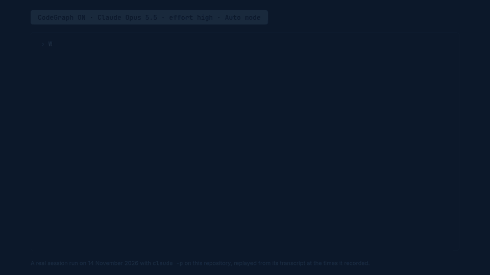
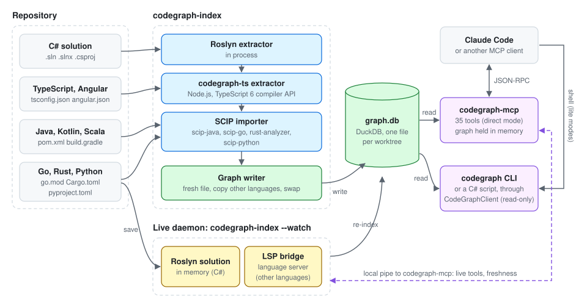

# CodeGraph

**Overview** · [CodeGraph](codegraph/README.md) · [Docs](codegraph/docs/README.md) · [MCP server](codegraph/MCP-SERVER.md) · [Extractors](codegraph/EXTRACTORS.md) · [Benchmarks](codegraph/BENCHMARKS.md) · [Prompts](codegraph/PROMPTS.md) · [Changelog](codegraph/CHANGELOG.md) · [Claude Code plugin](codegraph/plugin/README.md) · [VS Code extension](codegraph/vscode-extension/README.md)

*Idea: [nerdcules](https://github.com/nerdcules) · Written by: Claude, in [Claude Code](https://claude.com/claude-code) · [How it was built](codegraph/docs/story.md)*

**CodeGraph gives your AI coding assistant the compiler's answers: who calls this, what breaks if I
change it, which tests guard it.**

It works with any MCP client, and sets itself up for Claude Code, GitHub Copilot (CLI, VS Code, Visual
Studio, JetBrains), Codex, Cursor, the Gemini CLI, and the Roo Code, Kilo Code and Continue extensions.
[Tested with](codegraph/docs/installation.md#tested-with) Claude Code, the Copilot CLI, Copilot in VS Code, Codex and
Cursor.

[](https://github.com/nerdcules/CodeGraph/actions/workflows/ci.yml)
[](https://github.com/nerdcules/CodeGraph/releases/latest)

[](codegraph-promo.mp4)

*A real session, replayed from its transcript. Click for the video with sound: the same question with CodeGraph on (42 s, "37 tests guard it") and off (87 s, "about 40"). A later run-time check found 44 tests that execute the method ([why](codegraph/docs/why-it-saves-tokens.md#in-a-real-session)).*

It reads a codebase with its compiler (C#, TypeScript and Angular, Java, Go, Rust, Python), stores
what it finds as a graph, and serves that graph to your assistant as MCP tools. In the session above, the
assistant answered with four codegraph calls in 42 seconds; without CodeGraph it ran eight shell commands, took
87 seconds and estimated "about 40" tests.

Install, with the path of a repository to set up:

```bash
curl -fsSL https://raw.githubusercontent.com/nerdcules/CodeGraph/main/codegraph/install.sh | bash -s -- ~/dev/YourApp --add-to-path
```

```powershell
& ([scriptblock]::Create((irm https://raw.githubusercontent.com/nerdcules/CodeGraph/main/codegraph/install.ps1))) C:\dev\YourApp -AddToPath
```

Then start your assistant in that repository and ask what breaks if you change something. The script
sets the repository up for Claude Code and the Copilot CLI; add `--client copilot,cursor,codex` and so on (or
`all`) for the others.

In VS Code, the [CodeGraph extension](codegraph/vscode-extension/README.md) does the same from the editor: it
installs CodeGraph, sets repositories up and runs each graph's live daemon, and shows each graph's state. It came in
the [1.3.0-beta.1 pre-release](https://github.com/nerdcules/CodeGraph/releases/tag/v1.3.0-beta.1) (17 November
2026). GitHub's latest release stays 1.2.0, so the commands above install 1.2.0 unless given
`--version v1.3.0-beta.1` (`-Version` on Windows).

The project lives in [codegraph/](codegraph/). Its [README](codegraph/README.md) shows the first five
minutes, the questions you can ask, and where to go next depending on who you are; the
[docs](codegraph/docs/README.md) have the rest, including [the story](codegraph/docs/story.md) of
how a developer and an AI assistant built this.



---

**Overview** · [CodeGraph](codegraph/README.md) · [Docs](codegraph/docs/README.md) · [MCP server](codegraph/MCP-SERVER.md) · [Extractors](codegraph/EXTRACTORS.md) · [Benchmarks](codegraph/BENCHMARKS.md) · [Prompts](codegraph/PROMPTS.md) · [Changelog](codegraph/CHANGELOG.md) · [Claude Code plugin](codegraph/plugin/README.md) · [VS Code extension](codegraph/vscode-extension/README.md)
