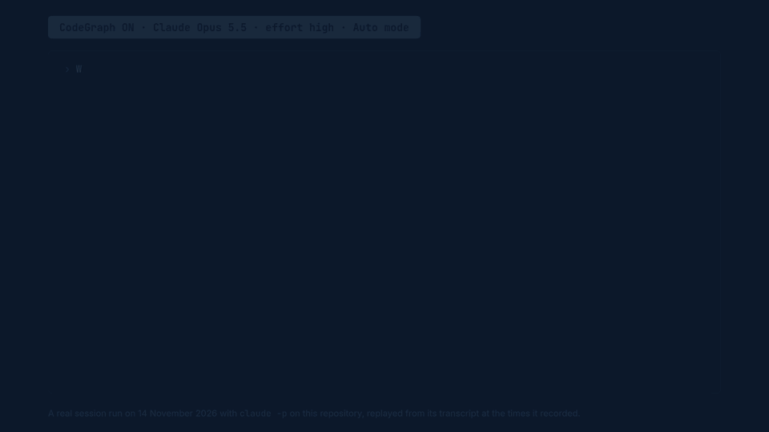
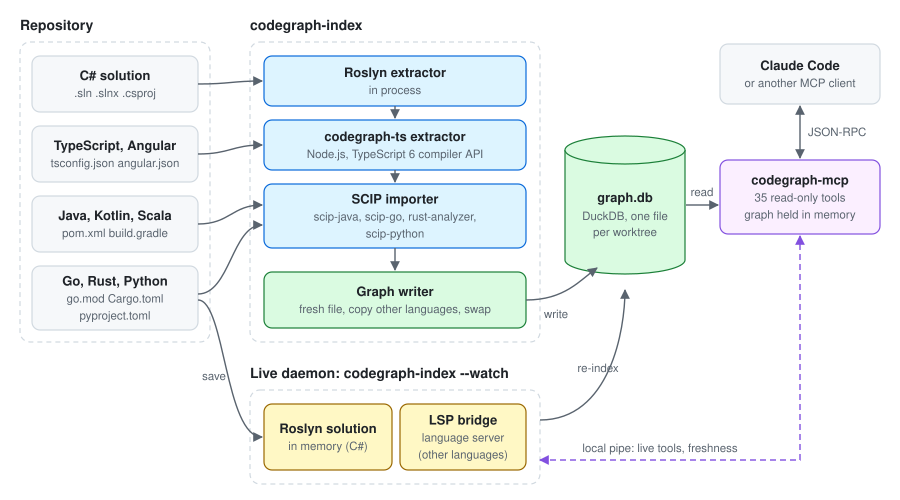

# CodeGraph

**CodeGraph gives Claude Code the compiler's answers: who calls this, what breaks if I change it,
which tests guard it.**

[](https://github.com/nerdcules/CodeGraph/actions/workflows/ci.yml)
[](https://github.com/nerdcules/CodeGraph/releases/latest)

[](codegraph-promo.mp4)

*A real session, replayed from its transcript. Click for the video with sound: the same question with CodeGraph on (42 s, exactly 37 tests) and off (87 s, "about 40").*

It reads a codebase with its compiler (C#, TypeScript and Angular, Java, Go, Rust, Python), stores
what it finds as a graph, and serves that graph to Claude Code as MCP tools. One question costs one
tool call instead of twenty file reads. An optional Obsidian plugin shows the same graph to people as
linked notes.

Install, with the path of a repository to set up:

```bash
curl -fsSL https://raw.githubusercontent.com/nerdcules/CodeGraph/main/codegraph/install.sh | bash -s -- ~/dev/YourApp --add-to-path
```

```powershell
& ([scriptblock]::Create((irm https://raw.githubusercontent.com/nerdcules/CodeGraph/main/codegraph/install.ps1))) C:\dev\YourApp -AddToPath
```

Then start Claude Code in that repository and ask what breaks if you change something.

The project lives in [codegraph/](codegraph/). Its [README](codegraph/README.md) shows the first five
minutes, the questions you can ask, and where to go next depending on who you are; the
[docs](codegraph/docs/README.md) have the rest, including [the story](codegraph/docs/story.md) of
how a developer and an AI assistant built this.


