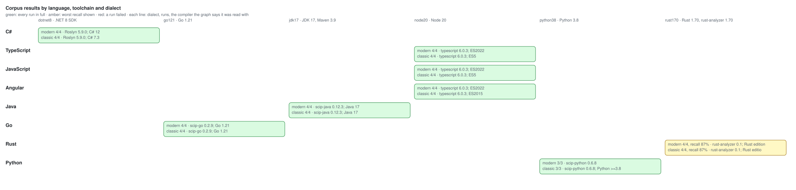
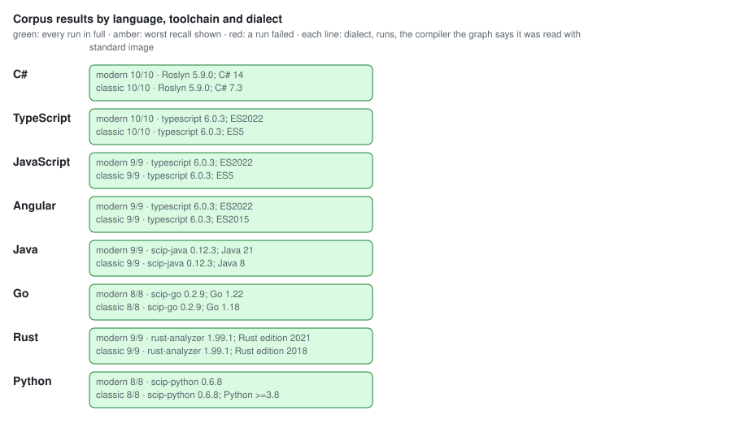
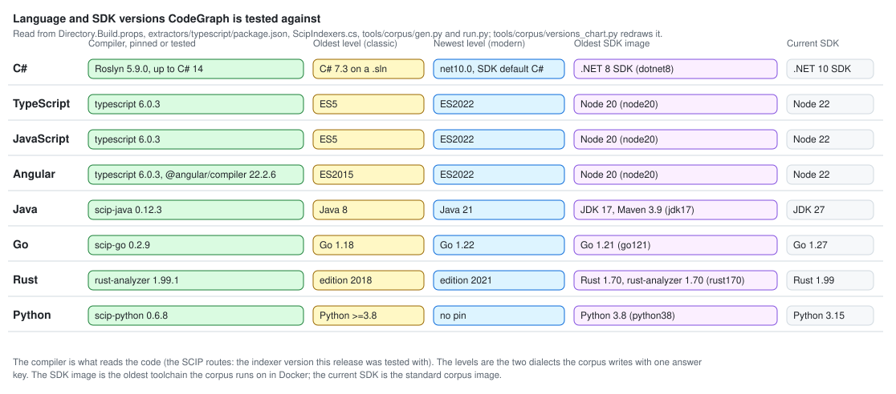

# Benchmarks

Numbers from `codegraph-bench` (tools/CodeGraph.Bench) against this repository's own graph, Release build,
Linux x64, .NET 10. Query figures are the median of 7 runs after a warm-up. Index figures are one run of the
published `codegraph-index`, so they include the MSBuild solution load.

```bash
dotnet build -c Release
dotnet run -c Release --no-build --project tools/CodeGraph.Bench -- /tmp/bench.db \
    --index CodeGraph.slnx --indexer src/CodeGraph.Indexer/bin/Release/net10.0/codegraph-index [--live]
```

## Baseline (before the live daemon)

Commit: working tree after the code-review fixes, 2026-11-09.

| measurement | value |
|---|---|
| graph | 595 nodes, 3558 edges |
| full index | 11.5 s |
| graph file after full index | 7,692 KB |
| no-op incremental index | 3.5 s |
| graph file after 3 more full rebuilds | 15,884 KB |
| open read-only (per tool call) | 11 ms |
| get_node | 0.6 ms |
| callers_of depth 1 (most-called method) | 6.8 ms |
| impact_of depth 5 | 8.2 ms |
| impact_of depth 20 | 7.9 ms |
| covered_by depth 30 | 7.8 ms |
| explain_reachability | 1.3 ms |
| neighbors | 5.0 ms |
| subgraph depth 2 | 21 ms |
| path_between depth 10 (test → most-called) | 11 ms |
| find_symbol 'Dispose' | 3.5 ms |
| search_code 'open store read only' | 9.3 ms |
| most_called | 5.1 ms |
| coverage_stats | 9.9 ms |
| uncovered | 11 ms |
| dead_code_report | 12 ms |
| freshness check, cold | 4.5 ms |
| freshness check, warm | 1.2 ms |

What the baseline says: every graph query is single-digit to low double-digit milliseconds, so a tool call's
cost is the read-only open plus the query. The two things the architecture work targets are not in this table
at all, because the baseline cannot do them: answering from the live Roslyn solution (positions, metadata
symbols, diagnostics, what-if compiles), and the one-debounce freshness that makes `STALE` rare. The file
growth row (7.7 MB to 15.9 MB over four rebuilds of the same graph) is the storage leak to fix alongside.

## After the live daemon and the file-growth fix

Same machine, same method, 2026-11-09. The graph is larger because `tools/CodeGraph.Bench` joined the
solution (6 projects, 63 documents).

### Indexing and graph queries

| measurement | before | after |
|---|---|---|
| graph | 595 nodes, 3558 edges | 687 nodes, 3978 edges |
| full index | 11.5 s | 9.0 s |
| graph file after full index | 7,692 KB | 8,716 KB |
| no-op incremental index | 3.5 s | 2.5 s |
| graph file after 3 more full rebuilds | 15,884 KB | 8,716 KB |
| graph file after 9 incremental runs (watch-mode shape) | grows ~2.7 MB per run, unbounded | plateaus at 13–14 MB |
| open read-only (per tool call) | 11 ms | 10 ms |
| get_node | 0.6 ms | 0.7 ms |
| callers_of depth 1 (most-called method) | 6.8 ms | 6.8 ms |
| impact_of depth 5 | 8.2 ms | 7.9 ms |
| impact_of depth 20 | 7.9 ms | 7.7 ms |
| covered_by depth 30 | 7.8 ms | 7.7 ms |
| explain_reachability | 1.3 ms | 1.3 ms |
| neighbors | 5.0 ms | 4.9 ms |
| subgraph depth 2 | 21 ms | 21 ms |
| path_between depth 10 (test → most-called) | 11 ms | 12 ms |
| find_symbol 'Dispose' | 3.5 ms | 3.0 ms |
| search_code 'open store read only' | 9.3 ms | 8.3 ms |
| most_called | 5.1 ms | 5.1 ms |
| coverage_stats | 9.9 ms | 11 ms |
| uncovered | 11 ms | 12 ms |
| dead_code_report | 12 ms | 11 ms |
| freshness check, cold | 4.5 ms | 3.8 ms |
| freshness check, warm | 1.2 ms | 1.2 ms |

Graph queries are unchanged within noise, as intended: the daemon adds capability beside the graph rather than
changing how the graph is queried. The index-time differences are run-to-run variance of the MSBuild load.
The storage fix is the real change in this table: a full rebuild now writes a fresh file and swaps it in, so
repeated rebuilds no longer double the file, and `CHECKPOINT` after every incremental write lets DuckDB reuse
freed blocks, so a long `--watch` session plateaus instead of growing without bound.

### Live daemon (`codegraph-index --watch`, measured with `--live`)

These had no "before": the baseline could not answer them at all.

| measurement | value |
|---|---|
| live ping (pipe round trip) | 0.1–0.2 ms |
| live flush when idle | 0.1–0.2 ms |
| live symbol_at (declaration line) | 0.2–0.3 ms |
| live references, source symbol (most-called method) | 2–7 ms |
| live references, metadata symbol (System.IO.File) | 1.6–3.5 ms |
| live diagnostics, one file | 0.2–0.4 ms |
| live diagnostics, whole solution | 7–29 ms |
| live check_change, unchanged file | 96–305 ms |
| live check_change, edited file | 96–385 ms |
| check_change renaming a Core method used across the solution (6 projects) | 1.08 s, 6 new errors found |
| save → flush → fresh `find_symbol` answer, through the MCP server | 0.64 s (5 files re-walked in 0.3 s) |

Ranges are the spread across two runs minutes apart; the lower figures are with Roslyn's caches warm. The
what-if compile is the expensive one by design: it is an incremental build of the file's project and every
dependent, and it is still cheaper than finding out from `dotnet build` after the edit is on disk.

The staleness story changed shape. Before, a save made within the 3-second freshness cache was invisible until
the cache expired, and any save at all meant `⚠ STALE INDEX` until someone re-ran the indexer. Now the server
asks the daemon first (a 0.1 ms pipe call), and when a save is pending or being indexed it waits for that pass,
so the answer reflects the working tree. `STALE` remains only for the case where no daemon is running.

## Round 2: held reader, and a probe regression found and fixed

Measured 2026-11-09 on a 758-node, 4,397-edge graph of this repo. Tool-call latency is the median wall time of
a `tools/call` round trip over stdio against the published server, driven by a script, with no daemon running.
Three builds were measured on the same graph: the original server before any of this work (`1dfea57`), the
server after the live-daemon round (`c60a16b`), and this round.

| tool call, back-to-back | original `1dfea57` | after daemon round `c60a16b` | now |
|---|---|---|---|
| `graph_stats` | 12.1 ms | 513 ms | 1.3 ms |
| `find_symbol 'Dispose'` | 15.7 ms | 517 ms | 4.0 ms |
| `impact_of` depth 5 | 27.7 ms | 530 ms | 12.9 ms |

| tool call, 0.5 s apart (a model's pace) | original `1dfea57` | after daemon round `c60a16b` | now |
|---|---|---|---|
| `graph_stats` | 13.3 ms | 514 ms | 2.2 ms |
| `find_symbol 'Dispose'` | 17.9 ms | 519 ms | 5.6 ms |
| `impact_of` depth 5 | 31.4 ms | 532 ms | 17.2 ms |

| component | value |
|---|---|
| open read-only, nothing holding the database | 9.9 ms |
| open read-only with the anchor held | 0.025 ms |
| daemon probe when none runs | 0.012 ms |
| full index while the server answers a call every 0.2 s | completes, 9.4 s wall; the server sees the new graph on its next call |

**The regression.** The daemon round added a probe before every tool call. On Linux a named-pipe connect to
a socket that does not exist does not fail; .NET retries until the connect timeout, which was 500 ms. So
every tool call without a daemon cost half a second, and the round's own benchmark missed it because it timed
store queries, not tool calls through the server. The probe now checks that the endpoint exists before
connecting, uses a 150 ms timeout for a socket left by a killed daemon, and remembers a dead socket for 3 s.

**The anchor.** One read-only connection held between calls keeps DuckDB's instance loaded, so each call's
own open drops from about 10 ms to 25 µs. It is released after 1.5 s idle, after 10 s of continuous use, and
whenever the daemon reports pending saves, so the indexer's write lock waits at most a couple of seconds.
Net against the original server: a cheap call is about 10× faster and `impact_of` about 2× faster.

## Round 3: framework calls as External nodes

Measured 2026-11-09 on this repo, three builds back to back: before the change, a first attempt that used
ordinary `Calls` edges for framework targets, and the final design with a separate `CallsExternal` kind.

| measurement | before | first try (`Calls`) | final (`CallsExternal`) |
|---|---|---|---|
| graph | 833 nodes, 4892 edges | 1348 nodes, 7527 edges | 1352 nodes, 7564 edges |
| full index | 9.4 s | 9.7 s | 9.6 s |
| graph file after full index | 9,228 KB | 10,508 KB | 10,508 KB |
| no-op incremental index | 2.5 s | 2.5 s | 2.5 s |
| callers_of depth 1 | 6.8 ms | 7.4 ms | 6.6 ms |
| impact_of depth 5 | 8.5 ms | 9.3 ms | 8.6 ms |
| covered_by depth 30 | 8.2 ms | 8.8 ms | 7.8 ms |
| path_between depth 10 | 12 ms | 15 ms | 11 ms |
| coverage_stats | 13 ms | 13 ms | 11 ms |
| uncovered | 13 ms | 14 ms | 11 ms |
| dead_code_report | 12 ms | 12 ms | 11 ms |

The first attempt added 58% more `Calls` edges, and every recursive walk scans the edges of its kinds, so the
solution-only walks slowed by up to 50% in an earlier run. Giving framework calls their own edge kind leaves those
scans exactly as large as before; a walk that starts at an external member seeds its callers through the `to_id`
index instead. Indexing costs nothing measurable because the targets were already bound for the call edges.
The graph gains 516 framework members for this repo; `Path.Combine(string, string)` is the most called, with 37
callers.

## Round 4: multi-target projects compiled once

A scratch copy of `CodeGraph.Core` targeting `net10.0;net10.0-windows`, with one file compiled only for the
Windows target. Full index, three runs each, same machine.

| mode | graph | full index (3 runs) |
|---|---|---|
| `--all-targets` (the old behaviour) | 421 nodes, 1252 edges | 3.7 s, 3.7 s, 3.7 s |
| default: later targets walk only their own files | 421 nodes, 1252 edges | 3.3 s, 3.2 s, 3.2 s |

The graphs are identical: the Windows-only file and its call are indexed, and both project nodes contain their
files. About 2.5 s of each run is the MSBuild load, so the second compilation was most of the remaining time;
the saving grows with each extra target (an `net10.0;net10.0-android;net10.0-ios` app skips two of three).
The trade-off: code that differs between targets under `#if` is indexed as the first target sees it.
`--all-targets` restores the old behaviour.

## Round 5: data_flow

`data_flow` on the most-called method with parameters, through the daemon on this repo: **0.42 ms** median
(7 runs). The same daemon's other live calls in that run: ping 0.25 ms, symbol_at 0.31 ms, source references
7.1 ms, metadata references 4.3 ms, one-file diagnostics 0.39 ms, whole-solution diagnostics 37 ms,
check_change 0.4–0.5 s.

## Round 6: semantic search plumbing

No embedding model runs on this machine, so these numbers use a local stand-in endpoint (a Python HTTP server
that hashes words into 256 dimensions). They measure what CodeGraph adds: request batching, storage, cache
reuse and the vector query. A real model adds its own inference time on top, once per changed declaration at
index time and once per distinct query at search time. Ranking quality with a real model is not measured here.

| measurement | without embeddings | with embeddings |
|---|---|---|
| full index (2 runs) | 10.2 s, 10.1 s | 10.3 s, 10.4 s |
| embedding step inside it | | 0.2 s for 839 declarations |
| no-op incremental index | 2.5 s | 2.5 s (0 declarations sent) |

| `search_code` through the server, median of 20 queries | latency |
|---|---|
| `mode=lexical` | 11.1 ms |
| `mode=semantic` | 4.5 ms |
| `mode=hybrid` (the default when vectors exist) | 14.2 ms |

**Storage and scale.** A first version stored float lists in DuckDB and searched with `list_cosine_similarity`.
Measured at a larger scale it did not hold up, so vectors are now quantised to one signed byte per component
(scaled per vector so each uses the full range, with the scale stored beside it) and searched in memory with
SIMD dot products; the server loads them once per graph file. Synthetic random 768-dimension vectors, the
hardest case for ranking because their cosines bunch together:

| vectors × 768 | design | write | search | file | top-10 agreement with exact cosine |
|---|---|---|---|---|---|
| 839 | float list in DuckDB | 0.1 s | 7.7 ms | 3 MB | exact |
| 839 | 8-bit, in memory | 0.1 s | 2.9 ms (43 ms first, loading) | 2 MB | 100 / 100 |
| 40,000 | float list in DuckDB | 2.4 s | 197 ms | 195 MB | exact |
| 40,000 | fixed `FLOAT[768]` in DuckDB | 2.0 s | 123 ms | 189 MB | exact |
| 40,000 | 8-bit, in memory | 0.5 s | 8.0 ms (131 ms first, loading) | 37 MB | 100 / 100 |

A first quantiser scaled every unit vector by a fixed 127, which left 768-dimension components about a dozen
levels; a test comparing against exact cosine caught it at 179 / 200 agreement, and per-vector scaling fixed it.

## Round 7: large graphs (synthetic, up to 165,000 methods)

Synthetic call graphs shaped like layered application code: 12 layers, each method calling five in the next
layers, 10% of calls going to 20 hub methods per layer, and tests calling into random layers.

**Store queries before this round:**

| query | 11k nodes, 49k edges | 55k nodes, 244k edges | 165k nodes, 732k edges |
|---|---|---|---|
| callers depth 1 (hub) | 9 ms | 23 ms | 48 ms |
| impact depth 5 | 19 ms | 50 ms | 95 ms |
| impact depth 20 (hub) | 70 ms | 242 ms | 662 ms |
| covered_by depth 30 (hub) | 44 ms | 142 ms | 330 ms |
| callees depth 10 | 58 ms | 149 ms | 298 ms |
| coverage_stats | 21 ms | 68 ms | 164 ms |
| path_between depth 10 | 2,368 ms | 1,553 ms | 1,061 ms |

**DuckDB `USING KEY` recursion** (keeps one row per node instead of one per node and depth) was the planned
fix for the walks. On the 150k graph it was slower, 426 ms against 251 ms for the same walk, because the
duplicate rows it removes are only 3.3 per node; most of the walk's cost is the 105,000 nodes a hub genuinely
reaches. It is not adopted.

**What was slow instead** was `path_between`, which enumerated every simple path up to the depth limit before
keeping three. It is now a breadth-first search, one indexed query per level and each node visited once, then
a walk back over parents. It returns up to `maxPaths` paths of the shortest length only.

| path_between | 11k nodes | 55k nodes | 165k nodes |
|---|---|---|---|
| before | 2,368 ms | 1,553 ms | 1,061 ms |
| after | 38 ms | 105 ms | 60 ms |
| after, no path exists | 1.9 ms | 3.9 ms | 4.9 ms |

**And the answers were too big.** On a hub, `impact_of` and `callers_of` printed every reachable node. Traversal
tools now list the nearest 200 rows (50 for guarding tests) and summarise the rest as counts per depth.
Through the server on the 55k graph:

| tool call | before: latency, answer | after: latency, answer |
|---|---|---|
| `impact_of` hub, depth 20 | 452 ms, 2,473,442 chars (~618,000 tokens) | 334 ms, 16,231 chars (~4,100 tokens) |
| `callers_of` hub, depth 5 | 124 ms, 1,379,921 chars (~345,000 tokens) | 139 ms, 13,151 chars (~3,300 tokens) |
| `path_between` | 1,685 ms, 709 chars | 84 ms, 711 chars |

The old `impact_of` answer would not fit in any model's context window.

Two defects surfaced while measuring this round and are fixed: a flush arriving while the daemon's debounce was
already running waited out the debounce (up to 500 ms), and a test's fake embedder used .NET's per-process string
hash, which made one ranking test fail about one run in ten.

## Round 8: ReadyToRun publish

The install scripts now publish ReadyToRun for the machine's platform (`-r <rid> -p:PublishReadyToRun=true`)
instead of a plain framework-dependent build. Native AOT was measured first and rejected. The indexer cannot use
it: MSBuildLocator loads MSBuild from the SDK at runtime, and Roslyn's workspace services are composed by
reflection. The server failed to publish: the web routes return anonymous types, and there were 27 trim and AOT
warnings from reflection-based JSON and tool discovery. AOT would also only shorten start-up, since warm tool calls
are spent in DuckDB, which is native already.

Same machine, this repo's graph; index times are three runs each.

| measurement | plain publish | ReadyToRun |
|---|---|---|
| full index, wall time | 11.3–11.6 s | 8.7–8.8 s |
| index work inside that | 8.9–9.0 s | 6.5–6.6 s |
| server start to `initialize` answered | 327 ms | 257 ms |
| first `find_symbol` after start | 141 ms | 103 ms |
| first `impact_of` after start | 31 ms | 28 ms |
| warm `find_symbol` | 6.0 ms | 5.9 ms |
| server publish folder | 318 MB (DuckDB for every OS) | 75 MB (this platform only) |

Most of the index time is JIT compilation of Roslyn and MSBuild code paths, which ReadyToRun removes; every
one-shot index and every daemon start pays it. Warm calls are unchanged.

## Round 9: other languages

The same store and tools over TypeScript, Angular and SCIP-indexed code. Same machine; Node 26, TypeScript 6.0.3
inside the extractor, typescript-language-server 6.0.3.

Indexing, three runs each:

| workspace | files | nodes | edges | extractor | whole run | graph file |
|---|---|---|---|---|---|---|
| Angular fixture (`extractors/typescript/test/fixtures`) | 10 | 60 | 129 | 0.8 s | 1.2 s | |
| RealWorld Angular app (Angular 21, npm packages installed) | 47 | 670 | 2,503 | 1.9 s | 2.7 s | |
| NestJS monorepo (no npm install) | 1,165 | 10,754 | 28,276 | 4.9 s | 7.0 s | 43 MB, flat across re-imports |

A re-import first deleted the language's rows in place. On NestJS that took 15.8 s instead of 7.0 s, and the file
grew to 90 MB. It now writes a fresh file, copies the other languages across and swaps it in, as a full C#
rebuild does, so it costs the same as the first import.

Graph queries, median of 7:

| measurement | RealWorld (670 nodes) | NestJS (10,754 nodes) |
|---|---|---|
| callers_of depth 1 | 6.3 ms | 17 ms |
| impact_of depth 5 | 7.3 ms | 41 ms |
| impact_of depth 20 | 7.3 ms | 175 ms |
| covered_by depth 30 | 6.8 ms | 144 ms |
| find_symbol | 3.0 ms | 11 ms |
| search_code | 7.4 ms | 15 ms |
| dead_code_report | 8.9 ms | 24 ms |

Live tools on RealWorld through `--watch` (typescript-language-server ready 4.8 s after start):

| measurement | first version | after fixes |
|---|---|---|
| live ping | 14 ms | 0.41 ms |
| live references, most-called method | 129 ms | 109 ms |
| live symbol_at | 16 ms | 16 ms |
| live diagnostics, one file | 0.2 ms | 0.19 ms |
| live check_change, unchanged or comment-only edit | 20,033 ms | 2,096 ms |

`ping` had opened the graph to count files on every call; it now counts once per index. `check_change` had
waited out per-file timeouts, because typescript-language-server sends no report for a file that stays clean. It
now waits for the files to settle. An edit that adds errors returns as soon as they are reported, about a
second on the fixture. A clean edit waits three times the server's measured report latency, about two seconds
here.

Native extractor against scip-typescript on RealWorld:

| | codegraph-ts | scip-typescript + import |
|---|---|---|
| time | 2.7 s | 2.3 s + 0.4 s |
| nodes / edges | 670 / 2,503 | 733 / 1,608 |
| signatures, modifiers | yes | no (modifiers read from source) |
| Angular templates, DI, routes | yes | no |
| test nodes | 224 (describe and it blocks) | none |

Java, on `tests/CodeGraph.Tests/Fixtures/java-shop` (a Maven project with an interface, two levels of
inheritance and a JUnit 5 test), Temurin JDK 27, Maven 3.10, scip-java 0.12.3:

| step | time |
|---|---|
| `codegraph-index init` (scip-java runs `mvn clean verify`, then the import) | 5.6 s |
| import of the index alone | 0.3 s |
| `--watch` re-index after a save | 5.6 s |

The real index showed two things a synthetic one had not. scip-java records a method's relationship in both
directions, so every base method looked like it overrode its own override, and `impact_of` listed a method
among its own dependents. It also lists a type's supertypes transitively. The importer now keeps the
subtype-to-supertype direction and direct supertypes only, as the C# extractor does. Ids also dropped the
version field, because `1.0` in every id would have changed with each release, and JDK calls with each JDK.
Java names now read `org.acme.shop.Cart.total`.

## Round 10: language versions and older toolchains

The question was how to tell when a repo is on a language version the indexer does not know, and how to keep
older repos indexing when the compilers move on. The answer has three parts, each measured here.

**What the graph says it was read with.** Every route now records its compiler, the language versions the
projects asked for, compile errors with the first one named, the "feature X needs C# N" subset, declaration
shapes it has no mapping for, and notes (`lang.<language>.*` meta rows, EXTRACTORS.md). `index_status` prints
a line per language. The cost on this repo's own solution: none measurable (12.9 s full index before and
after; the parse already happened, and the walk already binds every declaration).

**A version axis in the tests.** `CSharpVersionMatrixTests` indexes one fixture per C# 10 to C# 14 feature at
every version Roslyn knows; a declaration-level feature used one version too early is reported, not hidden;
the same code gives the same graph on every version that accepts it. The matrix found its first gap at once: a
C# 14 extension block was a nameless type of kind None. The TypeScript legacy fixture (ES5, CommonJS,
namespaces, `import = require`) found that `import X = require()` produced no `Imports` edge.

**The same answer key on old syntax and old SDKs.** The corpus writes each codebase in two dialects (`classic`:
C# 7.3 on a `.sln`, ES5 CommonJS, Java 8, Go 1.18, Rust 2018, Python 3.8) and runs them on six Docker images
with an older SDK and the .NET 10 runtime beside it. Four profiles, both dialects, seed 1:

| toolchain | language | dialect | runs | methods found | Calls P/R (worst run) | read with |
|---|---|---|---|---|---|---|
| dotnet8 (.NET 8 SDK) | csharp | classic | 4/4 | 551/551 | 100/100 | Roslyn 5.9.0; C# 7.3 |
| dotnet8 | csharp | modern | 4/4 | 551/551 | 100/100 | Roslyn 5.9.0; C# 12 |
| node20 (Node 20) | typescript | classic | 4/4 | 441/441 | 100/100 | typescript 6.0.3; ES5; note: target=ES5 deprecated |
| node20 | typescript | modern | 4/4 | 441/441 | 100/100 | typescript 6.0.3; ES2022 |
| node20 | javascript | classic, modern | 8/8 | 640/640 | 100/100 | typescript 6.0.3; ES5, ES2022 |
| node20 | angular | classic, modern | 8/8 | 1,240/1,240 | 100/100 | typescript 6.0.3, @angular/compiler 22.2.6; ES2015, ES2022 |
| jdk17 (Temurin 17, Maven 3.9) | java | classic, modern | 8/8 | 1,020/1,020 | 100/100 | scip-java 0.12.3; Java 17 |
| go121 (Go 1.21) | go | classic, modern | 8/8 | 784/784 | 100/100 | scip-go 0.2.9; Go 1.21 |
| python38 (Python 3.8) | python | classic, modern | 6/6 | 528/528 | 100/100 | scip-python 0.6.8; Python >=3.8 |
| rust170 (Rust 1.70, rust-analyzer 1.70) | rust | classic, modern | 8/8 | 738/738 | 100/87.1 | rust-analyzer 0.1; note: older than the 1.99.1 tested |



What the matrix found, in the order it found it:

- On the .NET 8 image MSBuildLocator finds only SDK 8, so Roslyn 5.9's build host loads MSBuild 17.8 into a
  .NET 10 process. It works: `net8.0` projects index at 100 percent whether their LangVersion is the SDK's
  default (C# 12) or pinned to 7.3, and the graph says which.
- A `net8.0` repo on a machine without that reference pack, never restored, gave 588 declaration errors and lost
  every cross-project heritage edge, with nothing saying why. The indexer now names such a project as
  unrestored (System.Object did not resolve), and the corpus restores C# codebases first, as a checkout is.
- TypeScript 6 reports `target: ES5` and `moduleResolution: node` as errors but still builds the program; an
  ES5 workspace indexes in full and the deprecations are notes.
- The JDK 17 image's Maven 3.9 defaults to plugin versions the host's `~/.m2` did not hold, so offline runs
  failed before javac ran. The image now warms its own repository at build time.
- rust-analyzer 1.70 has no `--output` on `scip`, writes a file module's path reversed (`invoice0/m0/` for
  `src/m0/invoice0.rs`), names trait impl members `Type#Trait#member()`, records no symbol kinds and no
  enclosing ranges. The importer reads all of that now (ids come out the same as from a current
  rust-analyzer), and method recall went from 1 of 14 to 14 of 14. What stays missing is calls through
  `dyn Trait`, which that version did not resolve: 87 to 90 percent call recall, and trait methods reported
  dead. The graph's note says the indexer is older than the tested one.
- Brace matching for indexes without enclosing ranges helps any older indexer, not only rust-analyzer: a
  reference lands in the member that holds it instead of being dropped.

The standard corpus then ran in both dialects on the usual image (.NET 10 SDK, Node 22, JDK 27, Go 1.27, Rust
1.99, Python 3.15): 144 runs, 383,212 expected edges, 906 s with 3 containers at a time. One difference: the
classic C# dialect pinned `net8.0`, whose reference pack the offline image does not have, and the graph said so
(588 errors, `System.Object did not resolve`, "run dotnet restore"). The dialect now keeps the SDK's framework
(the language level is LangVersion; `--level net8.0` is for the .NET 8 image), and the classic C# runs are 100
percent like the rest: the same answer key holds on old syntax and on new, on old SDKs and on new.



The versions all of this tests against, drawn from the code (`tools/corpus/versions_chart.py`; a test fails when
a pinned version changes without a redraw):



## Where it ended up

This repo's own graph, first baseline against the final build of this work, same machine and method. The graph
is 2.5 times larger now: the repo grew, and framework calls are External nodes.

| measurement | first baseline | final |
|---|---|---|
| graph | 595 nodes, 3,558 edges | 1,583 nodes, 8,784 edges |
| full index | 11.5 s | 10.5 s |
| no-op incremental index | 3.5 s | 2.5 s |
| graph file after 3 more full rebuilds | 15,884 KB (and growing) | 12,556 KB (flat) |
| open per tool call | 11 ms | 0.024 ms while the anchor holds the graph |
| impact_of depth 20 | 7.9 ms | 8.6 ms |
| path_between depth 10 | 11 ms | 3.9 ms |
| coverage_stats | 9.9 ms | 11 ms |
| dead_code_report | 12 ms | 11 ms |
| `find_symbol` through the server | 15.7 ms | 4.7 ms |
| `impact_of` through the server | 27.7 ms | 15.1 ms |
| `graph_stats` through the server | 12.1 ms | 1.3 ms |

Store queries held steady while the graph grew 2.5 times; tool calls through the server got 2 to 9 times faster;
and on large solutions `path_between` is 15 to 60 times faster and traversal answers are about 150 times smaller.
