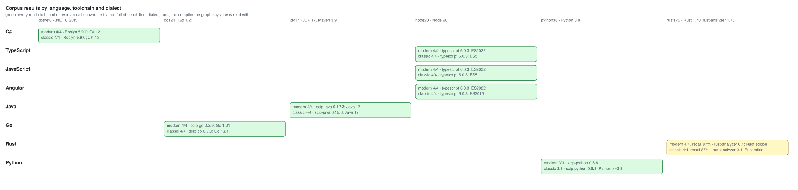
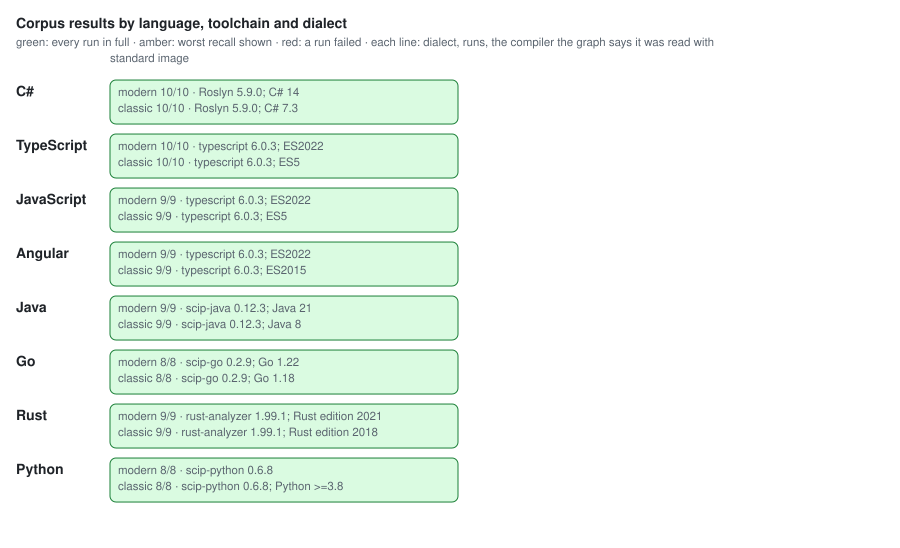
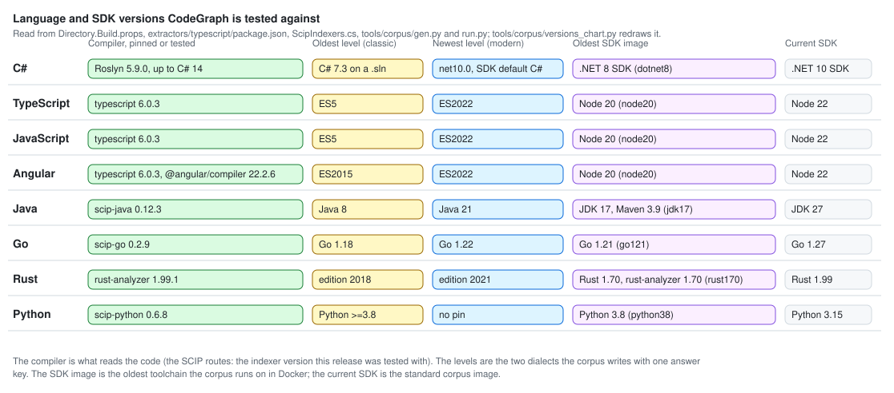
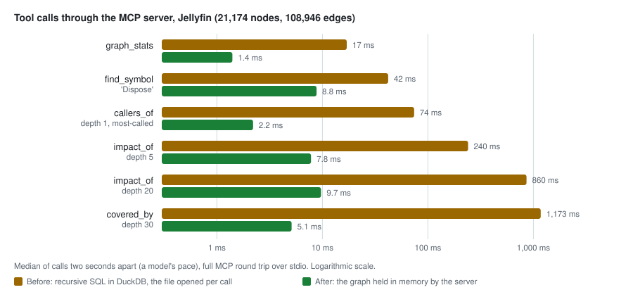

# Benchmarks

[CodeGraph](README.md) · [Docs](docs/README.md) · [MCP server](MCP-SERVER.md) · [Extractors](EXTRACTORS.md) · **Benchmarks** · [Prompts](PROMPTS.md) · [Changelog](CHANGELOG.md) · [Claude Code plugin](plugin/README.md) · [VS Code extension](vscode-extension/README.md)

The token benchmark of the three ways to ask (the MCP tools, the `codegraph` CLI and C# scripts) has its own page:
[bench/README.md](bench/README.md).

Numbers from `codegraph-bench` (tools/CodeGraph.Bench) against this repository's own graph, Release build,
Linux x64, .NET 10. Query figures are the median of 7 runs after a warm-up. The bench takes 3 for the snapshot
load, the cold freshness check (no warm-up), the live `check_change` and whole-solution diagnostics, and, with
`--server`, 5 for calls 2 s apart. Index figures are one run of the `codegraph-index` given to `--indexer` (in the
command below, the Release build output), so they include the MSBuild solution load. File sizes are in KB of 1,024
bytes (`codegraph-bench`) and MB of 1,048,576 bytes (`file-growth.sh`).

```bash
dotnet build -c Release
dotnet run -c Release --no-build --project tools/CodeGraph.Bench -- /tmp/bench.db \
    --index CodeGraph.slnx --indexer src/CodeGraph.Indexer/bin/Release/net10.0/codegraph-index [--live]
```

## Baseline (before the live daemon)

Commit: working tree after the code-review fixes, 2026-11-09.

| measurement | value |
|---|---|
| graph | 595 nodes, 3558 edges |
| full index | 11.5 s |
| graph file after full index | 7,692 KB |
| no-op incremental index | 3.5 s |
| graph file after 3 more full rebuilds | 15,884 KB |
| open read-only (per tool call) | 11 ms |
| get_node | 0.6 ms |
| callers_of depth 1 (most-called method) | 6.8 ms |
| impact_of depth 5 | 8.2 ms |
| impact_of depth 20 | 7.9 ms |
| covered_by depth 30 | 7.8 ms |
| explain_reachability | 1.3 ms |
| neighbors | 5.0 ms |
| subgraph depth 2 | 21 ms |
| path_between depth 10 (test → most-called) | 11 ms |
| find_symbol 'Dispose' | 3.5 ms |
| search_code 'open store read only' | 9.3 ms |
| most_called | 5.1 ms |
| coverage_stats | 9.9 ms |
| uncovered | 11 ms |
| dead_code_report | 12 ms |
| freshness check, cold | 4.5 ms |
| freshness check, warm | 1.2 ms |

What the baseline says: every graph query is single-digit to low double-digit milliseconds, so a tool call's
cost is the read-only open plus the query. The two things the architecture work targets are not in this table
at all, because the baseline cannot do them: answering from the live Roslyn solution (positions, metadata
symbols, diagnostics, what-if compiles), and the one-debounce freshness that makes `STALE` rare. The file
growth row (7.7 MB to 15.9 MB over four rebuilds of the same graph) is the storage leak to fix alongside.

## After the live daemon and the file-growth fix

Same machine, same method, 2026-11-09. The graph is larger because `tools/CodeGraph.Bench` joined the
solution (6 projects, 63 documents).

### Indexing and graph queries

| measurement | before | after |
|---|---|---|
| graph | 595 nodes, 3558 edges | 687 nodes, 3978 edges |
| full index | 11.5 s | 9.0 s |
| graph file after full index | 7,692 KB | 8,716 KB |
| no-op incremental index | 3.5 s | 2.5 s |
| graph file after 3 more full rebuilds | 15,884 KB | 8,716 KB |
| graph file after 9 incremental runs (watch-mode shape) | grows ~2.7 MB per run, unbounded | plateaus at 13–14 MB |
| open read-only (per tool call) | 11 ms | 10 ms |
| get_node | 0.6 ms | 0.7 ms |
| callers_of depth 1 (most-called method) | 6.8 ms | 6.8 ms |
| impact_of depth 5 | 8.2 ms | 7.9 ms |
| impact_of depth 20 | 7.9 ms | 7.7 ms |
| covered_by depth 30 | 7.8 ms | 7.7 ms |
| explain_reachability | 1.3 ms | 1.3 ms |
| neighbors | 5.0 ms | 4.9 ms |
| subgraph depth 2 | 21 ms | 21 ms |
| path_between depth 10 (test → most-called) | 11 ms | 12 ms |
| find_symbol 'Dispose' | 3.5 ms | 3.0 ms |
| search_code 'open store read only' | 9.3 ms | 8.3 ms |
| most_called | 5.1 ms | 5.1 ms |
| coverage_stats | 9.9 ms | 11 ms |
| uncovered | 11 ms | 12 ms |
| dead_code_report | 12 ms | 11 ms |
| freshness check, cold | 4.5 ms | 3.8 ms |
| freshness check, warm | 1.2 ms | 1.2 ms |

Graph queries are unchanged within noise, as intended: the daemon adds capability beside the graph rather than
changing how the graph is queried. The index-time differences are run-to-run variance of the MSBuild load.
The storage fix is the real change in this table: a full rebuild now writes a fresh file and swaps it in, so
repeated rebuilds no longer double the file, and `CHECKPOINT` after every incremental write lets DuckDB reuse
freed blocks, so a long `--watch` session plateaus instead of growing without bound. (Round 13 found it still
crept under the live daemon; fixed in round 14.)

### Live daemon (`codegraph-index --watch`, measured with `--live`)

These had no "before": the baseline could not answer them at all.

| measurement | value |
|---|---|
| live ping (pipe round trip) | 0.1–0.2 ms |
| live flush when idle | 0.1–0.2 ms |
| live symbol_at (declaration line) | 0.2–0.3 ms |
| live references, source symbol (most-called method) | 2–7 ms |
| live references, metadata symbol (System.IO.File) | 1.6–3.5 ms |
| live diagnostics, one file | 0.2–0.4 ms |
| live diagnostics, whole solution | 7–29 ms |
| live check_change, unchanged file | 96–305 ms |
| live check_change, edited file | 96–385 ms |
| check_change renaming a Core method used across the solution (6 projects) | 1.08 s, 6 new errors found |
| save → flush → fresh `find_symbol` answer, through the MCP server | 0.64 s (5 files re-walked in 0.3 s) |

Ranges are the spread across two runs minutes apart; the lower figures are with Roslyn's caches warm. The
what-if compile is the expensive one by design: it is an incremental build of the file's project and every
dependent, and it is still cheaper than finding out from `dotnet build` after the edit is on disk.

The staleness story changed shape. Before, a save made within the 3-second freshness cache was invisible until
the cache expired, and any save at all meant `⚠ STALE INDEX` until someone re-ran the indexer. Now the server
asks the daemon first (a 0.1 ms pipe call), and when a save is pending or being indexed it waits for that pass,
so the answer reflects the working tree. `STALE` remains only for the case where no daemon is running.

## Round 2: held reader, and a probe regression found and fixed

Measured 2026-11-09 on a 758-node, 4,397-edge graph of this repo. Tool-call latency is the median wall time of
a `tools/call` round trip over stdio against the published server, driven by a script, with no daemon running.
Three builds were measured on the same graph: the original server before any of this work (`1dfea57`), the
server after the live-daemon round (`c60a16b`), and this round.

| tool call, back-to-back | original `1dfea57` | after daemon round `c60a16b` | now |
|---|---|---|---|
| `graph_stats` | 12.1 ms | 513 ms | 1.3 ms |
| `find_symbol 'Dispose'` | 15.7 ms | 517 ms | 4.0 ms |
| `impact_of` depth 5 | 27.7 ms | 530 ms | 12.9 ms |

| tool call, 0.5 s apart (a model's pace) | original `1dfea57` | after daemon round `c60a16b` | now |
|---|---|---|---|
| `graph_stats` | 13.3 ms | 514 ms | 2.2 ms |
| `find_symbol 'Dispose'` | 17.9 ms | 519 ms | 5.6 ms |
| `impact_of` depth 5 | 31.4 ms | 532 ms | 17.2 ms |

| component | value |
|---|---|
| open read-only, nothing holding the database | 9.9 ms |
| open read-only with the anchor held | 0.025 ms |
| daemon probe when none runs | 0.012 ms |
| full index while the server answers a call every 0.2 s | completes, 9.4 s wall; the server sees the new graph on its next call |

**The regression.** The daemon round added a probe before every tool call. On Linux a named-pipe connect to
a socket that does not exist does not fail; .NET retries until the connect timeout, which was 500 ms. So
every tool call without a daemon cost half a second, and the round's own benchmark missed it because it timed
store queries, not tool calls through the server. The probe now checks that the endpoint exists before
connecting, uses a 150 ms timeout for a socket left by a killed daemon, and remembers a dead socket for 3 s.

**The anchor.** One read-only connection held between calls keeps DuckDB's instance loaded, so each call's
own open drops from about 10 ms to 25 µs. It is released after 1.5 s idle, after 10 s of continuous use, and
whenever the daemon reports pending saves, so the indexer's write lock waits at most a couple of seconds.
Net against the original server: `graph_stats` is 6 to 9× faster, `find_symbol` 3 to 4× and `impact_of` about 2×.

## Round 3: framework calls as External nodes

Measured 2026-11-09 on this repo, three builds back to back: before the change, a first attempt that used
ordinary `Calls` edges for framework targets, and the final design with a separate `CallsExternal` kind.

| measurement | before | first try (`Calls`) | final (`CallsExternal`) |
|---|---|---|---|
| graph | 833 nodes, 4892 edges | 1348 nodes, 7527 edges | 1352 nodes, 7564 edges |
| full index | 9.4 s | 9.7 s | 9.6 s |
| graph file after full index | 9,228 KB | 10,508 KB | 10,508 KB |
| no-op incremental index | 2.5 s | 2.5 s | 2.5 s |
| callers_of depth 1 | 6.8 ms | 7.4 ms | 6.6 ms |
| impact_of depth 5 | 8.5 ms | 9.3 ms | 8.6 ms |
| covered_by depth 30 | 8.2 ms | 8.8 ms | 7.8 ms |
| path_between depth 10 | 12 ms | 15 ms | 11 ms |
| coverage_stats | 13 ms | 13 ms | 11 ms |
| uncovered | 13 ms | 14 ms | 11 ms |
| dead_code_report | 12 ms | 12 ms | 11 ms |

The first attempt added 58% more `Calls` edges (commit `eadb3e7`; the table does not count them), and every recursive walk scans the edges of its kinds, so the
solution-only walks slowed by up to 25% in this table (`path_between`, 12 to 15 ms). The commit message
(`eadb3e7`) says up to 50% in an earlier run, whose figures were not kept. Giving framework calls their own edge
kind leaves those scans exactly as large as before; a walk that starts at an external member seeds its callers
through the `to_id` index instead. Indexing costs nothing measurable because the targets were already bound for
the call edges. The graph gains 516 framework members for this repo; `Path.Combine(string, string)` is the most called, with 37
callers.

## Round 4: multi-target projects compiled once

A scratch copy of `CodeGraph.Core` targeting `net10.0;net10.0-windows`, with one file compiled only for the
Windows target. Full index, three runs each, same machine.

| mode | graph | full index (3 runs) |
|---|---|---|
| `--all-targets` (the old behaviour) | 421 nodes, 1252 edges | 3.7 s, 3.7 s, 3.7 s |
| default: later targets walk only their own files | 421 nodes, 1252 edges | 3.3 s, 3.2 s, 3.2 s |

The graphs are identical: the Windows-only file and its call are indexed, and both project nodes contain their
files. About 2.5 s of each run is the MSBuild load, so the second compilation was most of the remaining time;
the saving grows with each extra target (an `net10.0;net10.0-android;net10.0-ios` app skips two of three).
The trade-off: code that differs between targets under `#if` is indexed as the first target sees it.
`--all-targets` restores the old behaviour.

## Round 5: data_flow

`data_flow` on the most-called method with parameters, through the daemon on this repo: **0.42 ms** median
(7 runs). The same daemon's other live calls in that run: ping 0.25 ms, symbol_at 0.31 ms, source references
7.1 ms, metadata references 4.3 ms, one-file diagnostics 0.39 ms, whole-solution diagnostics 37 ms,
check_change 0.4–0.5 s.

## Round 6: semantic search plumbing

No embedding model runs on this machine, so these numbers use a local stand-in endpoint (a Python HTTP server
that hashes words into 256 dimensions). They measure what CodeGraph adds: request batching, storage, cache
reuse and the vector query. A real model adds its own inference time on top, once per changed declaration at
index time and once per distinct query at search time. Ranking quality with a real model is not measured here.

| measurement | without embeddings | with embeddings |
|---|---|---|
| full index (2 runs) | 10.2 s, 10.1 s | 10.3 s, 10.4 s |
| embedding step inside it | | 0.2 s for 839 declarations |
| no-op incremental index | 2.5 s | 2.5 s (0 declarations sent) |

| `search_code` through the server, median of 20 queries | latency |
|---|---|
| `mode=lexical` | 11.1 ms |
| `mode=semantic` | 4.5 ms |
| `mode=hybrid` (the default when vectors exist) | 14.2 ms |

**Storage and scale.** A first version stored float lists in DuckDB and searched with `list_cosine_similarity`.
Measured at a larger scale it did not hold up, so vectors are now quantised to one signed byte per component
(scaled per vector so each uses the full range, with the scale stored beside it) and searched in memory with
SIMD dot products; the server loads them once per graph file. Synthetic random 768-dimension vectors, the
hardest case for ranking because their cosines bunch together:

| vectors × 768 | design | write | search | file | top-10 agreement with exact cosine |
|---|---|---|---|---|---|
| 839 | float list in DuckDB | 0.1 s | 7.7 ms | 3 MB | exact |
| 839 | 8-bit, in memory | 0.1 s | 2.9 ms (43 ms first, loading) | 2 MB | 100 / 100 |
| 40,000 | float list in DuckDB | 2.4 s | 197 ms | 195 MB | exact |
| 40,000 | fixed `FLOAT[768]` in DuckDB | 2.0 s | 123 ms | 189 MB | exact |
| 40,000 | 8-bit, in memory | 0.5 s | 8.0 ms (131 ms first, loading) | 37 MB | 100 / 100 |

A first quantiser scaled every unit vector by a fixed 127, which left 768-dimension components about a dozen
levels; a test comparing against exact cosine caught it at 179 / 200 agreement, and per-vector scaling fixed it.

## Round 7: large graphs (synthetic, up to 165,000 methods)

Synthetic call graphs shaped like layered application code: 12 layers, each method calling five in the next
layers, 10% of calls going to 20 hub methods per layer, and tests calling into random layers.

**Store queries before this round:**

| query | 11k nodes, 49k edges | 55k nodes, 244k edges | 165k nodes, 732k edges |
|---|---|---|---|
| callers depth 1 (hub) | 9 ms | 23 ms | 48 ms |
| impact depth 5 | 19 ms | 50 ms | 95 ms |
| impact depth 20 (hub) | 70 ms | 242 ms | 662 ms |
| covered_by depth 30 (hub) | 44 ms | 142 ms | 330 ms |
| callees depth 10 | 58 ms | 149 ms | 298 ms |
| coverage_stats | 21 ms | 68 ms | 164 ms |
| path_between depth 10 | 2,368 ms | 1,553 ms | 1,061 ms |

**DuckDB `USING KEY` recursion** (keeps one row per node instead of one per node and depth) was the planned
fix for the walks. On the largest graph (165k nodes) it was slower, 426 ms against 251 ms for the same walk (figures from commit
`63fc7f0`, which does not name the walk),
because the duplicate rows it removes are only 3.3 per node; most of the walk's cost is the 105,000 nodes a hub
genuinely reaches. It is not adopted.

**What was slow instead** was `path_between`, which enumerated every simple path up to the depth limit before
keeping three. It is now a breadth-first search, one indexed query per level and each node visited once, then
a walk back over parents. It returns up to `maxPaths` paths of the shortest length only.

| path_between | 11k nodes | 55k nodes | 165k nodes |
|---|---|---|---|
| before | 2,368 ms | 1,553 ms | 1,061 ms |
| after | 38 ms | 105 ms | 60 ms |
| after, no path exists | 1.9 ms | 3.9 ms | 4.9 ms |

**And the answers were too big.** On a hub, `impact_of` and `callers_of` printed every reachable node. Traversal
tools now list the nearest 200 rows (50 for guarding tests) and summarise the rest as counts per depth.
Through the server on the 55k graph:

| tool call | before: latency, answer | after: latency, answer |
|---|---|---|
| `impact_of` hub, depth 20 | 452 ms, 2,473,442 chars (~618,000 tokens) | 334 ms, 16,231 chars (~4,100 tokens) |
| `callers_of` hub, depth 5 | 124 ms, 1,379,921 chars (~345,000 tokens) | 139 ms, 13,151 chars (~3,300 tokens) |
| `path_between` | 1,685 ms, 709 chars | 84 ms, 711 chars |

The old `impact_of` answer would not fit in any model's context window.

Two defects surfaced while measuring this round and are fixed: a flush arriving while the daemon's debounce was
already running waited out the debounce (up to 500 ms), and a test's fake embedder used .NET's per-process string
hash, which made one ranking test fail about one run in ten.

## Round 8: ReadyToRun publish

The install scripts now publish ReadyToRun for the machine's platform (`-r <rid> -p:PublishReadyToRun=true`)
instead of a plain framework-dependent build. Native AOT was measured first and rejected. The indexer cannot use
it: MSBuildLocator loads MSBuild from the SDK at runtime, and Roslyn's workspace services are composed by
reflection. The server failed to publish: the web routes return anonymous types, and there were 27 trim and AOT
warnings from reflection-based JSON and tool discovery. AOT would also only shorten start-up, since warm tool calls
are spent in DuckDB, which is native already.

Same machine, this repo's graph; index times are three runs each.

| measurement | plain publish | ReadyToRun |
|---|---|---|
| full index, wall time | 11.3–11.6 s | 8.7–8.8 s |
| index work inside that | 8.9–9.0 s | 6.5–6.6 s |
| server start to `initialize` answered | 327 ms | 257 ms |
| first `find_symbol` after start | 141 ms | 103 ms |
| first `impact_of` after start | 31 ms | 28 ms |
| warm `find_symbol` | 6.0 ms | 5.9 ms |
| server publish folder | 318 MB (DuckDB for every OS) | 75 MB (this platform only) |

About a quarter of the index time (27% of the index work, 24% of the wall time) was JIT compilation of Roslyn and
MSBuild code paths, which ReadyToRun removes; every one-shot index and every daemon start paid it. Warm calls are
unchanged.

## Round 9: other languages

The same store and tools over TypeScript, Angular and SCIP-indexed code. Same machine; Node 26, TypeScript 6.0.3
inside the extractor, typescript-language-server 6.0.3.

Indexing, three runs each:

| workspace | files | nodes | edges | extractor | whole run | graph file |
|---|---|---|---|---|---|---|
| Angular fixture (`extractors/typescript/test/fixtures`) | 10 | 60 | 129 | 0.8 s | 1.2 s | |
| RealWorld Angular app (Angular 21, npm packages installed) | 47 | 670 | 2,503 | 1.9 s | 2.7 s | |
| NestJS monorepo (no npm install) | 1,165 | 10,754 | 28,276 | 4.9 s | 7.0 s | 43 MB, flat across re-imports |

A re-import first deleted the language's rows in place. On NestJS that took 15.8 s instead of 7.0 s, and the file
grew to 90 MB. It now writes a fresh file, copies the other languages across and swaps it in, as a full C#
rebuild does, so it costs the same as the first import.

Graph queries, median of 7:

| measurement | RealWorld (670 nodes) | NestJS (10,754 nodes) |
|---|---|---|
| callers_of depth 1 | 6.3 ms | 17 ms |
| impact_of depth 5 | 7.3 ms | 41 ms |
| impact_of depth 20 | 7.3 ms | 175 ms |
| covered_by depth 30 | 6.8 ms | 144 ms |
| find_symbol | 3.0 ms | 11 ms |
| search_code | 7.4 ms | 15 ms |
| dead_code_report | 8.9 ms | 24 ms |

Live tools on RealWorld through `--watch` (typescript-language-server ready 4.8 s after start):

| measurement | first version | after fixes |
|---|---|---|
| live ping | 14 ms | 0.41 ms |
| live references, most-called method | 129 ms | 109 ms |
| live symbol_at | 16 ms | 16 ms |
| live diagnostics, one file | 0.2 ms | 0.19 ms |
| live check_change, unchanged or comment-only edit | 20,033 ms | 2,096 ms |

`ping` had opened the graph to count files on every call; it now counts once per index. `check_change` had
waited out per-file timeouts, because typescript-language-server sends no report for a file that stays clean. It
now waits for the files to settle. An edit that adds errors returns as soon as they are reported, about a
second on the fixture. A clean edit waits three times the server's measured report latency, about two seconds
here.

Native extractor against scip-typescript on RealWorld:

| | codegraph-ts | scip-typescript + import |
|---|---|---|
| time | 2.7 s | 2.3 s + 0.4 s |
| nodes / edges | 670 / 2,503 | 733 / 1,608 |
| signatures, modifiers | yes | no (modifiers read from source) |
| Angular templates, DI, routes | yes | no |
| test nodes | 224 (describe and it blocks) | none |

Java, on `tests/CodeGraph.Tests/Fixtures/java-shop` (a Maven project with an interface, two levels of
inheritance and a JUnit 5 test), Temurin JDK 27, Maven 3.10, scip-java 0.12.3:

| step | time |
|---|---|
| `codegraph-index init` (scip-java runs `mvn clean verify`, then the import) | 5.6 s |
| import of the index alone | 0.3 s |
| `--watch` re-index after a save | 5.6 s |

The real index showed two things a synthetic one had not. scip-java records a method's relationship in both
directions, so every base method looked like it overrode its own override, and `impact_of` listed a method
among its own dependents. It also lists a type's supertypes transitively. The importer now keeps the
subtype-to-supertype direction and direct supertypes only, as the C# extractor does. Ids also dropped the
version field, because `1.0` in every id would have changed with each release, and JDK calls with each JDK.
Java names now read `org.acme.shop.Cart.total`.

## Round 10: language versions and older toolchains

The question was how to tell when a repo is on a language version the indexer does not know, and how to keep
older repos indexing when the compilers move on. The answer has three parts, each measured here.

**What the graph says it was read with.** Every route now records its compiler, the language versions the
projects asked for, compile errors with the first one named, the "feature X needs C# N" subset, declaration
shapes it has no mapping for, and notes (`lang.<language>.*` meta rows, EXTRACTORS.md). `index_status` prints
a line per language. The cost on this repo's own solution: none measurable (12.9 s full index before and
after; the parse already happened, and the walk already binds every declaration).

**A version axis in the tests.** `CSharpVersionMatrixTests` indexes one fixture per C# 10 to C# 14 feature at
every version Roslyn knows; a declaration-level feature used one version too early is reported, not hidden;
the same code gives the same graph on every version that accepts it. The matrix found its first gap at once: a
C# 14 extension block was a nameless type of kind None. The TypeScript legacy fixture (ES5, CommonJS,
namespaces, `import = require`) found that `import X = require()` produced no `Imports` edge.

**The same answer key on old syntax and old SDKs.** The corpus writes each codebase in two dialects (`classic`:
C# 7.3 on a `.sln`, ES5 CommonJS, Java 8, Go 1.18, Rust 2018, Python 3.8) and runs them on six Docker images
with an older SDK and the .NET 10 runtime beside it. Four profiles (three for Python, which has no multi-project
profile), both dialects, seed 1:

| toolchain | language | dialect | runs | methods found | Calls P/R (worst run) | read with |
|---|---|---|---|---|---|---|
| dotnet8 (.NET 8 SDK) | csharp | classic | 4/4 | 551/551 | 100/100 | Roslyn 5.9.0; C# 7.3 |
| dotnet8 | csharp | modern | 4/4 | 551/551 | 100/100 | Roslyn 5.9.0; C# 12 |
| node20 (Node 20) | typescript | classic | 4/4 | 441/441 | 100/100 | typescript 6.0.3; ES5; note: target=ES5 deprecated |
| node20 | typescript | modern | 4/4 | 441/441 | 100/100 | typescript 6.0.3; ES2022 |
| node20 | javascript | classic, modern | 8/8 | 640/640 | 100/100 | typescript 6.0.3; ES5, ES2022 |
| node20 | angular | classic, modern | 8/8 | 1,240/1,240 | 100/100 | typescript 6.0.3, @angular/compiler 22.2.6; ES2015, ES2022 |
| jdk17 (Temurin 17, Maven 3.9) | java | classic, modern | 8/8 | 1,020/1,020 | 100/100 | scip-java 0.12.3; Java 17 |
| go121 (Go 1.21) | go | classic, modern | 8/8 | 784/784 | 100/100 | scip-go 0.2.9; Go 1.21 |
| python38 (Python 3.8) | python | classic, modern | 6/6 | 528/528 | 100/100 | scip-python 0.6.8; Python >=3.8 |
| rust170 (Rust 1.70, rust-analyzer 1.70) | rust | classic, modern | 8/8 | 738/738 | 100/87.1 | rust-analyzer 0.1; note: older than the 1.99.1 tested |



What the matrix found, in the order it found it:

- On the .NET 8 image MSBuildLocator finds only SDK 8, so Roslyn 5.9's build host loads MSBuild 17.8 into a
  .NET 10 process. It works: `net8.0` projects index at 100 percent whether their LangVersion is the SDK's
  default (C# 12) or pinned to 7.3, and the graph says which.
- A `net8.0` repo on a machine without that reference pack, never restored, gave 588 declaration errors and lost
  every cross-project heritage edge, with nothing saying why. The indexer now names such a project as
  unrestored (System.Object did not resolve), and the corpus restores C# codebases first, as a checkout is.
- TypeScript 6 reports `target: ES5` and `moduleResolution: node` as errors but still builds the program; an
  ES5 workspace indexes in full and the deprecations are notes.
- The JDK 17 image's Maven 3.9 defaults to plugin versions the host's `~/.m2` did not hold, so offline runs
  failed before javac ran. The image now warms its own repository at build time.
- rust-analyzer 1.70 has no `--output` on `scip`, writes a file module's path reversed (`invoice0/m0/` for
  `src/m0/invoice0.rs`), names trait impl members `Type#Trait#member()`, records no symbol kinds and no
  enclosing ranges. The importer reads all of that now (ids come out the same as from a current
  rust-analyzer), and method recall went from 1 of 14 to 14 of 14. What stays missing is calls through
  `dyn Trait`, which that version did not resolve: 87 to 90 percent call recall, and trait methods reported
  dead. The graph's note says the indexer is older than the tested one.
- Brace matching for indexes without enclosing ranges helps any older indexer, not only rust-analyzer: a
  reference lands in the member that holds it instead of being dropped.

The standard corpus then ran in both dialects on the usual image (.NET 10 SDK, Node 22, JDK 27, Go 1.27, Rust
1.99, Python 3.15): 144 runs, 383,212 expected edges, 906 s with 3 containers at a time. One difference: the
classic C# dialect pinned `net8.0`, whose reference pack the offline image does not have, and the graph said so
(588 errors, `System.Object did not resolve`, "run dotnet restore"). The dialect now keeps the SDK's framework
(the language level is LangVersion; `--level net8.0` is for the .NET 8 image), and the classic C# runs are 100
percent like the rest: the same answer key holds on old syntax and on new, on old SDKs and on new.



The versions all of this tests against, drawn from the code (`tools/corpus/versions_chart.py`; a test fails when
a pinned version changes without a redraw):



## Round 11: the graph in memory

Measured 2026-11-13 on three graphs: this repo (2,885 nodes, 16,955 edges), Jellyfin 10.11.11 (40 projects,
21,174 nodes, 108,946 edges, a 47 s full index), and the round 7 synthetic shape at 165,000 methods (181,500
nodes, 805,523 edges). That is 10% more nodes and edges than round 7's largest graph (165k nodes, 732k edges), at
the same 4.4 edges per node. The generator was not kept, so neither graph can be rebuilt, and how round 7's nodes
split into methods and other kinds is not recorded. "Before" is a build of `aa01b14`; "snapshot off" is this
round's build with `CODEGRAPH_SNAPSHOT=off`. Tool calls are timed with `codegraph-bench --server`, which drives
each `codegraph-mcp` over stdio as a client does.

**Why.** The telemetry of real sessions on this repo showed `find_symbol` at 77 to 84 ms and `impact_of` at about
40 ms, against 4 to 15 ms in this file's tables. There were two causes. First, every walk was a recursive CTE that
joins the whole edges table once per depth. DuckDB is a columnar engine built for scans, so a walk cost what the
table holds rather than what the walk reaches: a floor of about 10 ms on this repo, and 0.8 s for `impact_of` on
Jellyfin. Second, the anchor lets go after 1.5 s idle (round 2), and a model's calls come 2 to 4 s apart, so in
practice nearly every call reopened the database (11 ms) and read through cold buffers.

**What changed.** The server holds a `GraphSnapshot`: every node record, and the edges as compressed adjacency
arrays over integer node numbers in both directions, with each edge's kind beside it. Walks are breadth-first
searches over those arrays with per-walk scratch arrays reused from a pool, and hits sort on a precomputed
(full name, id) rank. A `GraphSnapshotCache` loads it in the background at start and whenever the file's stamp
changes (the database and its write-ahead log), and never answers a snapshot that does not match the file. Until
one does, a call reads through DuckDB as before, so no call is slower than it was. The load does not open the
anchor, and it refuses to read while another call may still hold an instance of a file a rebuild has replaced.
A call that needs only graph reads never opens the database at all. Full-text search, vectors and metadata still do.

The recursive SQL stays as the reference. Every SQL ordering now ends in the id, so ties have one defined order,
and the parity tests run every read both ways over random graphs (call cycles, self-calls, dispatch chains,
framework calls, ids only an edge names, overloads sharing a full name). `codegraph-bench --parity N` does the
same on a real graph:

| graph | checks | differences | time in DuckDB | time in memory |
|---|---|---|---|---|
| this repo | 6,068 over 425 nodes | 0 | 50 s | 0.25 s |
| Jellyfin | 6,096 over 427 nodes | 0 | 528 s | 0.50 s |

**Tool calls through the server, Jellyfin:**

| tool call | before `aa01b14` | snapshot off | snapshot |
|---|---|---|---|
| first call after start (`find_symbol`) | 147 ms | 163 ms | 85 ms |
| `graph_stats`, back to back | 1.4 ms | 1.7 ms | 0.32 ms |
| `graph_stats`, 2 s apart | 17 ms | 17 ms | 1.4 ms |
| `find_symbol 'Dispose'`, back to back | 23 ms | 23 ms | 2.7 ms |
| `find_symbol 'Dispose'`, 2 s apart | 42 ms | 40 ms | 8.8 ms |
| `callers_of` depth 1 (most-called), back to back | 49 ms | 48 ms | 1.5 ms |
| `callers_of` depth 1 (most-called), 2 s apart | 74 ms | 73 ms | 2.2 ms |
| `impact_of` depth 5, back to back | 219 ms | 217 ms | 2.9 ms |
| `impact_of` depth 5, 2 s apart | 240 ms | 257 ms | 7.8 ms |
| `impact_of` depth 20, back to back | 845 ms | 834 ms | 4.5 ms |
| `impact_of` depth 20, 2 s apart | 860 ms | 865 ms | 9.7 ms |
| `covered_by` depth 30, back to back | 1,170 ms | 1,149 ms | 1.3 ms |
| `covered_by` depth 30, 2 s apart | 1,173 ms | 1,171 ms | 5.1 ms |



**Tool calls through the server, this repo:**

| tool call | before `aa01b14` | snapshot |
|---|---|---|
| first call after start (`find_symbol`) | 161 ms | 66 ms |
| `graph_stats`, 2 s apart | 16 ms | 1.3 ms |
| `find_symbol 'Dispose'`, 2 s apart | 22 ms | 1.7 ms |
| `callers_of` depth 1, 2 s apart | 26 ms | 1.2 ms |
| `impact_of` depth 5, 2 s apart | 29 ms | 1.1 ms |
| `impact_of` depth 20, 2 s apart | 31 ms | 1.8 ms |
| `covered_by` depth 30, 2 s apart | 28 ms | 1.4 ms |

**Store queries, DuckDB against the snapshot (median of 7, 5 for 165k):**

| query | Jellyfin, DuckDB | Jellyfin, memory | 165k, DuckDB | 165k, memory |
|---|---|---|---|---|
| get_node | 0.67 ms | < 0.001 ms | 0.68 ms | < 0.001 ms |
| callers_of depth 1 (most-called) | 45 ms | 0.023 ms | 57 ms | 0.32 ms |
| impact_of depth 5 | 204 ms | 0.16 ms | 378 ms | 40 ms |
| impact_of depth 20 | 819 ms | 0.41 ms | 590 ms | 31 ms |
| covered_by depth 30 | 1,117 ms | 0.20 ms | 267 ms | 24 ms |
| explain_reachability | 7.6 ms | 0.002 ms | 6.0 ms | 0.016 ms |
| neighbors | 25 ms | 0.035 ms | 25 ms | 0.63 ms |
| subgraph depth 2 | 106 ms | 0.30 ms | 142 ms | 2.1 ms |
| path_between depth 10 | 50 ms | 0.003 ms | 41 ms | 0.048 ms |
| find_symbol 'Dispose' | 23 ms | 1.9 ms | 47 ms | 5.1 ms |
| most_called | 31 ms | 1.1 ms | 230 ms | 19 ms |
| coverage_stats | 598 ms | 0.17 ms | 172 ms | 1.7 ms |
| uncovered | 616 ms | 0.56 ms | 192 ms | 8.7 ms |
| dead_code_report | 189 ms | 0.39 ms | 99 ms | 2.6 ms |

| snapshot | this repo | Jellyfin | 165k synthetic |
|---|---|---|---|
| load (background) | 40 ms | 306 ms | 1,134 ms |
| managed memory | 2 MB | 17 MB | 78 MB |

What it says: through the server, graph tools on Jellyfin went from tens to hundreds of milliseconds (over a
second for `covered_by`) to single digits, and on this repo to about a millisecond. The "snapshot off" column
matches "before" within noise, so the gain is the snapshot itself. The other change in this round, reading HEAD
from `.git` instead of starting `git rev-parse` for the freshness check, is a couple of milliseconds on Linux and
does not show here; it matters more on Windows, where starting a process is slow. The calls 2 s apart still cost
a few milliseconds more than back to back: the freshness check's 3 s cache has expired, so it stats every indexed
file again (1,960 on Jellyfin). On the 165k graph a hub's walk reaches about 100,000 nodes, and most of its 24 to
40 ms is sorting and returning those rows; the tools print the nearest 200.

Not done, from the plan: a binary snapshot file written by the indexer. It was meant to cut the reload after each
re-index, but with the load in the background and reads falling back to DuckDB meanwhile, a 0.3 s load on Jellyfin
never sits in front of a call. It is worth revisiting for graphs whose load takes seconds. Keeping the anchor open
longer is no longer needed either: graph reads do not open the database.

## Round 12: the docs re-measured

Measured 2026-11-14 at `72822e6` (Release, Linux x64, 8 cores, no container) to bring the docs up to date. No code
changed in this round; the graph did. This repo is now 3,119 nodes and 18,685 edges, up from 1,583 and 8,784 when
most of the docs were written, and the test suite is 405 tests.

| measurement | value |
|---|---|
| graph file, after a full index and after 3 more rebuilds | 20,236 KB, 20,748 KB |
| full index, wall clock (the indexer's own figure) | 16.2–16.3 s (13.6–14.4 s) |
| no-op incremental index, wall clock | 2.6–2.7 s |
| snapshot load, managed memory | 43 ms, 2 MB |
| live daemon resident memory, solution loaded | about 380 MB |

**The README's question**, "what breaks if I change `GraphStore.Replace`, and which tests cover it?", through
`codegraph-mcp` over stdio, 11 calls 2 s apart: `find_symbol` 1.5 ms, `impact_of` depth 5 1.8 ms, `snippet` 1.9 ms
(medians; in two earlier sessions with the machine busy, `impact_of` was 2.4 and 8.0 ms). The answer is now 12
dependents and 37 guarding tests. What enters the context, at 4 characters a token:

| route | size |
|---|---|
| `find_symbol`, `impact_of`, `snippet` | 1,640 + 15,704 + 4,566 = 21,910 characters, about 5,500 tokens |
| the 15 files those answers name | 258,628 characters, about 65,000 tokens |
| the 25 files in `src/` and `tests/` that match `.Replace(` | 491,682 characters, about 123,000 tokens |

**Tool calls through the server**, `codegraph-bench --server`, back to back / 2 s apart: first call after start
67 ms; `graph_stats` 0.37 / 1.2 ms; `find_symbol 'Dispose'` 1.1 / 1.7 ms; `callers_of` depth 1 1.1 / 1.7 ms;
`impact_of` depth 5 1.1 / 1.9 ms; depth 20 1.7 / 3.5 ms; `covered_by` depth 30 1.4 / 1.4 ms. The store queries
from memory stay under 0.8 ms (`subgraph` depth 2 is the largest); through DuckDB they are 1.2 to 28 ms.

**Live daemon**, `--live`, three runs (a fresh daemon, the same one warm, another fresh one):

| measurement | value |
|---|---|
| live ping (pipe round trip) | 0.22–0.26 ms |
| live flush when idle | 0.16–0.21 ms |
| live symbol_at (declaration line) | 0.28–0.29 ms |
| live references, source symbol (most-called) | 5.0–6.0 ms |
| live references, metadata symbol (System.IO.File) | 8.4–15 ms |
| live diagnostics, one file | 0.25–0.39 ms |
| live diagnostics, whole solution | 50–104 ms |
| live data_flow (most-called method with parameters) | 0.4–1.8 ms |
| live check_change, unchanged file | 302–735 ms |
| live check_change, edited file | 315–1,204 ms |
| check_change renaming `GraphStore.Replace` (6 projects compile against it) | 0.97–1.09 s, 0 errors before, 42 after |
| save → fresh `find_symbol` answer through the server, a file 2 others depend on (3 walked) | 0.90–0.96 s |
| the same, `Worktree.cs` (10 walked) | 1.14–1.29 s |

**Other graphs, re-checked the same day.**

- Jellyfin through the server, calls 2 s apart (round 11's chart): `graph_stats` 4.0 ms, `find_symbol` 7.4 ms,
  `callers_of` 2.5 ms, `impact_of` depth 5 8.5 ms, depth 20 10 ms, `covered_by` 6.1 ms. Round 11 had 1.4, 8.8, 2.2,
  7.8, 9.7 and 5.1 ms: the walks within 20% either way and `graph_stats` 2.6 ms slower (round 13 measured 1.1 ms),
  so its chart stands. A full index: 44.3 and 45.3 s (was 47 s); neither round recorded whether these are wall clock
  or the indexer's own figure.
- NestJS at `4410584` (2026-11-13), no npm install: 1,180 files, 11,228 nodes, 30,062 edges in 7.7–7.8 s, 43 MB.
  Store queries 2.7–174 ms through DuckDB, under 1.3 ms from memory (`find_symbol` and `most_called` the largest).
- RealWorld Angular at `d426ec8`, npm packages installed: 670 nodes, 2,503 edges in 2.8–2.9 s, as in round 9. Live,
  through `--watch` (typescript-language-server ready in 4.9 s), two runs: ping 0.46 ms, symbol_at 16–17 ms, references
  129–131 ms, diagnostics one file 0.16–0.18 ms, whole workspace 14–16 ms, `check_change` on a clean edit 2.5–2.8 s.
  `check_change` through the server, on an edit that adds an error to `auth.component.ts` (one dependent): 3.5–4.8 s.
- The corpus's large profile, seeds 1 and 2, modern dialect, 2 CPUs per container, 2 at a time: every language in
  full. Index seconds for the larger seed: JavaScript 4.24, TypeScript 6.14, Angular 8.44, Rust 12.32, C# 12.59,
  Python 13.35, Java 16.51, Go 18.16 (`docs/images/perf-index.svg`, redrawn). Go needed a fix to `run.py`: under mise,
  `GOBIN` is Go's own bin, so the runner now mounts whichever of `GOBIN` and `GOPATH/bin` holds scip-go.

The save-to-answer time was 0.64 s on 2026-11-09, with 687 nodes. It is about a second now, and the indexer at
`aa01b14`, before the snapshot, takes the same 0.97–1.07 s on today's graph, so the change is the graph's size,
not round 11. The docs said "well under a second"; they now say "about a second".

## Round 13: performance and resilience after the client work

Measured 2026-11-14 on the `any-mcp-client` branch, on top of `2e1799b` (Release, Linux x64, 8 cores, no
container). The machine was not idle: other sessions held the load average between 1.3 and 4. The branch adds
`init --client`, `--root`, argument repair and test-setup edges, so this round checks that none of it cost speed,
and runs a resilience battery for the first time.

**This repo**, a copy of its code at the branch (docs removed, code identical): 3,170 nodes, 19,297 edges.

| measurement | round 13 | round 12 |
|---|---|---|
| full index, wall clock (the indexer's own figure), 3 runs | 16.7–17.6 s (14.3–15.0 s) | 16.2–16.3 s (13.6–14.4 s) |
| no-op incremental index, 3 runs | 2.7–2.9 s | 2.6–2.7 s |
| graph file after a full index, and after 3 more | 23,308–23,820 KB, flat | 20,236–20,748 KB, flat |
| snapshot load, managed memory | 45 ms, 2 MB | 43 ms, 2 MB |
| store queries from memory, all 14 | 0.001–0.76 ms | under 0.8 ms |
| parity, SQL against memory | 7,776 checks over 547 nodes, 0 mismatches | |
| live daemon resident memory, solution loaded | about 405 MB | about 380 MB |

The graph has 1.6% more nodes and 3.3% more edges than in round 12, and 204 of the new edges are the test-setup
edges. The index times moved by about as much.

**Tool calls through the server**, `codegraph-bench --server`, back to back / 2 s apart: first call after start
75 ms; `graph_stats` 0.36 / 1.1 ms; `find_symbol 'Dispose'` 1.2 / 1.5 ms; `callers_of` depth 1 0.73 / 2.8 ms;
`impact_of` depth 5 1.2 / 2.0 ms; depth 20 0.83 / 1.1 ms; `covered_by` depth 30 0.69 / 1.2 ms. Round 12's figures
were 0.37–1.7 ms back to back and 1.2–3.5 ms 2 s apart.

**Live daemon**, `--live`, five calls each, the second run (the first found the solution still loading): ping
0.21 ms; flush when idle 0.21 ms; symbol_at 0.37 ms; references to a source symbol 6.3 ms, to System.IO.File 17 ms;
diagnostics for one file 0.45 ms, for the solution 138 ms; data_flow 0.54 ms; check_change on an unchanged file
744 ms, on an edited one 1,184 ms. Six are inside round 12's ranges or within 5% of them. Four are above:
symbol_at (0.28–0.29 ms in round 12), System.IO.File references (8.4–15 ms), one-file diagnostics (0.25–0.39 ms)
and whole-solution diagnostics (50–104 ms). The machine was not idle, so this run cannot say whether they got slower.

**Save to a fresh answer.** A new method saved into `Worktree.cs`, then `find_symbol` for it at once through
the server (the server flushes the daemon, skipping its 500 ms wait): 10 of 10 found, median 1.43 s, range
1.21–6.14 s; one save of the ten took 6.1 s. Round 12 measured 1.14–1.29 s for the same file.

**The file under the live daemon.** A fresh full index writes 23.3 MB. The first pass after it, even one that walks
no file, adds about 9 MB: an incremental pass re-emits every project node and its edges and rewrites the file
stamps, and DuckDB writes the row groups it touches as new blocks. Over 100 saves the file went 32.5, 32.0, 44.3,
45.1, 46.9, 47.1, 47.1, 46.9, 47.6, 48.4 and 49.9 MB (every 10 saves): it mostly reuses freed blocks, but it still
creeps, by about 3 MB over the last 50 saves. A full index writes a fresh file and resets it. Fixed in
[round 14](#round-14-the-graph-file-under-the-live-daemon).

**Jellyfin** at `1fbd873`, re-indexed with this build: 21,174 nodes and 109,420 edges. Against the graph of the
same commit from round 12, 474 edges are new and none is gone: 230 calls from a test to its class's constructor,
7 to its `Dispose`, and the 237 TestedBy edges that go with them. Static coverage (`coverage_stats`) of its 6,689
production methods went from 2,752 reachable from a test (41.1%) to 2,829 (42.3%): 77 methods that only test
setup reaches now count as tested.

| measurement | round 13 | round 12 |
|---|---|---|
| full index, the indexer's own figure (wall clock), 2 runs | 44.9–45.0 s (59.7–60.1 s) | 44.3–45.3 s (which of the two was not recorded) |
| no-op incremental index | 0.9 s (15.8 s wall, most of it the solution load) | |
| graph file | 126,732 KB | |
| snapshot load, managed memory | 287 ms, 17 MB | |
| parity | 4,626 checks over 322 nodes, 0 mismatches | |
| through the server, 2 s apart: `graph_stats`, `find_symbol`, `callers_of`, `impact_of` depth 5 and 20, `covered_by` | 1.1, 6.8, 5.5, 8.3, 6.7, 5.6 ms | 4.0, 7.4, 2.5, 8.5, 10, 6.1 ms |

**Resilience.** [`tools/CodeGraph.Bench/resilience.py`](tools/CodeGraph.Bench/resilience.py) runs each scenario on its
own copy of this repo against the Release server and indexer. The first run found two bugs; both are fixed, and
the second run passed all 12.

| scenario | result |
|---|---|
| A server started before any graph exists, then the graph is built under it | Pass. Before: "no code graph at …"; after the build, the next call answers without a restart. |
| A damaged graph file (64 random 4 KB blocks overwritten): the server | Pass. It stays up; calls that hit a damaged block now say the file is damaged and how to rebuild it. Before the fix they said only "An error occurred invoking 'find_symbol'". |
| A damaged graph file: the indexer | Pass after a fix. Before it, both an incremental run and `--full` crashed (SIGABRT): `--full` still read the old file to keep other languages' rows. Now an incremental run rebuilds from source and `--full` skips the unreadable rows, both saying so. |
| `kill -9` of the indexer at 5 moments of a full index and 3 of an incremental one | Pass. After every kill the graph opened and held its 3,170 nodes; the next index succeeded. |
| 8 servers calling in a loop while the indexer ran 3 full and 3 incremental passes | Pass. 951,741 calls, 0 errors, p50 1.5 ms, p99 6.8 ms, max 673 ms (a reload after a swap); a method added between passes was found afterwards. |
| Malformed requests: not JSON, an unknown tool, a missing or mistyped argument, depth −5 and 10⁹, a 1 MB query, control characters, an unknown id, a SQL-looking query, an id in brackets or named `symbolId` | Pass. Each got an answer, the server kept serving, and the graph was intact after. Before the fix, the missing and mistyped arguments got only "An error occurred"; now they name the problem and list the tool's parameters. |
| The live daemon killed under a server that started it | Pass. live_status says no daemon and how to start one, graph tools keep answering, a live tool says it needs the daemon, and `live_status start=true` starts a new one. |
| stdin closed | Pass. The server exits 0 at once. |
| `--root` a missing folder, a file, an unexpanded `${workspaceFolder}`, or empty | Pass. Each falls back to the working directory; the battery's held no graph, so each said "no code graph at …". Run from a folder with a graph, the server answers from that graph (round 15). |
| A file edited with no daemon | Pass. The answer starts with "⚠ STALE INDEX". |
| `init` against a `.mcp.json` that is not an object, a `.vscode/mcp.json` with comments and trailing commas, and a read-only `.cursor/mcp.json` | Pass. The first and third exit 1 with "cannot update …" and leave the file alone; the second merges and keeps the other server (and drops the comments). |

The first run also failed the stale-answer scenario, but the test was wrong: a daemon left by the scenario before
it re-indexed the edit, so the answer was rightly fresh.

## Round 14: the graph file under the live daemon

Round 13 left one finding open: under `--watch` the graph file grew with every pass and kept creeping. Measured
on 2026-11-14, Release builds, the same copy of this repo as round 13 (3,170 nodes, 19,297 edges).

**The cause.** An incremental pass deleted every row of each file it re-walked, and of every project file, then
inserted the new rows, nearly all of them the same as the ones it had deleted. It also rewrote all 107 file
stamps and every meta key. At a checkpoint, DuckDB writes every row group and index part that a delete or insert
touched as new blocks, then frees the old ones. Checked with DuckDB 1.5.2 on a freshly written copy of the graph
(92 blocks of 256 KB):
- Inserting one edge added 4 blocks. Deleting one added 7.
- Deleting and re-inserting the 12 rows that hang off project files added 26 blocks.
- The primary-key indexes take about 55 of the 92 blocks, the table data about 13.

**The change.** An incremental pass now writes only what differs. It deletes the rows of a replaced file that the
new rows do not have, inserts the new rows the graph does not hold, and updates a node only when a column
changed. The same goes for search terms, vectors, file stamps and meta keys. The end state is the one the old
delete-and-insert gave. `Replace` in `GraphStore.cs`; a full index is unchanged.

**This repo, the command-line indexer.** [`file-growth.sh cli`](tools/CodeGraph.Bench/file-growth.sh): a full
index, 8 no-op passes, then 30 passes that each change one method in `Worktree.cs` (10
files walked). "Before" is this branch's build without the change.

| graph file | before | after |
|---|---|---|
| fresh full index | 23.0 MB | 23.0 MB |
| 8 no-op passes | 32.0–33.8 MB | 25.0–26.3 MB |
| 30 edit passes | 33.0–44.5 MB, rising from 42.5 to 44.5 over the last 20 | 36.0–38.5 MB, no trend |

**This repo, the live daemon.** [`file-growth.sh daemon`](tools/CodeGraph.Bench/file-growth.sh): a full index, then
`--watch`, then 150 saves 3 s apart, each changing one method in `Worktree.cs`. The file size is read every 10
saves. "Before" is the 1.1.0 build, whose `Replace` is the code before this change.

| | 1.1.0 | this build, run 1 | this build, run 2 |
|---|---|---|---|
| fresh full index | 23.3 MB | 23.0 MB | 23.3 MB |
| once the daemon is up | 32.3 MB | 25.0 MB | 25.3 MB |
| saves 10 to 150 | 43.8 → 51.0 MB, rising | 30.3–38.0 MB, 37.0 at save 150 | 37.8–38.3 MB |
| passes, the indexer's own time, including the start-up pass | 150, median 1.4 s (0.3–6.9 s) | | 149, median 1.0 s (0.2–7.8 s) |

Round 13 measured 32.5 → 49.9 MB over 100 saves with the build before this change. The remaining room above the
fresh 23 MB is where DuckDB writes a pass's touched row groups before it frees the old ones. The file reuses it
and has stopped growing: 150 saves in two runs showed no trend. The pass times come from a machine that other
sessions were also loading, so read them as "no slower", not as a speed-up.

**Jellyfin** at `1fbd873`, the command-line indexer. A full index, a no-op pass, 5 passes that each add a class
to `MediaBrowser.Model/Entities/MediaStream.cs` (61 files walked), then one that restores the file.

| | 1.1.0 | this build |
|---|---|---|
| fresh full index | 124.5 MB | 124.5 MB |
| after the no-op pass | 171.8 MB, 0.9 s | 126.5 MB, 0.3 s |
| after each of the 6 edit and restore passes | 199.3–240.3 MB | 161.8–173.0 MB |
| edit pass, the indexer's own time | 22.9–28.3 s | 21.4–24.6 s |

These are 7 passes, too few to show whether Jellyfin's file levels off; this repo's 150 saves do.

**Still the same graph.** After the restore pass, every table was compared with a fresh full index of the same
source (`EXCEPT` both ways). Both graphs had 0 rows that differed:
- this repo: 3,170 nodes, 19,297 edges, 19,387 edge origins, 107 file stamps, 2,112 search documents and 62,094
  search terms;
- Jellyfin: 21,174, 109,420, 110,217, 2,021, 17,010 and 370,629.

Neither graph has vectors, so the vector path is covered by the unit tests only. All 428 tests pass. One new
test runs 10 unchanged passes over a 5,000-node graph. On the 1.1.0 code it fails: the file grew 15,360 KB from
9,740 KB, and its test class took 42.8 s instead of 4.7 s. A second new test checks that a pass swaps a node's
search terms.

**Not done.** The file could be compacted back to its fresh size: DuckDB's `COPY FROM DATABASE` copied the grown
graph into a 23.0 MB file in 0.54 s, with every index and key. Now that the file no longer grows, it is not worth
swapping the file under the readers for that.

## Round 15: Windows

On 2026-11-14 a Claude Code session on Windows 11 Pro (10.0.26300, x64) ran the branch at `2d13546`. It used the
.NET 10.0.404 SDK, PowerShell 7.7.0 and Windows PowerShell 5.1, and Python 3.14.7. That session's report is
`windows-report.md` on the `windows-test-results` branch, and these figures come from it. Its raw logs stayed on
that machine.

| check | result |
|---|---|
| test suite | 425 passed, 0 failed, 3 skipped: two need the TypeScript extractor's npm packages, which were not installed yet, and one uses a shell-script stand-in for a SCIP indexer |
| full index of this repo, 2 runs | 3,207 nodes, 19,577 edges, 13.8–14.7 s (17.0–18.2 s wall), 20.3–20.5 MB |
| no-op index | 0.2 s (3.3 s wall), file 22.3 MB |
| 3 full indexes while a server answered `codegraph-bench --server` | all 3 finished (13.5–13.8 s each); a search of the indexer and bench output for "denied", "another process", "IOException", "exception" and "error" found only "0 compile error(s)"; the bench answered every call, after its first in 0.55–2.7 ms during the indexes, 0.53–2.8 ms after them and 0.56–2.4 ms with no index running |
| `install.ps1 -FromSource -Client copilot,cursor,roo`, in pwsh 7 and in 5.1 | exit 0 in both; the 6 config files were byte-identical after each; VS Code and Cursor got `--root ${workspaceFolder}`, Visual Studio (`.vs\mcp.json` beside the solution) and JetBrains (`.github\mcp.json`) got the absolute root |
| one stdio call from the set-up repo | initialize 426 ms, `graph_stats` 58 ms |
| live daemon, one method added to `Worktree.cs`, on the unrestored clone (2,951 nodes; the pass reported 26 compile errors) | 10 files walked in 4.1 s; the new graph was ready 4.6 s after the save; `find_symbol` 105 ms for the first call, 4 ms for the second |
| `uninstall.ps1`, in pwsh 7 and in 5.1 | all 6 entries removed; another server and another key added to each file were kept |
| resilience battery | 11 of 12 after a stand-in for `SIGKILL` (below); R4: 424,812 calls from 8 servers during 6 writes, 0 errors, p99 6.9 ms |

The same commit indexed on Linux after a `dotnet restore` gives the same 3,207 nodes and 19,577 edges. The 3,170
nodes in rounds 13 and 14 came from an older copy of the repo.

**What it found, and what changed:**

- **The indexer crashed when the only SDK installed was a newer one.** With the .NET 11.0.100 SDK alone, every
  index died at once with exit -532462766, an unhandled "No instances of MSBuild could be detected". The indexer
  runs on .NET 10, and MSBuildLocator only offers an SDK that the running runtime can load. Now it stops with exit 1
  and says what to install: the .NET 10 SDK. A build from source can also set `DOTNET_ROLL_FORWARD=LatestMajor`;
  on Windows, with that set, the tests passed (425) and the index counts were the same. Installing SDK 10.0.404
  also cured it.
- **A clone whose packages were never restored indexed incompletely, with no clear warning.** The fresh clone gave
  2,951 nodes and 17,155 edges with 1,168 compile errors (the first was `CS0246 … 'DuckDB'`), and nothing said why.
  The next no-op passes then reported 0 compile errors, because a pass that walks no file wrote zeros over the
  figures. On Linux the same unrestored commit gives 2,316 nodes, and its first error is CS0518 "System.Object is not
  defined", the case the existing "not restored" note covers. Now:
  - a project with missing-type errors (CS0246, CS0234) and no `obj/project.assets.json` gets the note "its NuGet
    packages were not restored … Run dotnet restore and index again", even when the framework resolves;
  - a pass that walks no file keeps the compile figures and notes of the last walk.
- **The resilience script did not run on Windows.** `signal.SIGKILL` does not exist there, so it stopped at R3. The
  Windows session ran it through a shim that maps `SIGKILL` to `SIGTERM`, which calls `TerminateProcess` on
  Windows, the same hard kill. With the shim, R3 still failed, but every graph after a kill was whole: the answer
  began with "⚠ STALE INDEX", and the script read that warning as part of the node count. The script now kills
  with `Popen.kill()` (or `SIGTERM` where there is no `SIGKILL`), and it reads the count past the warning.
- **Uninstall under Windows PowerShell 5.1 rewrote each config file in 5.1's own layout.** The content was the
  same, but the layout made every line show as changed. `uninstall.ps1` now lays the JSON out as `init` writes it,
  2 spaces a level, and it turns 5.1's `\u003c`-style escapes back into the characters. Checked in pwsh on
  Linux against 5.1's layout as the report quotes it: content and layout come out the same, and running it twice
  changes nothing.

**The re-test on Windows**, the same machine on 2026-11-14 at `d3350b3`, with SDKs 10.0.404 and 11.0.100
installed. Its report is `windows-report-2.md` on the same branch.

| check | result |
|---|---|
| test suite | 434 passed, 1 failed, 1 skipped (the shell-script stand-in). The TypeScript packages were installed now, so the live TypeScript test ran for the first time on Windows, and it failed: below |
| fresh clone, not restored, `--full` | the "not restored" note for the 4 projects with missing types (Core 19 errors, Indexer 163, Mcp 76, Tests 929); none for Web and Bench; 2,975 nodes, 17,322 edges |
| the same clone, a pass without `--full` | 0 files walked; the graph meta and `index_status` still read 1,187 compile errors and the 4 notes |
| after `dotnet restore`, `--full` | 3,232 nodes, 19,777 edges; a restored clone of `2d13546` gives 3,207 and 19,577, the same as Linux |
| `uninstall.ps1` in Windows PowerShell 5.1 | exit 0; all 6 config files kept the other server and key, 2-space indents, LF, no BOM, the layout `init` writes |
| resilience battery, no shim | 12 of 12. R3: 5 kills, each leaving the graph whole (3,232 nodes). R4: 435,009 calls, 0 errors, p99 6.4 ms, max 526 ms |

It found two more things, now changed:

- **The live TypeScript test could not read the daemon's log on Windows.** It read `daemon.log` with
  `File.ReadAllText` to build its assertion messages, and it built them even when the assertion passed. The daemon
  holds the file open for writing, and Windows refuses a reader that only shares for reading, so the test failed
  with an IOException 3 times in 3. The test now opens the log sharing read and write. Linux does not lock the
  file, so only a Windows run can show the fix works. The Windows CI run of pull request #4 at `7c726c2` (run
  43700576787, the first CI run with the TypeScript packages installed before the tests) got past the log read,
  then failed further on: both references came back with no enclosing member (`[null, null]`). The URI code
  bundled in typescript-language-server (`lib/cli.mjs`) lower-cases a Windows drive letter and percent-encodes
  its colon (`file:///d%3A/…`); .NET reads that as the rooted path `/d:/…`, which became `D:\d:\…` (run 43701266400
  showed this in a unit test), while the graph holds the path as the extractor resolved it (`D:\…`), and the lookup from a
  position to its member compared paths exactly. On Windows it now drops that leading slash, upper-cases the
  drive letter, and compares paths without case. With that, references and rename passed on Windows (run
  43701724025), and `check_change` failed instead: no new errors where 2 were expected. Diagnostics were stored
  under the server's URI (`file:///c%3A/…`) and looked up under .NET's (`file:///C:/…`), so none was ever found;
  the same mismatch made the start-up wait for a first file's diagnostics run out its 60 s (the daemon logged
  "typescript-language-server ready in 66.6s"). Published diagnostics are now stored under .NET's form. In run
  43702208790 at `b239329` the test passed on Windows (440 passed, 1 skipped: the shell-script SCIP test), and
  Linux and macOS passed 439 with 2 skipped (the Windows-only path tests). The test prints the daemon's log only
  when it fails, so the start-up time after the fix was not recorded.
- **The uninstall did not name what it removed.** It printed "entry removed" once per file and "deleted" for each
  folder. `uninstall.ps1` and `uninstall.sh` now print the path of each file and folder. Both were run here against
  a scratch install and repo.

`--root` with a folder that holds no graph still falls back to the graph of the folder the server runs in (R8
passes); this is unchanged since the first run.

**The third run on Windows**, the same machine on 2026-11-15 at `af1eab5`, with Node v24.20.0. Its report is
`windows-report-3.md` on the same branch.

| check | result |
|---|---|
| test suite | 441: 440 passed, 0 failed, 1 skipped (the shell-script SCIP test); the live TypeScript test and all 5 `LspPathTests` ran and passed |
| install from source, pwsh 7 and 5.1 | exit 0 in both, no `note:` line |
| restored clone, `--full` | 3,244 nodes, 19,843 edges; 11.2 s by the indexer, 14.6 s wall; 23,605,248 bytes |
| C# live daemon, 5 saves adding a method to `Worktree.cs` | the first `find_symbol` after each save found the method 4,433, 2,239, 2,107, 1,915 and 1,485 ms after the write (10 files walked each time, 1.4–4.4 s) |
| the daemon's memory (`live_status`) | 140 MB working set before the saves, 369 MB after them, 393 MB after the restore |
| `uninstall.ps1` in Windows PowerShell 5.1 | exit 0; one line naming each file and folder; all 6 files kept the other server and key, with 2-space indents |
| resilience battery, no shim | 12 of 12; R4: 438,207 calls, 0 errors, p99 6.0 ms, max 528 ms |

It found two more things, now changed:

- **`install.ps1` took an unknown option for a repo.** `$Repo` collects the arguments no parameter matches, so
  `.\install.ps1 -ObsidianVault x` (the parameter retired in this branch) downloaded release 1.1.0 into the
  default `C:\tools\codegraph`, then failed to set up "repos" `-ObsidianVault` and `x`. The test plan asked for
  that command and expected an error. `C:\tools` did not exist before the run, and the user deleted it after.
  `install.ps1` now stops with "unknown option" before it downloads or writes anything, as `install.sh` already
  did; checked here in pwsh with `-ObsidianVault x` and `-Bogus`, and the install folder was not created.
- **The daemon's log held its progress spinner.** 322 of the 513 lines of the daemon's `--log` file were spinner
  frames. The status line turns itself off when stderr is redirected, but `--log` points stderr at a file from
  inside the process, which that check does not see. `--log` now turns it off. Checked here by indexing this repo
  with `--log` under a terminal: without the change, all 8 log lines carried spinner redraws (carriage returns);
  with it, none did.

The first `find_symbol` after each save returned the new method, so each figure in the live-daemon row is the
time of one call that waited for the daemon's pass, not of a polling loop.

**The fourth run on Windows**, at `ef202fe` on the same day, checked those two changes. Its report is
`windows-report-4.md` on the same branch. The suite passed 440 of 441, with 1 skipped (the shell-script SCIP test).
`install.ps1 -ObsidianVault x` and `-Bogus`, each with an `-InstallDir` under the test folder, stopped with
"unknown option" in pwsh 7 and in Windows PowerShell 5.1 (exit 1 with `-File`): no download, no install folder,
and no `C:\tools`. A daemon started with `--log` in its own console window, through 3 saves and a restore, wrote a
47-line log with no spinner frame and no bare carriage return; the run-3 log had 322 spinner lines and 448 bare
carriage returns in 513 lines. Every line of a Windows log ends in CRLF, so the plan's count of lines holding a
carriage return (47 of 47) did not measure the spinner; the bare ones did. The daemon's passes for the 3 saves
took 4.2, 2.1 and 2.1 s.

**The battery on Linux with the changed script**, this build. R3 now passes: 8 kills, 5 during full indexes and 3
during incremental ones, the graph whole (3,170 nodes) after each. 11 of 12 passed. R4 had 8 errors in 891,861 calls; each answer began with the "⚠ STALE
INDEX" banner, and the script kept only its first 80 characters, so the error itself was lost. Run alone three
more times (R4 cut out of the script into a scratch copy that printed each error in full; that copy is not
committed), R4 passed each time with 0 errors in 853,764–904,146 calls. The slowest call took 8.6–14.1 s, against
673 ms in round 13. The load average was 20–31 on 8 cores during those runs, against 1.3–4 in round 13. This
section first said other sessions held it there; that was not measured, and round 16 shows R4 raises the load that
far by itself. So these runs cannot say whether anything got slower. The cause of the 8 errors is open (round 16
ran R4 26 more times on three systems, with no error). The script now keeps each error's whole text and prints the
first 400 characters of the first 3.

## Round 16: macOS, and R4 on its own on three systems

**macOS.** On 2026-11-15 a Claude Code session on an Intel Mac (macOS 15.7.9, x86_64, 8 logical CPUs, 16 GB) ran
the branch at `a3150ec`, with the .NET 10.0.302 SDK, Node v24.19.0 (from nvm) and Python 3.9.6. Its report is
`mac-report-1.md` on the `mac-test-results` branch, with the R4 records `idle.jsonl` and `loaded.jsonl`. The Mac
rebooted at 15:58, between the uninstall and the resilience battery; no panic report was found, so the cause is not
known. macOS clears `/tmp` at boot, and the test folder was under `/tmp`, so the logs of the steps before the reboot
were lost: those rows come from the console output the session kept. The battery and R4 ran on a folder rebuilt
at the same commit.

| check | result |
|---|---|
| test suite | 441: 439 passed, 0 failed, 2 skipped (the Windows drive-letter tests) |
| Release build, `-warnaserror` | exit 0, 0 warnings, 0 errors |
| `install.sh --from-source`, run from `/tmp/cg-mac1/src/codegraph` | failed 2 times in 2: first CS0006 (a Debug reference assembly not found), then CS0103 (`DuckDB` not found) in the publish step; below |
| the same, run from `/private/tmp/cg-mac1/src/codegraph` | exit 0 |
| `install.sh`, release 1.1.0 | downloaded `codegraph-osx-x64.tar.gz`, checksum ok, exit 0; `--version` printed 1.1.0; no Gatekeeper message, no quarantine attribute |
| `install.sh --bogus` | "unknown option: --bogus", exit 1, no install folder |
| restored clone, `--full` | 3,245 nodes, 19,848 edges; 16.2 s by the indexer, 21.11 s wall |
| C# live daemon, 5 saves each adding a method to `Worktree.cs` | `find_symbol`, polled every 0.2 s, found the method 5.49, 2.80, 2.90, 2.81 and 2.33 s after the save; the daemon's passes took 5.2, 2.4, 2.6, 2.6 and 2.5 s |
| the daemon's memory (`live_status`) | 162 MB working set before the saves, 356 MB after them |
| the daemon's `--log` file | 66 lines, no bare carriage return |
| `init --client claude,copilot,cursor,roo`, then `uninstall.sh --yes` | one line naming each file and folder; all 6 config files kept another server and another key |
| resilience battery, after the reboot | 12 of 12; R4: 1,094,370 calls, 0 errors, p99 4.3 ms, max 582 ms |

`uninstall.sh` without `--yes` asks on the terminal; a Claude Code session has none, so that prompt was not tested
in this run. The second Mac run, below, tested it.

**What it found, and what changed:**

- **A checkout reached through a symlink built twice.** On macOS `/tmp` is a symlink to `/private/tmp`. The OS
  reports a process's working directory with symlinks resolved, and MSBuild tasks resolve a relative item against
  that directory. A solution opened as `/tmp/...` therefore had CodeGraph.Core and CodeGraph.Indexer under two
  spellings: `dotnet restore` restored them twice (8 "Restored" lines for 6 projects; once it failed with
  "nuget.g.props already exists"), the Release build also built them in Debug, and the from-source install failed at
  random. Commit `f007cdd` adds `Directory.Build.targets`, which makes each project reference, embedded resource and
  copied None or Content item absolute in the spelling of the solution; `install.sh` and `tools/release/package.sh`
  resolve their own folder with `pwd -P`; and `tests/install-through-symlink.sh` clones the repo, reaches the clone
  through a symlink, and restores, builds and installs from source through it. The macOS CI job runs that script,
  and since the commit after `43aeb92` the Linux job does too.
  Linux resolves the working directory the same way, so the script shows the bug there too. On Linux on 2026-11-15,
  with the .NET 11.0.100 SDK (`global.json` rolls forward to the latest major):

  | commit | `install-through-symlink.sh` | test suite through the symlink |
  |---|---|---|
  | `a3150ec`, before | exit 1: "restored more than once: CodeGraph.Core.csproj CodeGraph.Indexer.csproj" | the first build failed in restore ("project.assets.json already exists"); the second passed but also built CodeGraph.Core and CodeGraph.Indexer in Debug, and the suite then ran 421 of 441 tests: 88 passed, 331 failed ("Could not load file or assembly 'CodeGraph.Core'"), 2 skipped. The test output had no `Fixtures/` folder, and the web UI was embedded as `CodeGraph.Mcp.index.html` |
  | `f007cdd`, after | exit 0: each of 6 projects restored once, Release output only, the install's executables start (`--version` 1.1.0) | 441: 439 passed, 0 failed, 2 skipped (the Windows drive-letter tests); the Release build printed no Debug output; the fixtures were in `Fixtures/`, and the web UI was embedded as `CodeGraph.Mcp.wwwroot.index.html` |

  In CI run 43758540573 at `78a7307`, the macOS job (an Apple silicon runner; the install published osx-arm64)
  ran the script: each of 6 projects restored once, Release output only, and the install finished. The suite
  passed there 439 of 441 with 2 skipped, as on Linux; Windows passed 440 with 1 skipped.

**The second Mac run**, the same Intel Mac on 2026-11-15 at `1a9ee1c`, checked the fix there and the uninstall
prompt. Its report is `mac-report-2.md` on the `mac-test-results` branch; its step logs stayed on the Mac.

| check | result |
|---|---|
| test suite | 441: 439 passed, 0 failed, 2 skipped (the Windows drive-letter tests) |
| `install.sh --from-source --skip-tests` from `/tmp/cg-mac2/srcN/codegraph`, 3 fresh clones | exit 0 in 3 of 3 (2 of 2 failed in the first run); no `bin/Debug` line; each project restored once per dotnet command, every path spelled `/private/tmp`; `--version` 1.1.0 |
| `tests/install-through-symlink.sh` | exit 0: each of 6 projects restored once, Release output only, the install finished |
| `uninstall.sh` on a terminal (`script -q /dev/null`), every answer `n` | asked for the install folder and both config files; removed nothing |
| the same, every answer `y` | asked the same 3 times; deleted the install folder and both codegraph entries, naming each path |

Through `script`, the exit code of `uninstall.sh` itself cannot be seen, so it was not recorded. `init`, run as
`/tmp/cg-mac2/bin3/codegraph-index`, wrote the server's path as `/private/tmp/cg-mac2/bin3/codegraph-mcp`; the
uninstall found and removed those entries. After it, each config file held `{"mcpServers": {}}`.

**R4 on its own.** Round 15's 8 errors were never seen in full, so R4 was cut out of the battery into a script that
repeats it, keeps every error's whole text, and can start CPU burners (processes that spin in a loop) for the whole
run. Each run copies an indexed clone, starts 8 servers with a reader thread each, and runs 3 full and 3
incremental indexes under them. All runs were at `a3150ec`, on 2026-11-15. Load is the 1-minute load average at
the end of each run.

| system | runs | burners | calls per run | errors | p99 | slowest call | load |
|---|---|---|---|---|---|---|---|
| Linux, 8 cores | 3 | 0 | 879,968–964,092 | 0 | 6.2–52.2 ms | 495–678 ms | 24.6–30.5 |
| Linux, 8 cores | 5 | 24 | 862,275–950,361 | 0 | not kept (59.2 and 66.5 ms in the 2 runs whose lines remain) | 468–1,354 ms | 21.4–33.2 |
| Windows 11, 12 logical CPUs | 3 | 0 | 443,802–452,862 | 0 | 6.0–6.2 ms | 547–921 ms | none on Windows |
| Windows 11, 12 logical CPUs | 6 | 36 | 212,754–368,403 | 0 | 123.8–229.7 ms | 6,280–10,343 ms | CPU 100% in 12 of 12 samples, queue 99–168 |
| macOS, 8 logical CPUs | 3 | 0 | 1,043,673–1,089,801 | 0 | 4.2–4.4 ms | 418–475 ms | 56.5–63.4 |
| macOS, 8 logical CPUs | 6 | 24 | 699,690–795,456 | 0 | 12.7–12.8 ms | 1,459–1,607 ms | 105.6–115.3 |

The Windows records are in `windows-5/` on the `windows-test-results` branch (`windows-report-5.md`), the Mac's on
`mac-test-results`. The Linux records were kept in a scratch folder that was later cleaned; the ranges above were
read from them before that, and 2 of the 5 loaded runs' printed lines survive in the session log. Every writer in
all 26 runs exited 0.

No run had an error. The slowest call, 10,343 ms on Windows with 36 burners, was the only one over 10 s, and it
stayed under the 15 s a reader waits for the graph's lock. With no burners the load average was 24.6–30.5 on
Linux and 56.5–63.4 on the Mac, so R4's own 8 servers, 8 readers and indexer make most of that load. The cause of
round 15's 8 errors is still open: these runs neither reproduce them nor show what they were.

## Where it ended up

This repo's own graph, first baseline against the build before round 11 and the build after it, same machine and
method. The graph grew 5 times over the work: the repo grew, and framework calls became External nodes.

| measurement | first baseline | before round 11 (`96c5701`) | with the graph in memory (round 11) |
|---|---|---|---|
| graph | 595 nodes, 3,558 edges | 1,583 nodes, 8,784 edges | 2,885 nodes, 16,955 edges |
| full index | 11.5 s | 10.5 s | 16.2 s (3,119 nodes, 18,685 edges, round 12) |
| no-op incremental index | 3.5 s | 2.5 s | 2.6 s (round 12) |
| graph file after 3 more full rebuilds | 15,884 KB (and growing) | 12,556 KB (flat) | 20,748 KB (flat, round 12) |
| open per tool call | 11 ms | 0.024 ms while the anchor holds the graph | none for graph reads |
| impact_of depth 20 (store) | 7.9 ms | 8.6 ms | 0.067 ms |
| path_between depth 10 (store) | 11 ms | 3.9 ms | 0.006 ms |
| coverage_stats (store) | 9.9 ms | 11 ms | 0.048 ms |
| dead_code_report (store) | 12 ms | 11 ms | 0.10 ms |
| `find_symbol` through the server | 15.7 ms | 4.7 ms | 0.98 ms |
| `impact_of` through the server | 27.7 ms | 15.1 ms | 0.55 ms |
| `graph_stats` through the server | 12.1 ms | 1.3 ms | 0.34 ms |
| `impact_of` depth 5 through the server, calls 2 s apart | | 29 ms (`aa01b14`) | 1.1 ms |

The "before round 11" figures were measured when this section was first written (`96c5701`, 2026-11-09) and are in
no round's table. The store figures and the back-to-back server figures in the last column come from round 11's
bench runs on this repo; round 11's table for this repo prints only the first call and the calls 2 s apart.
Round 12 measured the same server calls back to back: `find_symbol` 1.1 ms, `impact_of` depth 5 1.1 ms,
`graph_stats` 0.37 ms.

Store queries held steady while the graph grew, until round 11 took them out of the database: they now cost
microseconds here and stay under 2 ms on Jellyfin. Tool calls through the server went from 12 to 28 ms at the
start to about a millisecond; on large solutions `path_between` is 15 to 60 times faster than it was, traversal
answers are about 100 to 150 times smaller, and walks are about 10 to 17,000 times faster than the SQL they replaced
(round 11: the low end is `impact_of` depth 5 on its 165,000-method graph, 378 to 40 ms, on a hub that reaches about 100,000
nodes, where the time is in returning the rows; the high end is `path_between` on Jellyfin, 50 to 0.003 ms).

---

[CodeGraph](README.md) · [Docs](docs/README.md) · [MCP server](MCP-SERVER.md) · [Extractors](EXTRACTORS.md) · **Benchmarks** · [Prompts](PROMPTS.md) · [Changelog](CHANGELOG.md) · [Claude Code plugin](plugin/README.md) · [VS Code extension](vscode-extension/README.md)
