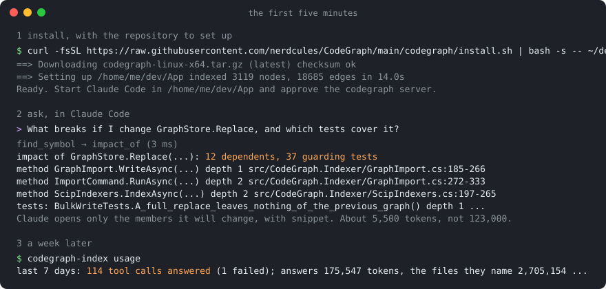
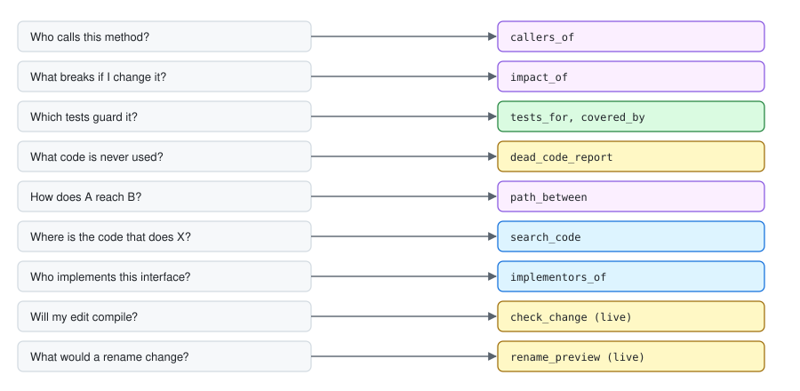

<p align="center"></p>

# CodeGraph

**CodeGraph** · [Docs](docs/README.md) · [MCP server](MCP-SERVER.md) · [Extractors](EXTRACTORS.md) · [Benchmarks](BENCHMARKS.md) · [Prompts](PROMPTS.md) · [Changelog](CHANGELOG.md) · [Claude Code plugin](plugin/README.md) · [VS Code extension](vscode-extension/README.md)

**CodeGraph gives your AI coding assistant the compiler's answers: who calls this, what breaks if I
change it, which tests guard it.**

It is an MCP server, so it works with any assistant that speaks MCP. `codegraph-index init` writes the
config for Claude Code, GitHub Copilot (CLI, VS Code, Visual Studio, JetBrains), Codex, Cursor, the Gemini
CLI, and the Roo Code, Kilo Code and Continue extensions. [Tested with](docs/installation.md#tested-with)
Claude Code, the Copilot CLI, Copilot in VS Code, Codex and Cursor, with real tool calls.

[](https://github.com/nerdcules/CodeGraph/actions/workflows/ci.yml)
[](https://github.com/nerdcules/CodeGraph/releases/latest)
[](../LICENSE)

It reads a codebase with its compiler, stores what it finds as a graph, and serves that graph to your
assistant as tools. Every edge is a resolved symbol, never a text match. On this repository at release
1.1.0's code (`72822e6`, BENCHMARKS round 12), the answers to "what breaks if I change `GraphStore.Replace`?"
are about 5,500 tokens, where the 25 files that match `.Replace(` are about 123,000. Four assistants got that
question three times with CodeGraph and three times without: with it, 7 of 12 answers said how many tests run
the method; without it, none did. Claude Code was also faster and cheaper with it; Codex and the Copilot CLI
were not, and Cursor's runs varied too much to call
([measured](docs/measured-results.md#four-assistants-with-and-without)). On four public repositories (Go,
Python, TypeScript, C#) on 19 November, Claude Code with it answered sooner on all four (median 5.5 to 20.0
seconds sooner), made fewer model calls in all 12 rounds, and gave a test total in all 12 answers, where the
answers without it gave none on three of the four. The trade is tokens: the tool definitions add 8,681 tokens to
each session's start, so input tokens and cost were higher on all four. The total is the tests that can reach the
method, which can run above the tests that execute it: on Python's HTTPX, 225 listed where 46 run it
([measured](docs/measured-results.md#four-public-repositories)).

- Precision and recall of 100% on generated codebases in eight languages, on current toolchains and on 2023-era ones, bar one old rust-analyzer at 87% call recall ([benchmarks](BENCHMARKS.md))
- 460 tests: in a local Linux run on 19 November 2026, 458 passed and 2 skipped (tests of Windows drive letters). [CI](https://github.com/nerdcules/CodeGraph/actions/workflows/ci.yml) runs them on Linux, macOS and Windows for every push to main and every pull request; each run's log has its counts
- Prebuilt for six platforms, nothing to compile ([releases](https://github.com/nerdcules/CodeGraph/releases/latest))

Languages: C# through Roslyn; TypeScript, JavaScript and Angular through the TypeScript compiler; Java,
Kotlin, Scala, Go, Rust and Python through their SCIP indexers. One graph can hold several, such as a .NET
API and its Angular front end.

## Install

One command. It asks what it needs, shows the plan, and changes nothing until you say yes.

macOS and Linux:

```bash
curl -fsSL https://raw.githubusercontent.com/nerdcules/CodeGraph/main/codegraph/install.sh | bash
```

Windows (PowerShell):

```powershell
& ([scriptblock]::Create((irm https://raw.githubusercontent.com/nerdcules/CodeGraph/main/codegraph/install.ps1)))
```

| It asks for | Default |
|---|---|
| The install folder | `~/.codegraph/bin`, or `C:\tools\codegraph` on Windows |
| The repositories to set up | the git repository you run it in |
| The assistants for each repository | Claude Code; also Cursor, the Gemini CLI and Codex when it finds them |
| The live daemon | no |
| Add to PATH | yes |
| The [VS Code extension](vscode-extension/README.md) | yes, when `code` is on PATH and the release carries the extension |

To skip the questions, give the answers and `--yes`: `... | bash -s -- ~/dev/YourApp --add-to-path --yes`.
[Installation](docs/installation.md) has every option, the Claude Code plugin, upgrade and removal.

## Your first five minutes



**1. Install** with the command [above](#install). The script downloads the release for your platform and
checks its checksum. For each repository you pick, it writes the `codegraph` server into the config of each
assistant you pick (`.mcp.json` for Claude Code and the Copilot CLI), ignores `.codegraph/`, and builds the first
graph ([other assistants](docs/installation.md#use-another-assistant)).

C# repositories also need the .NET SDK the project builds with, no newer than 10, because the graph comes
from a real compile. TypeScript needs Node.js 22.22.3 or later on 22, or 24.15 or later (what the extractor's
packages declare; round 10 also indexed at 100% on Node 20). Java, Go, Rust and Python need their SCIP indexer
on PATH ([installation](docs/installation.md) has the table). A full index of this repository (3,170 nodes)
took 16.7 to 17.6 seconds in BENCHMARKS round 13.

**2. Ask.** Start your assistant in the repository, approve the `codegraph` server when it asks, and ask
a question you would normally answer with grep and a lot of scrolling:

> What breaks if I change `GraphStore.Replace`, and which tests cover it?

The assistant calls `find_symbol`, then `impact_of`, and gets this back in about 2 milliseconds (1.8 ms, the
median in BENCHMARKS round 12). This is the answer on release 1.1.0's code (`72822e6`), trimmed here:

```
impact of CodeGraph.Core.GraphStore.Replace(...): 12 dependents, 37 guarding tests
dependents:
method  CodeGraph.Indexer.GraphImport.WriteAsync(...)        depth 1  src/CodeGraph.Indexer/GraphImport.cs:185-266
method  Program.Main                                          depth 1  src/CodeGraph.Indexer/Program.cs:11-570
method  CodeGraph.Indexer.ImportCommand.RunAsync(...)        depth 2  src/CodeGraph.Indexer/GraphImport.cs:272-333
method  CodeGraph.Indexer.ScipIndexers.IndexAsync(...)       depth 2  src/CodeGraph.Indexer/ScipIndexers.cs:197-265
method  CodeGraph.Indexer.TypeScriptExtractor.IndexAsync(...) depth 2  src/CodeGraph.Indexer/TypeScriptExtractor.cs:103-171
...
tests:
method  CodeGraph.Tests.BulkWriteTests.A_full_replace_leaves_nothing_of_the_previous_graph()  depth 1  tests/CodeGraph.Tests/BulkWriteTests.cs:125-136
method  CodeGraph.Tests.IncrementalIndexTests.Incremental_reindex_matches_a_full_index(...)    depth 1  tests/CodeGraph.Tests/IncrementalIndexTests.cs:62-81
...
```

The dependents at depth 2 and 3 reach `Replace` through other methods. A text search would not have
found them, and would have matched every `string.Replace` on the way. The assistant then opens only the
members it is going to change, with `snippet`.

**3. See how it was used.** After a week, run `codegraph-index usage` in the repository. It prints a line like
this one, from this repository's own log on 19 November 2026:

```
last 7 days: 114 tool calls answered (1 failed); answers 175,547 tokens, the files they name 2,705,154 tokens
(estimated at 4 characters a token); most used: find_symbol ×42, impact_of ×29, snippet ×26
```

These are sizes, not a saving: a session without the graph reads parts of files, not every file an answer names.
To measure a saving on your own code, `codegraph-index compare "<question>"` asks Claude Code the question in
separate new sessions with and without the server and reports what each session's log says it cost
([Measure it with and without](docs/usage.md#measure-it-with-and-without)).
The indexer prints the same line after each run, and the `usage_stats` tool opens with it.

## What you can ask



| Question | Tool |
|---|---|
| Where is `SaveAsync`? | `find_symbol`, `symbol_at`, `outline`, `snippet` |
| Where is the code that does X, when no name is known? | `search_code`: full-text over names, comments and bodies, ranked by BM25, optionally fused with embeddings |
| Who calls it, what does it call? | `callers_of`, `callees_of`, `neighbors`, `path_between`, `traverse` |
| What breaks if I change it? | `impact_of`, `dependents_of`, `depends_on`, `explain_reachability` |
| Which tests guard it? | `tests_for`, `covered_by`, `coverage_stats`, `uncovered` |
| Who implements or inherits this type? Where is it used? | `implementors_of`, `inheritors_of`, `overrides_of`, `references_to`, `members_of` |
| What is never used? What are the entry points? | `dead_code_report`, `list_roots`, `most_called` |
| Is the graph fresh? What did this cost? | `index_status`, `graph_stats`, `usage_stats` |
| Will my edit compile? What would a rename change? Where does this parameter go? | `check_change`, `rename_preview`, `diagnostics`, `live_references`, `data_flow` (live daemon) |

Every answer is checked against the working tree first. If indexed files changed since the graph was
built, the answer starts with a `⚠ STALE INDEX` line and marks the affected rows, so the model never
reasons silently from an old graph. `codegraph-index --watch` keeps the compiled solution in memory,
applies a save in about 1 to 1.5 seconds (BENCHMARKS rounds 12 and 13), and answers the live tools from the real compiler.

## Where to go next

| You are | Read |
|---|---|
| A developer who uses an AI coding assistant | [Installation](docs/installation.md), [Usage](docs/usage.md), [Prompts that use the graph](PROMPTS.md), [Use cases](docs/use-cases.md) |
| Deciding whether to trust it | [Measured results](docs/measured-results.md), [How it works](docs/how-it-works.md), [Performance](docs/performance.md), [Benchmarks](BENCHMARKS.md), [Trust and privacy](#trust-and-privacy) |
| Adding a language, or hacking on it | [Contributing](docs/contributing.md), [Architecture](docs/architecture.md), [The extractor contract](EXTRACTORS.md), [Language versions](docs/language-versions.md), [Every tool](MCP-SERVER.md) |
| Curious where this came from | [The story](docs/story.md): a developer, Claude Code, and the thought that the compiler already knew the answer |
| Wondering what is still missing | [What is missing](docs/roadmap.md), in order of what would matter most |

[docs/README.md](docs/README.md) lists every page.

## Trust and privacy

- **Local.** No source leaves the machine, unless you set `CODEGRAPH_EMBEDDINGS_URL` to a remote endpoint
  for semantic search: that endpoint then receives declaration text (names, signatures, doc comments and
  the start of each body) and the search queries. Semantic search is off unless the variable is set.
- **Read-only on the graph.** The server only reads the graph file. What it writes itself is telemetry:
  one JSON line per call in `.codegraph/telemetry.jsonl` beside the graph (`CODEGRAPH_TELEMETRY=off`
  keeps it in memory). A live daemon it starts when asked (`live_status start=true`, or
  `CODEGRAPH_DAEMON=auto`) is the indexer, which writes the graph and `daemon.log`.
- **Honest about staleness.** Every answer compares the graph with the working tree first.
- **The repo's MCP config is repo content.** Claude Code asks before starting a project's
  servers, Cursor lists a new one as Disabled until you enable it,
  VS Code starts them only in a folder you trust, and the Copilot CLI reads `.mcp.json` only in a
  trusted folder ([client tests](docs/client-tests/README.md)).
- **Checked builds.** Every release is built by the [release workflow](../.github/workflows/release.yml)
  from a tag, with a `SHA256SUMS` file the installers verify. The executables are not code-signed yet.

## What is missing

In order of what would matter most, from a frank look at the gap between the engineering and the
product. [docs/roadmap.md](docs/roadmap.md) has the detail.

1. **macOS is tested by CI and two runs on one Mac, not by daily use.** The author works on Linux and Windows. CI
   builds the Release configuration and runs the test suite on macOS for every push to main and every pull
   request, and the release workflow builds the macOS archives on each version tag. One run on an Intel Mac
   (macOS 15, 2026-11-15) covered the installers, the live daemon and the resilience battery, and found a build
   bug in checkouts reached through a symlink. The fix is checked on Linux, in macOS CI and in a second run on that
   Mac ([BENCHMARKS.md](BENCHMARKS.md) round 16). No one has lived with it there yet.
2. **No package managers.** There is a release archive and an installer, but no Homebrew tap, winget
   package or `dotnet tool`. The Claude Code plugin in [plugin/](plugin/) removes the install step on
   macOS and Linux; on Windows it needs the installer first.
3. **The first answer still needs a graph.** `init` builds it. Without the .NET SDK or the SCIP indexer a
   repository needs, the indexer exits with an error that names what to install, but the assistant's
   tools then answer only "no code graph".
4. **Nothing for teams.** The graph is per machine. A team shares only `.mcp.json`. Building the graph in
   CI and shipping it to teammates is possible and not done.
5. **TypeScript and the SCIP languages re-index the whole workspace on each save**, where C# re-walks
   the changed files and their dependents (10 files for a save to `Worktree.cs`, BENCHMARKS round 12).
   A full index of NestJS's 1,180 files takes 7.7 to 7.8 seconds (round 12).
6. **One daemon per language.** In a repository with C# and Angular, `--watch` on the solution keeps
   only the C# part current.
7. **`data_flow` answers for C# only**, and Java goes through scip-java, which tells calls and reads
   apart by the target's kind only.
8. **No recording of the install.** The install and the usage line a week later are still a picture of
   a terminal.

## License

[MIT](../LICENSE). Author: Alan Seunarayan.

---

**CodeGraph** · [Docs](docs/README.md) · [MCP server](MCP-SERVER.md) · [Extractors](EXTRACTORS.md) · [Benchmarks](BENCHMARKS.md) · [Prompts](PROMPTS.md) · [Changelog](CHANGELOG.md) · [Claude Code plugin](plugin/README.md) · [VS Code extension](vscode-extension/README.md)
