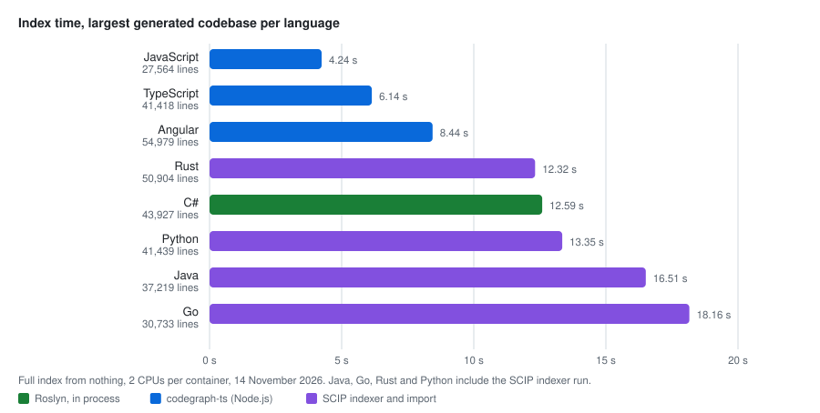
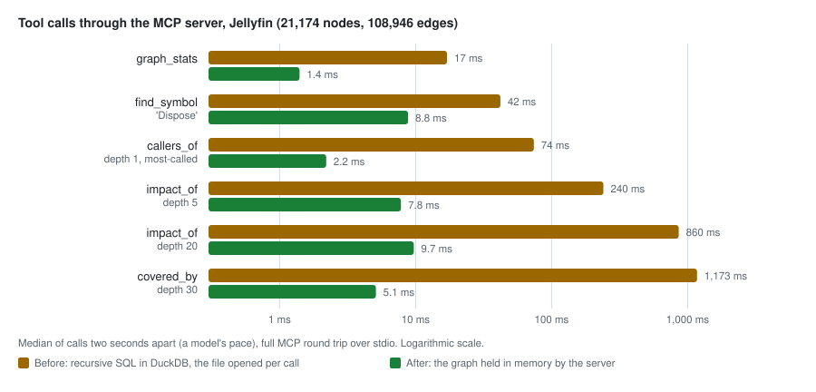

<p align="center"></p>

# CodeGraph

CodeGraph reads a codebase with its compiler, stores what it finds as a graph, and answers
questions about that graph: who calls this, what breaks if I change it, which tests guard it,
what is never used. The answers go to Claude Code, or any other MCP client, through an MCP
server. Every edge is a resolved symbol, never a text match, so the answer is the one the
compiler would give.

That is all CodeGraph needs. Two optional extras show the same graph to people: notes in an
Obsidian vault, and a small web viewer. Use them or leave them out; the indexer and the server
work the same either way.

- [What it does](#what-it-does)
- [What you can ask](#what-you-can-ask)
- [Why it saves tokens](#why-it-saves-tokens)
- [Quick start](#quick-start)
- [Keeping the graph current](#keeping-the-graph-current)
- [Optional: the code as notes in Obsidian](#optional-the-code-as-notes-in-obsidian)
- [Performance](#performance)
- [Trust and privacy](#trust-and-privacy)
- [Repository layout](#repository-layout)
- [Build and test](#build-and-test)
- [Not yet](#not-yet)
- [Further reading](#further-reading)

## What it does


Three programs share one file, `.codegraph/graph.db`, kept beside each git worktree:

| Program | What it does |
|---|---|
| `codegraph-index` | Builds the graph. C# goes through Roslyn in process; TypeScript, JavaScript and Angular through the TypeScript compiler; Java, Kotlin, Scala, Go, Rust and Python through their SCIP indexers. One graph can hold several languages, such as a .NET API and its Angular front end. |
| `codegraph-mcp` | A read-only MCP server over the graph: 35 tools over stdio, which Claude Code (or any MCP client) calls instead of reading source files. With `--web PORT` it also serves a graph viewer on localhost. |
| `codegraph-index --watch` | The live daemon. It keeps the compiled solution in memory, re-indexes a save in well under a second, and answers the questions a stored graph cannot: compiler errors, every reference including framework members, and what a proposed edit would break before it is written. |

The graph holds projects, files, types and members as nodes, and `Calls`, `References`,
`Inherits`, `Implements`, `Overrides`, `TestedBy`, `DependsOn` and `InvokedByFramework` as
edges. It records things a plain call graph misses: a call to an interface member counts as a
call to every implementation, reading a property is a call, a `using` or `await` is a call to
the members it binds to, and top-level statements belong to `Main`.

| Language | Route | Live tools |
|---|---|---|
| C# | Roslyn, in process | Roslyn |
| TypeScript, JavaScript, Angular | codegraph-ts (Node.js) | typescript-language-server |
| Java, Kotlin, Scala | scip-java | jdtls, when on PATH |
| Go | scip-go | gopls, when on PATH |
| Rust | rust-analyzer | rust-analyzer |
| Python | scip-python | pyright, when on PATH |

## What you can ask


| Question | Tool |
|---|---|
| Where is `SaveAsync`? | `find_symbol`, `symbol_at`, `outline`, `snippet` |
| Where is the code that does X, when no name is known? | `search_code`: full-text over names, comments and bodies, ranked by BM25, optionally fused with embeddings |
| Who calls it, what does it call? | `callers_of`, `callees_of`, `neighbors`, `path_between`, `traverse` |
| What breaks if I change it? | `impact_of`, `dependents_of`, `depends_on`, `explain_reachability` |
| Which tests guard it? | `tests_for`, `covered_by`, `coverage_stats`, `uncovered` |
| Who implements or inherits this type? Where is it used? | `implementors_of`, `inheritors_of`, `overrides_of`, `references_to`, `members_of` |
| What is never used? What are the entry points? | `dead_code_report`, `list_roots`, `most_called` |
| Is the graph fresh? What did this cost? | `index_status`, `graph_stats`, `usage_stats` |
| Will my edit compile? What would a rename change? Where does this parameter go? | `check_change`, `rename_preview`, `diagnostics`, `live_references`, `data_flow`, `live_status` (live daemon) |

Every answer is checked against the working tree first. If indexed files changed since the
graph was built, the answer starts with a `⚠ STALE INDEX` line and marks the affected rows, so
the model never reasons silently from an old graph. [MCP-SERVER.md](MCP-SERVER.md) lists every
tool with its arguments; [PROMPTS.md](PROMPTS.md) shows prompts that drive them.

## Why it saves tokens

An AI coding assistant pays for everything it reads. Without a graph, it answers "what breaks if
I change this method?" the way a person would with only a terminal: search for the name, open
the files that match, read them to tell real calls from look-alikes, then repeat for each
caller's callers and look for the tests. Every search result and every file it opens enters the
context window as input tokens, and stays there, taking room from the rest of the session.
Text search makes it worse, because a name matches more than the method: `.Replace(` also
matches every `string.Replace`. And the model can still miss a caller that goes through an
interface, a base class or a property, because nothing in the text says so.

CodeGraph moves that work to index time. The compiler resolves every call, override and test
once, and that costs no tokens. After that, each question is one tool call that returns only the
rows that answer it, with the file and line of each, so the model opens only the code it is
going to change.


Measured on this repository, for "what breaks if I change `GraphStore.Replace`?":

| How the assistant finds out | What enters its context | Size, at about 4 characters a token |
|---|---|---|
| CodeGraph: `find_symbol`, `impact_of`, `snippet` | The method, its 11 dependents, the 33 tests that guard them, and the method's own source | 21,138 characters, about 5,300 tokens |
| Opening the files that answer names, if the model somehow knew which they were | 13 files | 140,240 characters, about 35,000 tokens |
| Opening every file that matches `.Replace(` | 23 files, and the dependents' own callers are still to find | 422,643 characters, about 105,000 tokens |

So the same answer costs between a seventh and a twentieth of the tokens, and it includes the
transitive dependents and tests that a text search would still have to chase. The
savings come from a few design choices:

- **Rows, not files.** An answer row is a full name, a file and a line range, and a node id for
  the next call. The model reads source only with `snippet`, for the members it will touch.
- **Bounded answers.** Walks show the nearest 200 rows and a count of the rest at each depth.
  `impact_of` on the most-used member of a 55,000-node graph used to return about 618,000 tokens;
  it now returns about 4,100 ([performance](docs/performance.md#answer-size)).
- **No wasted turns.** The stale warning stops the model from reasoning from an old graph and
  redoing the work. With the live daemon, `check_change` compiles a proposed edit and lists what
  it breaks, so the model doesn't need a build-and-read-the-errors loop to find out.
- **People don't need the assistant at all.** The Obsidian notes and reports below hold the
  same answers, worked out in advance. A tester who reads "which tests reach this type" in a
  note, or a product manager who browses the project map, spends no tokens.

`usage_stats` reports, for the current session and all time, the tokens each tool returned and
an estimate of the source tokens those answers saved the model from reading. Point the assistant
at the tools, not at the Obsidian notes: a tool answer holds only the rows asked for, while a
note holds everything about a type.

## Quick start

Needs the .NET 10 SDK and git. TypeScript and Angular also need Node.js 22.22 or later, and the
SCIP languages need their indexer on PATH, such as `scip-java` (`cs install --contrib scip-java`).

```bash
./install.sh ~/dev/App --add-to-path              # macOS / Linux  → ~/.codegraph/bin
```

```powershell
.\install.ps1 C:\dev\App -AddToPath               # Windows        → C:\tools\codegraph
```


The script builds with warnings as errors, runs the tests, publishes both executables, and runs
`codegraph-index init` on each repo you name. `init` writes the `codegraph` server into the
repo's `.mcp.json`, adds `.codegraph/` to `.gitignore` and builds the first graph. Start Claude
Code in the repo and approve the server. For more repos, run `init` inside each one:

```bash
codegraph-index init                 # finds the solution, angular.json, tsconfig.json or build file from here
codegraph-index init --live          # the server starts the live daemon itself on its first call
```

`setup.sh` / `setup.ps1` run everything from a source checkout instead of publishing, and
`uninstall.sh` / `uninstall.ps1` take it all out again. [docs/installation.md](docs/installation.md)
covers options, upgrades and troubleshooting.

## Keeping the graph current


- **Incremental.** Each file's hash is stored. A re-run re-walks only changed files and their
  dependents (callers, subclasses, referencers, tests), then merges the result into the graph in
  about a second. `--full` rebuilds from scratch.
- **Watch mode.** `codegraph-index <solution> --watch` pays the solution load once and applies
  each save to the compiled solution in memory, so a one-file edit re-indexes in well under a
  second. The server notices each swap through the file's mtime.
- **Live daemon.** The same watch process answers over a local pipe. `check_change` compiles a
  proposed file in memory and reports what it would break; `rename_preview` runs Roslyn's rename on
  a fork; `diagnostics` reports compiler errors for the working tree. The graph stays the system of
  record for transitive and aggregate questions, where it is orders of magnitude faster.
- **Safe while sessions run.** A full rebuild writes a fresh file and swaps it in with one
  rename; the server only ever reads.

## Optional: the code as notes in Obsidian

CodeGraph doesn't need Obsidian: Claude Code and other MCP clients use the server directly.
The notes are for people who want to browse the code without an editor or an AI assistant, such
as architects, testers and product managers. Reading them uses no AI model and costs no tokens.

`codegraph-index export obsidian --out <vault>/_code` writes the graph as a folder of linked
Markdown notes: one per project and per type, members as headings, each type's users, callees
and tests, and reports for architects and testers. The Obsidian plugin runs that export, rewrites
the notes when the graph changes, and adds a live panel that asks the same `codegraph-mcp` Claude
Code uses.


Open a type and the panel shows its references, impact, tests and members; put the cursor under
a member and it shows that member's callers, callees, impact and tests, each row a link to its
note and a button that opens the source line in your editor.


The reports answer the questions people ask before they open an editor: which projects depend
on which, which types no test reaches, which public methods are untested, where the entry points
are and which members are called the most.


Obsidian's own graph view then shows the codebase as it shows any vault, coloured by project,
and feature notes written by people link into the generated ones and survive every rebuild.


Install the plugin with `./install.sh --obsidian-vault <vault>` or
`node obsidian-plugin/install-plugin.mjs <vault>`, then set the repo folder in its settings.
[docs/obsidian.md](docs/obsidian.md) walks through every feature with screenshots;
[obsidian-plugin/README.md](obsidian-plugin/README.md) has the details and the Dataview fields.

## Performance

Measured on generated codebases of about 30,000 to 55,000 lines per language, two CPUs each,
and on this repository's graph. [BENCHMARKS.md](BENCHMARKS.md) and
[docs/performance.md](docs/performance.md) have every number.





A full index of this repository takes about 10 s, almost all of it MSBuild and Roslyn, and a
re-index after one edit re-walks only that file and its dependents; a save under watch mode
reaches the graph in well under a second. Tool calls through the server take 1 to 15 ms on this
graph, a walk over 165,000 nodes under a second, and the live daemon's `check_change` compiles
an edited file and its dependents in under half a second.

## Trust and privacy

- **Local and read-only.** No source leaves the machine. The server only reads the graph file,
  and nothing is written during a query. Telemetry is one JSON line per call in
  `.codegraph/telemetry.jsonl` beside the graph (`CODEGRAPH_TELEMETRY=off` keeps it in memory).
- **Honest about staleness.** Every answer compares the graph with the working tree first.
- **The repo's `.mcp.json` is repo content.** Claude Code asks before starting a project's
  servers. The Obsidian plugin does the same: it shows the entry and starts it only after you
  approve that exact command, arguments and environment, and asks again when a pull changes it.
- **Generated notes stay in their folder.** The exporter rewrites only notes whose text changed,
  deletes only notes it wrote before, never follows a symbolic link out of the folder, and
  refuses to write into a folder it did not create.

## Repository layout

```
src/CodeGraph.Core      model, DuckDB store, traversals, full-text search, telemetry, live protocol
src/CodeGraph.Indexer   codegraph-index: Roslyn extractor, record and SCIP import, watch mode, live daemon, exports
extractors/typescript   codegraph-ts: TypeScript and Angular extractor (Node), with typescript-language-server
src/CodeGraph.Mcp       codegraph-mcp: stdio MCP server over graph.db
src/CodeGraph.Web       graph viewer UI and its API routes, embedded into codegraph-mcp --web
obsidian-plugin         Obsidian plugin: the graph as linked notes, plus a live panel over codegraph-mcp
tests/CodeGraph.Tests   store, search, telemetry, extraction, incremental and watch-mode sync, live daemon, exports
tools/CodeGraph.Bench   codegraph-bench: the numbers in BENCHMARKS.md
tools/corpus            generated codebases in eight languages, run in Docker, with answer keys
tools/obsidian-e2e      the plugin end to end in real Obsidian, headless, per Obsidian version
install.* / setup.*     publish and set up repos / run from a checkout
uninstall.*             remove the install folder, PATH entry, a repo's .mcp.json entry and graph
```

## Build and test

```bash
dotnet build -warnaserror
dotnet test
```

The build treats warnings and NuGet audit findings as errors, and `nuget.config` pins nuget.org
as the only source. The test suite needs no SDK discovery and no network: the store tests use a
throwaway DuckDB file and the indexer tests drive the real Roslyn extractor over an
`AdhocWorkspace`. The plugin's tests are `npm test` in `obsidian-plugin/`. Two more layers run
in Docker: [tools/corpus](tools/corpus/README.md) checks precision and recall against generated
codebases with answer keys, in a modern and a classic dialect and on older SDK images, and
[tools/obsidian-e2e](tools/obsidian-e2e/README.md) runs the plugin in real Obsidian.

## Not yet

- In a repo with both, `--watch` on the C# solution refreshes only C#. Run a second daemon on the
  front end with its own `--db`, or re-run `codegraph-index init` to refresh both.
- TypeScript and the SCIP languages re-index the whole workspace on each save: a few seconds for
  1,000 files, against per-file incremental indexing for C#.
- There is no native Java extractor: Java goes through scip-java, which tells calls and reads
  apart by the target's kind only.
- `data_flow` answers for C# only.
- `--watch` re-reads a project's globs only on a project-file change, so a new file in a
  directory no project covers is picked up by the next cold run.

## Further reading

| Page | Read it to |
|---|---|
| [docs/](docs/README.md) | Installation, usage, use cases, how it works, performance and architecture, with diagrams |
| [docs/obsidian.md](docs/obsidian.md) | Set up and use the Obsidian plugin, with screenshots |
| [docs/language-versions.md](docs/language-versions.md) | Which language versions each route reads, how older and newer repos are read, how to check a new version |
| [MCP-SERVER.md](MCP-SERVER.md) | Every tool with its arguments, output format, staleness, telemetry, semantic search, troubleshooting |
| [PROMPTS.md](PROMPTS.md) | Prompts that make Claude Code use the tools |
| [EXTRACTORS.md](EXTRACTORS.md) | What each language records, and the record contract for adding one |
| [BENCHMARKS.md](BENCHMARKS.md) | Every measurement, round by round |
