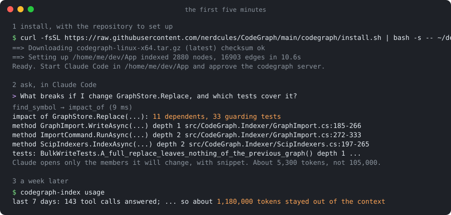
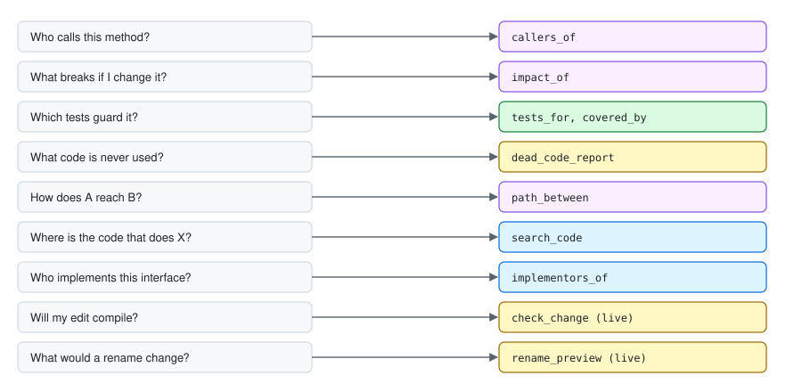

<p align="center"></p>

# CodeGraph

**CodeGraph** · [Docs](docs/README.md) · [MCP server](MCP-SERVER.md) · [Extractors](EXTRACTORS.md) · [Benchmarks](BENCHMARKS.md) · [Prompts](PROMPTS.md) · [Changelog](CHANGELOG.md) · [Claude Code plugin](plugin/README.md) · [Obsidian plugin](obsidian-plugin/README.md)

**CodeGraph gives Claude Code the compiler's answers: who calls this, what breaks if I change it,
which tests guard it.**

[](https://github.com/nerdcules/CodeGraph/actions/workflows/ci.yml)
[](https://github.com/nerdcules/CodeGraph/releases/latest)
[](../LICENSE)

It reads a codebase with its compiler, stores what it finds as a graph, and serves that graph to Claude
Code (or any MCP client) as tools. Every edge is a resolved symbol, never a text match. One question
costs one tool call instead of twenty file reads: on this repository, "what breaks if I change
`GraphStore.Replace`?" takes about 5,300 tokens of answers where opening the files that match would take
about 105,000.

- Precision and recall of 100% on generated codebases in eight languages, on current toolchains and on 2023-era ones, bar one old rust-analyzer at 87% call recall ([benchmarks](BENCHMARKS.md))
- 394 tests, run on Linux, macOS and Windows on every push
- Prebuilt for six platforms, nothing to compile ([releases](https://github.com/nerdcules/CodeGraph/releases/latest))

Languages: C# through Roslyn; TypeScript, JavaScript and Angular through the TypeScript compiler; Java,
Kotlin, Scala, Go, Rust and Python through their SCIP indexers. One graph can hold several, such as a .NET
API and its Angular front end.

## Your first five minutes



**1. Install.** The script downloads the release for your platform, checks its checksum, and sets up the
repository you name: it writes the `codegraph` server into the repo's `.mcp.json`, ignores `.codegraph/`,
and builds the first graph.

```bash
curl -fsSL https://raw.githubusercontent.com/nerdcules/CodeGraph/main/codegraph/install.sh | bash -s -- ~/dev/YourApp --add-to-path
```

```powershell
& ([scriptblock]::Create((irm https://raw.githubusercontent.com/nerdcules/CodeGraph/main/codegraph/install.ps1))) C:\dev\YourApp -AddToPath
```

C# repositories also need the .NET SDK the project builds with, because the graph comes from a real
compile. TypeScript needs Node.js 22. Java, Go, Rust and Python need their SCIP indexer on PATH
([installation](docs/installation.md) has the table). Indexing this repository takes about 10 seconds.

**2. Ask.** Start Claude Code in the repository, approve the `codegraph` server when it asks, and ask a
question you would normally answer with grep and a lot of scrolling:

> What breaks if I change `GraphStore.Replace`, and which tests cover it?

Claude calls `find_symbol`, then `impact_of`, and gets this back in 35 milliseconds, trimmed here:

```
impact of CodeGraph.Core.GraphStore.Replace(...): 11 dependents, 33 guarding tests
dependents:
method  CodeGraph.Indexer.GraphImport.WriteAsync(...)        depth 1  src/CodeGraph.Indexer/GraphImport.cs:185-266
method  Program.Main                                          depth 1  src/CodeGraph.Indexer/Program.cs:11-570
method  CodeGraph.Indexer.ImportCommand.RunAsync(...)        depth 2  src/CodeGraph.Indexer/GraphImport.cs:272-333
method  CodeGraph.Indexer.ScipIndexers.IndexAsync(...)       depth 2  src/CodeGraph.Indexer/ScipIndexers.cs:197-265
method  CodeGraph.Indexer.TypeScriptExtractor.IndexAsync(...) depth 2  src/CodeGraph.Indexer/TypeScriptExtractor.cs:103-171
...
tests:
method  CodeGraph.Tests.BulkWriteTests.A_full_replace_leaves_nothing_of_the_previous_graph()  depth 1  tests/CodeGraph.Tests/BulkWriteTests.cs:125-136
method  CodeGraph.Tests.IncrementalIndexTests.Incremental_reindex_matches_a_full_index(...)    depth 1  tests/CodeGraph.Tests/IncrementalIndexTests.cs:62-81
...
```

The dependents at depth 2 and 3 reach `Replace` through other methods. A text search would not have
found them, and would have matched every `string.Replace` on the way. Claude then opens only the
members it is going to change, with `snippet`.

**3. See what it did for you.** After a week, run `codegraph-index usage` in the repository. It prints a
line like this one (the numbers are an example):

```
last 7 days: 143 tool calls answered; the files they pointed at come to about 1,230,000 tokens, the answers
to 48,000, so about 1,180,000 tokens stayed out of the context; most used: find_symbol ×61, impact_of ×24, tests_for ×19
```

The indexer prints the same line after each run, and the `usage_stats` tool opens with it.

## What you can ask



| Question | Tool |
|---|---|
| Where is `SaveAsync`? | `find_symbol`, `symbol_at`, `outline`, `snippet` |
| Where is the code that does X, when no name is known? | `search_code`: full-text over names, comments and bodies, ranked by BM25, optionally fused with embeddings |
| Who calls it, what does it call? | `callers_of`, `callees_of`, `neighbors`, `path_between`, `traverse` |
| What breaks if I change it? | `impact_of`, `dependents_of`, `depends_on`, `explain_reachability` |
| Which tests guard it? | `tests_for`, `covered_by`, `coverage_stats`, `uncovered` |
| Who implements or inherits this type? Where is it used? | `implementors_of`, `inheritors_of`, `overrides_of`, `references_to`, `members_of` |
| What is never used? What are the entry points? | `dead_code_report`, `list_roots`, `most_called` |
| Is the graph fresh? What did this cost? | `index_status`, `graph_stats`, `usage_stats` |
| Will my edit compile? What would a rename change? Where does this parameter go? | `check_change`, `rename_preview`, `diagnostics`, `live_references`, `data_flow` (live daemon) |

Every answer is checked against the working tree first. If indexed files changed since the graph was
built, the answer starts with a `⚠ STALE INDEX` line and marks the affected rows, so the model never
reasons silently from an old graph. `codegraph-index --watch` keeps the compiled solution in memory,
applies each save in well under a second, and answers the live tools from the real compiler.

## Where to go next

| You are | Read |
|---|---|
| A developer who uses Claude Code | [Installation](docs/installation.md), [Usage](docs/usage.md), [Prompts that use the graph](PROMPTS.md), [Use cases](docs/use-cases.md) |
| Someone who reads code without an AI assistant: an architect, a tester, a product manager | [The code as notes in Obsidian](docs/obsidian.md): browse projects, types, tests and reports as linked notes, with no editor and no tokens |
| Deciding whether to trust it | [Why it saves tokens](docs/why-it-saves-tokens.md), [How it works](docs/how-it-works.md), [Performance](docs/performance.md), [Benchmarks](BENCHMARKS.md), [Trust and privacy](#trust-and-privacy) |
| Adding a language, or hacking on it | [Contributing](docs/contributing.md), [Architecture](docs/architecture.md), [The extractor contract](EXTRACTORS.md), [Language versions](docs/language-versions.md), [Every tool](MCP-SERVER.md) |
| Curious where this came from | [The story](docs/story.md): a developer, Claude Code, and the thought that the compiler already knew the answer |
| Wondering what is still missing | [What is missing](docs/roadmap.md), in order of what would matter most |

[docs/README.md](docs/README.md) lists every page.

## Trust and privacy

- **Local and read-only.** No source leaves the machine. The server only reads the graph file, and
  nothing is written during a query. Telemetry is one JSON line per call in
  `.codegraph/telemetry.jsonl` beside the graph (`CODEGRAPH_TELEMETRY=off` keeps it in memory).
- **Honest about staleness.** Every answer compares the graph with the working tree first.
- **The repo's `.mcp.json` is repo content.** Claude Code asks before starting a project's servers.
  The Obsidian plugin does the same: it starts the server only after you approve that exact command.
- **Checked builds.** Every release is built by the [release workflow](../.github/workflows/release.yml)
  from a tag, with a `SHA256SUMS` file the installers verify. The executables are not code-signed yet.

## What is missing

In order of what would matter most, from a frank look at the gap between the engineering and the
product. [docs/roadmap.md](docs/roadmap.md) has the detail.

1. **macOS is tested by CI, not by daily use.** The author works on Linux and Windows. The release builds
   and the test suite run on macOS on every push, but no one has lived with it there yet.
2. **No package managers.** There is a release archive and an installer, but no Homebrew tap, winget
   package or `dotnet tool`. The Claude Code plugin in [plugin/](plugin/) removes the install step on
   macOS and Linux; on Windows it needs the installer first.
3. **The first answer still needs a graph.** `init` builds it, but a repository with no SDK for its
   language indexes nothing, and says so only in the log.
4. **Nothing for teams.** The graph is per machine. A team shares only `.mcp.json`. Building the graph in
   CI and shipping it to teammates is possible and not done.
5. **TypeScript and the SCIP languages re-index the whole workspace on each save**, where C# re-walks
   one file. A few seconds for 1,000 files.
6. **`data_flow` answers for C# only**, and Java goes through scip-java, which tells calls and reads
   apart by the target's kind only.

## License

[MIT](../LICENSE). Author: Alan Seunarayan.

---

**CodeGraph** · [Docs](docs/README.md) · [MCP server](MCP-SERVER.md) · [Extractors](EXTRACTORS.md) · [Benchmarks](BENCHMARKS.md) · [Prompts](PROMPTS.md) · [Changelog](CHANGELOG.md) · [Claude Code plugin](plugin/README.md) · [Obsidian plugin](obsidian-plugin/README.md)
