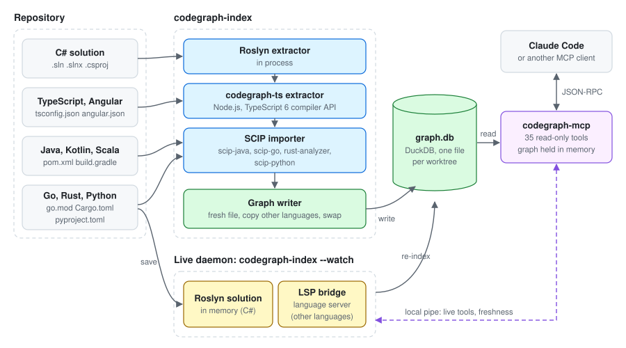
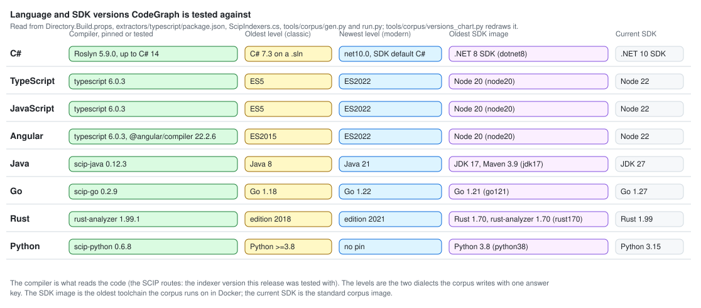

# CodeGraph documentation

*Author: Alan Seunarayan*

**Home** · [Installation](installation.md) · [Usage](usage.md) · [Obsidian](obsidian.md) · [Use cases](use-cases.md) · [How it works](how-it-works.md) · [Language versions](language-versions.md) · [Performance](performance.md) · [Architecture](architecture.md)

---

CodeGraph gives Claude Code the compiler's answers: who calls this, what breaks if I change it, which
tests guard it.
The indexer reads your code with the compiler of the language and writes a graph file.
The MCP server answers questions from that file.
Obsidian is optional: the [Obsidian](obsidian.md) plugin only shows the graph to people as notes.

## Start with the page for you

| You are | Start here | Then |
|---|---|---|
| A developer who uses Claude Code | [Installation](installation.md) | [Usage](usage.md), [Use cases](use-cases.md), [Prompts](../PROMPTS.md) |
| An architect, a tester or a product manager who reads code without an AI | [Obsidian](obsidian.md) | [Use cases](use-cases.md#share-the-structure-of-the-code-with-people-who-do-not-code) |
| Deciding whether to trust it | [Why it saves tokens](why-it-saves-tokens.md) | [How it works](how-it-works.md), [Performance](performance.md), [Benchmarks](../BENCHMARKS.md) |
| A contributor | [Contributing](contributing.md) | [Architecture](architecture.md), [Extractors](../EXTRACTORS.md), [Language versions](language-versions.md) |
| Curious | [The story](story.md) | [What is missing](roadmap.md) |

## All pages

| Page | Read it to |
|---|---|
| [Installation](installation.md) | Install a release, connect a repository to Claude Code, upgrade, remove. |
| [Usage](usage.md) | Build a graph, keep it current, use the tools, see what they did for you. |
| [Obsidian](obsidian.md) | Read the graph as linked notes in Obsidian, with a live panel. |
| [Use cases](use-cases.md) | Find the tool for a question about your code. |
| [Why it saves tokens](why-it-saves-tokens.md) | See the measurement behind the claim, and how the graph stays current. |
| [How it works](how-it-works.md) | Learn how the indexer builds the graph and how the server answers. |
| [Language versions](language-versions.md) | See which language versions each route reads, and how to check a new one. |
| [Performance](performance.md) | See the measured times for indexing and for tool calls. |
| [Architecture](architecture.md) | Learn the components, the data model and the extension points. |
| [Contributing](contributing.md) | Build from source, run the slow tests, add a language, cut a release. |
| [The story](story.md) | Where CodeGraph came from. |
| [What is missing](roadmap.md) | What is not done yet, in order. |

Reference pages outside this folder:

- [MCP-SERVER.md](../MCP-SERVER.md) gives the arguments of all 35 tools.
- [EXTRACTORS.md](../EXTRACTORS.md) gives the record format for a new language.
- [BENCHMARKS.md](../BENCHMARKS.md) gives all the measurements, round by round.
- [PROMPTS.md](../PROMPTS.md) gives prompts that make the client use the tools.
- [CHANGELOG.md](../CHANGELOG.md) lists each release.
- [plugin/README.md](../plugin/README.md) is the Claude Code plugin.

## Supported languages

| Language | Route | Live tools |
|---|---|---|
| C# | Roslyn, in process | Roslyn |
| TypeScript, JavaScript, Angular | codegraph-ts extractor (Node.js) | typescript-language-server |
| Java, Kotlin, Scala | scip-java | jdtls, when it is on PATH |
| Go | scip-go | gopls, when it is on PATH |
| Rust | rust-analyzer | rust-analyzer |
| Python | scip-python | pyright, when it is on PATH |

One graph can hold more than one language.
For example, a .NET API and its Angular front end can share one graph.

## Conventions in these pages

These pages use ASD-STE100 Simplified Technical English.
Sentences are short, and each instruction is one action.
A word has one meaning in all pages:

| Term | Meaning |
|---|---|
| the indexer | The `codegraph-index` executable. |
| the server | The `codegraph-mcp` executable, an MCP server. |
| the graph | The `.codegraph/graph.db` file of a worktree. |
| the live daemon | The indexer when it runs with `--watch`. |
| the client | Claude Code, or another MCP client. |
| a node | One type, member, file or project in the graph. |
| an edge | One relation between two nodes, for example `Calls`. |

Commands for macOS and Linux use bash.
Commands for Windows use PowerShell.
[The story](story.md) and [Contributing](contributing.md) are written in a plainer voice.

---

**Home** · Next: [Installation](installation.md) →
