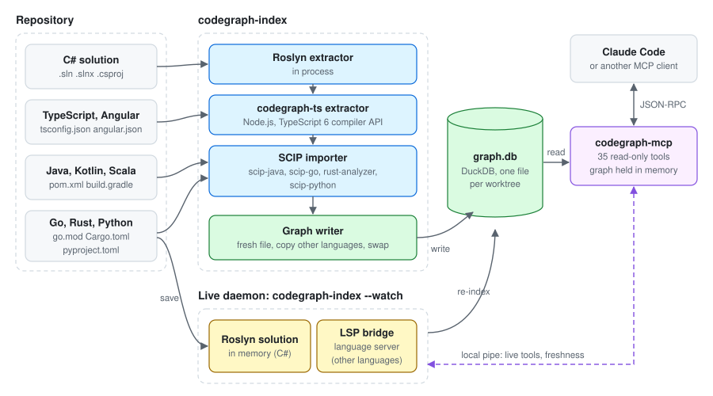

# Architecture

*Author: Alan Seunarayan*

[Home](README.md) · [Installation](installation.md) · [Usage](usage.md) · [Use cases](use-cases.md) · [How it works](how-it-works.md) · [Performance](performance.md) · **Architecture**

---

## Contents

- [Components](#components)
- [Source layout](#source-layout)
- [Processes](#processes)
- [The graph file](#the-graph-file)
- [Language routes](#language-routes)
- [The record contract](#the-record-contract)
- [The live protocol](#the-live-protocol)
- [Concurrency](#concurrency)
- [Security and privacy](#security-and-privacy)
- [Design decisions](#design-decisions)
- [Add a language](#add-a-language)
- [Limits](#limits)

## Components



| Component | Function |
|---|---|
| `codegraph-index` | Reads the code and writes the graph. With `--watch`, it is the live daemon. |
| `codegraph-ts` | A Node.js extractor for TypeScript, JavaScript and Angular. The indexer starts it. |
| SCIP indexers | External tools: scip-java, scip-go, rust-analyzer and scip-python. The indexer starts them and imports their output. |
| `graph.db` | One DuckDB file for each worktree. It holds all languages. |
| `codegraph-mcp` | The MCP server. It reads the graph and answers 35 tools over stdio. |
| The live daemon | Keeps the code loaded. It indexes each save and answers the live tools over a local pipe. |
| Language servers | typescript-language-server, jdtls, gopls, pyright or rust-analyzer. The live daemon uses them for languages other than C#. |

## Source layout

| Folder | Content |
|---|---|
| `src/CodeGraph.Core` | The model, the DuckDB store, the walks, the full-text and vector search, freshness, telemetry and the live protocol. |
| `src/CodeGraph.Indexer` | `codegraph-index`: the Roslyn extractor, the record and SCIP import, the export, the LSP bridge and the live daemon. |
| `src/CodeGraph.Mcp` | `codegraph-mcp`: the MCP server and its tools. |
| `src/CodeGraph.Web` | The graph viewer for `codegraph-mcp --web`. |
| `extractors/typescript` | `codegraph-ts`: the TypeScript and Angular extractor, with typescript-language-server. |
| `tests/CodeGraph.Tests` | The .NET test suite. |
| `tools/CodeGraph.Bench` | The benchmark tool. |
| `tools/corpus` | The generated codebases and the Docker test matrix. |

Only `src/CodeGraph.Indexer` knows about compilers.
The store and the server do not depend on a language.

## Processes

| Process | Starts | Stops | Reads | Writes |
|---|---|---|---|---|
| `codegraph-index` (one run) | You, or `init` | After the index | Source files | The graph |
| `codegraph-index --watch` | You, or the server | Ctrl+C, a signal, or the idle time | Source files | The graph |
| `codegraph-mcp` | The client | When the client stops | The graph | Telemetry only |
| `codegraph-ts`, SCIP indexer | The indexer | After the index | Source files | Records on stdout, or an index file |
| Language server | The live daemon | With the live daemon | Source files | Nothing |

## The graph file

The graph is a DuckDB file at `<worktree root>/.codegraph/graph.db`.

| Table | Content |
|---|---|
| `nodes` | One row for each node: id, kind, name, full name, signature, file, lines, modifiers and language. |
| `edges` | One row for each edge: from id, to id, kind. |
| `edge_origins` | The file that made each edge. The incremental index uses it. |
| `files` | The path, the SHA-256 hash and the language of each indexed file. |
| `search_docs`, `search_terms` | The BM25 full-text index for `search_code`. |
| `embeddings` | The vectors for meaning-based search, when an endpoint is set. |
| `meta` | The schema version, the solution, the commit, the index time and the settings of each language. |

The schema version is 6.
When the version changes, the indexer builds the graph again from the start.

## Language routes

There are three routes from code to graph:

| Route | Languages | How it gets the records |
|---|---|---|
| Roslyn | C# | In the indexer process. The indexer walks the syntax trees with the semantic model. |
| Node extractor | TypeScript, JavaScript, Angular | The indexer starts `node cli.mjs` and reads records from stdout. |
| SCIP | Java, Kotlin, Scala, Go, Rust, Python | The indexer starts the SCIP indexer, then reads the index file. |

All three routes give the same nodes and edges to the same writer.
Thus all tools work for all languages.

## The record contract

An extractor writes one JSON record on each line.
`codegraph-index import` reads these records.

```json
{"type":"header","language":"typescript","tool":"codegraph-ts 0.1.0","root":"/repo/web","target":"/repo/web/angular.json"}
{"type":"node","id":"ts:src/app/user.service.ts#UserService.load","kind":"Method","name":"load","file":"src/app/user.service.ts","start":14,"end":17}
{"type":"edge","from":"ts:src/app/user.service.ts#UserService.load","to":"ts:src/app/http.service.ts#HttpService.get","kind":"Calls"}
```

| Record | Content |
|---|---|
| `header` | The language, the tool, the root and the target. It is the first record. |
| `file` | A source file. The importer records its hash. |
| `node` | A node and its fields. |
| `edge` | An edge and the file that made it. |
| `search` | The text parts for full-text search. |
| `embed` | The text for an embedding. |
| `meta` | A setting, stored as `lang.<language>.<key>`. |

`codegraph-index export` writes the same records.
[EXTRACTORS.md](../EXTRACTORS.md#the-record-contract) gives all the fields.

## The live protocol

The server and the live daemon talk over a local pipe.
On Linux and macOS, the pipe is a Unix domain socket.
On Windows, it is a named pipe.

- The pipe name comes from a hash of the graph path.
- Each request is one JSON line, and each answer is one JSON line.
- Each request uses a new connection.

Before each tool call, the server makes sure that the pipe exists.
This check does not connect, so it takes microseconds when no live daemon runs.

## Concurrency

- **Many readers, one writer.** Many server processes can read one graph. One indexer writes it.
- **Swap, not edit.** A full index writes a new file and renames it over the old file. A reader never sees a half-written graph.
- **One live daemon for each graph.** A second `--watch` on the same graph finds the first one and stops.
- **Incremental writes.** An incremental index writes in one transaction and then runs a checkpoint.

## Security and privacy

- All processes run on your machine.
- No source code leaves your machine.
  The only exception is an embeddings endpoint, which you must set yourself.
- The server only reads the graph. It does not change your files.
- The live tools `check_change` and `rename_preview` do their work in memory. They do not write to disk.
- The pipe is local. It does not open a network port.

## Design decisions

| Decision | Reason |
|---|---|
| Use the compiler of each language | A text search finds wrong matches and misses calls through interfaces and base classes. |
| One DuckDB file for each worktree | One `.mcp.json` file serves all worktrees. Each worktree has its own graph. |
| The graph is the system of record | Transitive questions are much faster on indexed edges than on a compiler. |
| The live daemon is optional | The graph tools work without it. The live tools add positions, diagnostics and what-if compiles. |
| Short walk answers | A large answer fills the context of the client. 200 rows and the counts are enough to decide. |
| SCIP for breadth | One importer gives six languages. A language that needs more gets its own extractor, as TypeScript did. |
| TypeScript 6 for the extractor | TypeScript 7 is the native compiler. It has no compiler API that a Node.js program can use. |

## Add a language

1. **Select the route.**
   If a SCIP indexer exists, add an entry to `ScipIndexers.All` in `src/CodeGraph.Indexer/ScipIndexers.cs`.
   Give the build file names, the command, the install command and the file extensions.
2. **Or write an extractor.**
   Write a program that writes the records in [The record contract](#the-record-contract).
   Use `extractors/typescript` as an example.
3. **Add the language server.**
   Add the server command to `LspServer.For` in `src/CodeGraph.Indexer/Lsp/LspServer.cs`.
4. **Add tests.**
   Add a fixture with the edges that each feature must make.
   Add the language to the generator in `tools/corpus/gen.py`.
5. **Run the corpus.**
   Run `tools/corpus/run.py` and make sure that the summary shows no differences.

## Limits

- In a repository with more than one language, `--watch` on the C# solution updates only C#.
- The languages other than C# index the full workspace on each save.
- `data_flow` works for C# only.
- There is no native Java extractor. Java uses scip-java.
  scip-java tells calls and reads apart only by the kind of the target.
- The graph does not connect calls between languages, for example an HTTP call from TypeScript to a C# controller.

---

← Previous: [Performance](performance.md) · [Home](README.md)
