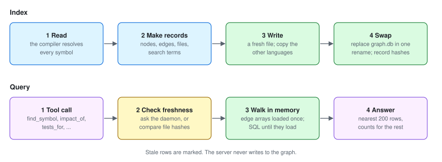

# How it works

*Author: Alan Seunarayan*

[Home](README.md) · [Installation](installation.md) · [Usage](usage.md) · [Obsidian](obsidian.md) · [Use cases](use-cases.md) · **How it works** · [Performance](performance.md) · [Architecture](architecture.md)

---

## Contents

- [Overview](#overview)
- [Read the code with the compiler](#read-the-code-with-the-compiler)
- [Nodes and edges](#nodes-and-edges)
- [Write the graph](#write-the-graph)
- [Incremental indexing](#incremental-indexing)
- [Answer a tool call](#answer-a-tool-call)
- [Freshness](#freshness)
- [The live daemon](#the-live-daemon)
- [What each language records](#what-each-language-records)
- [How the graph is tested](#how-the-graph-is-tested)

## Overview

CodeGraph has two paths:

- **The index path** reads the code and writes the graph. The indexer does this.
- **The query path** reads the graph and answers a tool call. The server does this.

The two paths share only the graph file.
The server never writes to the graph.

## Read the code with the compiler

The indexer does not search text.
It uses the compiler of the language, so each edge points to the symbol that the compiler resolved.

| Language | The compiler that reads the code |
|---|---|
| C# | Roslyn, through MSBuildWorkspace. The indexer loads the solution and compiles each project. |
| TypeScript, JavaScript, Angular | The TypeScript 6 compiler API. The Angular compiler parses the templates. |
| Java, Kotlin, Scala, Go, Rust, Python | The SCIP indexer of the language. CodeGraph imports the index that it writes. |

The compiler finds what a text search cannot find:

- A call through an interface or a base class.
- An implementation two levels below an interface.
- Two methods with the same name in different classes.
- A type in a signature, a generic argument, a cast or an attribute.

## Nodes and edges

The graph has nodes and edges.

| Node kind | Example |
|---|---|
| `Project` | A `.csproj`, a tsconfig project, or a Maven module. |
| `File` | One source file. |
| `Type` | A class, interface, struct, enum, record, trait or type alias. |
| `Method` | A method, constructor, function or Angular template. |
| `Property`, `Field` | A property, field or event. |
| `External` | A framework or package method that the code calls. |

| Edge kind | From | To |
|---|---|---|
| `Calls` | A member | The member that it calls or reads. |
| `CallsExternal` | A member | An `External` node. |
| `Inherits` | A type | Its base class. |
| `Implements` | A type or member | The interface, or the interface member. |
| `Overrides` | A member | The member that it overrides. |
| `References` | A member or type | A type that it uses. |
| `TestedBy` | A member | A test that calls it. |
| `InvokedByFramework` | The framework node | An entry point, for example `Main`. |
| `Contains`, `DependsOn` | A parent, a project | A child, a referenced project. |
| `Imports`, `Injects`, `Renders` | TypeScript and Angular | An imported file, an injected service, a rendered component. |

Each node has a stable id.
C# ids are the documentation-comment ids of Roslyn, for example `M:App.Core.Order.Submit`.
Other ids start with the language route, for example `ts:` or `scip:`.
An id does not change when the code moves in its file.

## Write the graph

The indexer writes a new graph file for each full index:

1. It writes all nodes and edges to a temporary file with the DuckDB appender.
2. It copies the nodes of the other languages from the old graph.
3. It records the SHA-256 hash of each source file.
4. It replaces the old graph with one rename.

The server can read the old graph during these steps.
After the rename, the next tool call reads the new graph.

A graph holds more than one language.
An index of one language replaces only that language.

## Incremental indexing

For C#, the second index is incremental:

1. The indexer compares the hash of each file with the stored hash.
2. It finds the changed files.
3. It finds the files that depend on them: callers, subclasses, references, tests and other parts of partial types.
4. It reads again only these files.
5. It removes the old edges of these files and writes the new edges.

Each edge records the file that made it.
Thus the indexer can remove the edges of one file and keep the edges of other files.

For the other languages, each index reads the full workspace again.

## Answer a tool call

1. The client sends a tool call over stdio, for example `impact_of` with a node id.
2. The server checks the freshness of the graph. See [Freshness](#freshness).
3. The server runs a SQL query on the graph. A walk is a recursive query on indexed edges.
4. The server makes the answer short. A walk shows the nearest 200 rows and the counts for the rest.
5. The server sends the answer as text.

The server keeps the graph file open between calls.
Thus a call does not pay the cost to open the file.

## Freshness

The server does not answer from an old graph without a warning.

- **Without the live daemon:** the server compares the file hashes with the files on disk. It marks the rows from changed files with `STALE`.
- **With the live daemon:** the server asks the live daemon if saves are pending. If a save is pending, the server waits for the index to finish. Thus the answer shows the current code.

## The live daemon

The live daemon is the indexer with `--watch`.
It does three things:

1. It keeps the code loaded in memory.
2. It indexes each save, after a quiet period of half a second.
3. It answers the live tools over a local pipe.

| Language | What answers the live tools |
|---|---|
| C# | The Roslyn solution in memory. |
| Other languages | A language server, through LSP. For example, typescript-language-server, jdtls or gopls. |

The pipe name comes from the path of the graph.
Thus no port or discovery file is necessary.
One live daemon serves all the server processes that read the same graph.

`check_change` with a language server works in this sequence:

1. It sends the proposed text to the language server.
2. It waits for the errors of the edited files and of the files that depend on them.
3. It puts back the original text.
4. It compares the errors before and after the change.

A language server does not tell when it has no more errors to send.
`check_change` measures how fast the server sends errors and waits three times that time.

## What each language records

| | C# | TypeScript, Angular | SCIP languages |
|---|---|---|---|
| Types, members, signatures, modifiers | Yes | Yes | Names and kinds. Modifiers come from the source line. |
| Calls, overrides, implementations | Yes | Yes | From references and relationships. |
| Framework and package calls | Yes | Yes | Methods only. |
| Tests | xUnit, NUnit, MSTest | Jasmine, Jest, Vitest | JUnit, TestNG, Go `TestXxx`, Rust `#[test]`, Python `test_*` |
| Entry points | `Main`, framework methods | Lifecycle hooks, templates | `main`, Spring handlers |
| Dependency injection | No | `Injects` edges | No |
| Incremental index | Per file | Full workspace | Full workspace |
| `data_flow` | Yes | No | No |

Each SCIP indexer writes its index in a different way.
The importer makes the results the same:

- **scip-java** gives an override in both directions. The importer keeps only the direction from the override to the base.
- **rust-analyzer** gives no relationships. The importer finds the trait from the `impl Trait for Type` line.
- **scip-go** includes a generated test file from the build cache. The importer ignores files outside the project.
- **scip-python** gives no information for nested classes. The importer finds their bases on the `class Name(...)` line.

## How the graph is tested

A generator makes codebases with a known answer.
It writes the same model in C#, Java, TypeScript, JavaScript, Angular, Go, Rust or Python.
It also writes a list of each node and edge that the graph must have.

A checker indexes each codebase and compares the graph with the list.
It measures precision and recall for each edge kind.
It also makes sure that the dead-code report finds the dead methods and does not show live ones.

The test runs in parallel Docker containers with no network.
The last run had 144 codebases and 384,000 edges, with no differences.
[tools/corpus/README.md](../tools/corpus/README.md) tells how to run it.

---

← Previous: [Use cases](use-cases.md) · Next: [Performance](performance.md) →
