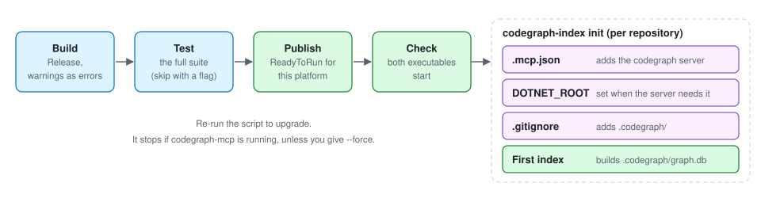

# Installation

*Author: Alan Seunarayan*

[Home](README.md) · **Installation** · [Usage](usage.md) · [Use cases](use-cases.md) · [How it works](how-it-works.md) · [Performance](performance.md) · [Architecture](architecture.md)

---

## Contents

- [Before you start](#before-you-start)
- [Install the language tools](#install-the-language-tools)
- [Install CodeGraph](#install-codegraph)
- [Set up more repositories](#set-up-more-repositories)
- [Connect the client](#connect-the-client)
- [Make sure that it works](#make-sure-that-it-works)
- [Upgrade](#upgrade)
- [Run from a source checkout](#run-from-a-source-checkout)
- [Remove CodeGraph](#remove-codegraph)
- [Troubleshooting](#troubleshooting)

## Before you start

You must have these items:

| Item | Version | Necessary for |
|---|---|---|
| .NET SDK | 10 | All languages. The indexer and the server are .NET executables. |
| git | any | All languages. The indexer finds the worktree root with git. |
| Node.js | 22.22 or later | TypeScript, JavaScript and Angular. |
| A language indexer | see below | Java, Kotlin, Scala, Go, Rust and Python. |

You also need a clone of the CodeGraph repository.

## Install the language tools

Install only the tools for the languages that you use.
C# needs no other tool.
The install script installs the TypeScript extractor when Node.js and npm are available.

| Language | Indexer | Install command |
|---|---|---|
| Java, Kotlin, Scala | scip-java | `cs install --contrib scip-java` (coursier) |
| Go | scip-go | `go install github.com/scip-code/scip-go/cmd/scip-go@latest` |
| Rust | rust-analyzer | `rustup component add rust-analyzer` |
| Python | scip-python | `npm install -g @sourcegraph/scip-python` |

The indexer finds a tool on PATH.
It also looks in the folders that coursier, `go install` and cargo use.
Thus you do not have to add these folders to PATH.

> **NOTE:** Java also needs a JDK and Maven or Gradle.
> scip-java runs the build of the project to read the code.

The live tools for a language also need a language server.
Install it if you want the live tools:

| Language | Language server |
|---|---|
| Java | jdtls |
| Go | gopls |
| Python | pyright |
| Rust | rust-analyzer (the same tool) |
| TypeScript, JavaScript | typescript-language-server (installed with the extractor) |

## Install CodeGraph



### On macOS or Linux

1. Open a terminal in the CodeGraph checkout.
2. Go to the `codegraph` folder:

   ```bash
   cd codegraph
   ```

3. Run the install script with the path of your repository:

   ```bash
   ./install.sh ~/dev/App --add-to-path
   ```

4. Open a new terminal, so that the new PATH is active.

The script installs the executables in `~/.codegraph/bin`.

### On Windows

1. Open PowerShell in the CodeGraph checkout.
2. Go to the `codegraph` folder:

   ```powershell
   cd codegraph
   ```

3. Run the install script with the path of your repository:

   ```powershell
   .\install.ps1 C:\dev\App -AddToPath
   ```

4. Open a new PowerShell window, so that the new PATH is active.

The script installs the executables in `C:\tools\codegraph`.
PowerShell 7 can also run `install.ps1` on macOS and Linux.

### Script options

| bash | PowerShell | Function |
|---|---|---|
| `<repo>...` | `<repo>, ...` | Set up these repositories. With no repository, the script asks for one. |
| `--install-dir DIR` | `-InstallDir DIR` | Install in a different folder. |
| `--add-to-path` | `-AddToPath` | Add the install folder to the user PATH. |
| `--live` | `-Live` | Let the server start the live daemon itself. |
| `--skip-tests` | `-SkipTests` | Do not run the test suite. |
| `--force` | `-Force` | Stop running `codegraph-mcp` processes before the copy. |

The script does these steps:

1. It builds the solution in Release mode, with warnings as errors.
2. It runs the test suite.
3. It publishes `codegraph-index` and `codegraph-mcp` as ReadyToRun executables for your platform.
4. It makes sure that both executables start.
5. It runs `codegraph-index init` on each repository that you give.

## Set up more repositories

You can set up a repository at any time after the installation.

1. Go to the repository:

   ```bash
   cd ~/dev/Other
   ```

2. Run `init`:

   ```bash
   codegraph-index init
   ```

`init` finds the project from the current folder.
It looks for a `.slnx` or `.sln` file first.
It then looks for `angular.json`, `tsconfig.json` or a build file such as `pom.xml`, `go.mod`, `Cargo.toml` or `pyproject.toml`.
If it finds two candidates, it stops and shows both.
Then give the one that you want:

```bash
codegraph-index init App.slnx
```

`init` does these steps:

1. It adds the `codegraph` server to `.mcp.json` at the worktree root. It keeps the other servers.
2. It starts the server as the client does. If the server cannot find .NET, `init` adds `DOTNET_ROOT` to the entry.
3. It adds `.codegraph/` to `.gitignore`.
4. It builds the first graph.

In a repository with a C# solution and an Angular folder, `init` indexes both into one graph.

| Option | Function |
|---|---|
| `--live` | Add `CODEGRAPH_DAEMON=auto`. The server then starts the live daemon on its first tool call. |
| `--no-index` | Write the configuration only. Do not build the graph. |
| `--db PATH` | Keep the graph at a different path. |

## Connect the client

`init` writes the configuration for you.
To write it yourself, put this `.mcp.json` file at the root of the repository:

```json
{
  "mcpServers": {
    "codegraph": {
      "command": "/home/you/.codegraph/bin/codegraph-mcp"
    }
  }
}
```

Do not put the path of the graph in the entry.
The server finds `.codegraph/graph.db` from its working folder.
Thus one `.mcp.json` file serves all the worktrees of a repository.

## Make sure that it works

1. Start Claude Code in the repository.
2. Approve the `codegraph` server when Claude Code asks.
3. Type `/mcp` and make sure that `codegraph` shows as connected.
4. Ask Claude Code: "Use codegraph graph_stats."
5. Make sure that the answer shows a node count and an edge count.

If the answer says "no code graph", build the graph:

```bash
codegraph-index init
```

## Upgrade

1. Close the Claude Code sessions that use CodeGraph.
2. Pull the latest version of the CodeGraph checkout:

   ```bash
   git pull
   ```

3. Run the install script again.

> **CAUTION:** A running `codegraph-mcp` holds its files open.
> The script stops if the server runs.
> Close the sessions, or give `--force` to stop the server.

## Run from a source checkout

`setup.sh` and `setup.ps1` do not copy executables.
The server runs from the checkout with `dotnet run --no-build`.
An upgrade is then a `git pull` and a build.

```bash
./setup.sh --solution ~/dev/App/App.sln
```

```powershell
.\setup.ps1 -Solution C:\dev\App\App.sln
```

The script asks before it pulls and before it changes `.mcp.json`.
Give `--yes` (bash) or `-Yes` (PowerShell) to answer yes to all questions.

## Remove CodeGraph

1. Close the Claude Code sessions that use CodeGraph.
2. Run the uninstall script:

   ```bash
   ./uninstall.sh --repo ~/dev/App
   ```

   ```powershell
   .\uninstall.ps1 -Repo C:\dev\App
   ```

The script removes the install folder and the PATH entry.
For each repository that you give, it removes the `codegraph` entry from `.mcp.json`.
It also removes the `.codegraph/` folder of that repository.
It asks before each removal.
Give `--yes` or `-Yes` to remove without questions.

## Troubleshooting

| Problem | Cause | Remedy |
|---|---|---|
| The tools say "no code graph at ...". | The repository has no graph yet. | Run `codegraph-index init` in the repository. |
| The server does not start in the client. | The client cannot find .NET. | Run `codegraph-index init` again. It adds `DOTNET_ROOT` when necessary. |
| The indexer says "scip-java is not on PATH". | The language indexer is not installed. | Install the indexer from the table in [Install the language tools](#install-the-language-tools). |
| The install script stops with "in use". | `codegraph-mcp` runs. | Close the sessions, or give `--force`. |
| Answers show `STALE`. | Files changed after the last index. | Run the indexer again, or start the live daemon. See [Usage](usage.md#keep-the-graph-current). |

---

← Previous: [Home](README.md) · Next: [Usage](usage.md) →
