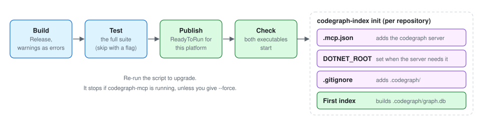

# Installation

*Author: Alan Seunarayan*

[Home](README.md) · **Installation** · [Usage](usage.md) · [Use cases](use-cases.md) · [How it works](how-it-works.md) · [Language versions](language-versions.md) · [Performance](performance.md) · [Architecture](architecture.md) · [Why it saves tokens](why-it-saves-tokens.md) · [The story](story.md) · [What is missing](roadmap.md) · [Contributing](contributing.md)

---

## Contents

- [Before you start](#before-you-start)
- [Install CodeGraph](#install-codegraph)
- [Install the language tools](#install-the-language-tools)
- [Set up more repositories](#set-up-more-repositories)
- [Connect the client](#connect-the-client)
- [Use another assistant](#use-another-assistant)
- [Tested with](#tested-with)
- [Make sure that it works](#make-sure-that-it-works)
- [Install as a Claude Code plugin](#install-as-a-claude-code-plugin)
- [Install the VS Code extension](#install-the-vs-code-extension)
- [Install by hand](#install-by-hand)
- [Upgrade](#upgrade)
- [Build from source](#build-from-source)
- [Remove CodeGraph](#remove-codegraph)
- [Troubleshooting](#troubleshooting)

## Before you start

CodeGraph is a prebuilt program.
You do not have to build it, and you do not have to install .NET to run it.
The release archive holds its own runtime.

You must have these items for the languages that you index:

| Item | Version | Necessary for |
|---|---|---|
| git | any | All languages. The indexer finds the worktree root with git. |
| .NET SDK | the one that your projects build with, 10 or older | C#. MSBuild loads the projects, so the SDK must be there, as for `dotnet build`. The indexer runs on .NET 10 and cannot load a newer SDK: with only the .NET 11 SDK installed, it stops and says to install the .NET 10 SDK beside it. |
| Node.js | 22.22.3 or later, or 24.15 or later | TypeScript, JavaScript and Angular. These are the versions that the extractor's packages declare. The corpus also indexed in full on Node 20 ([BENCHMARKS.md](../BENCHMARKS.md) round 10). |
| A language indexer | see below | Java, Kotlin, Scala, Go, Rust and Python. |

The repositories that you index can be on older versions.
A project on .NET 8, a `tsconfig` from the TypeScript 2 era, or a `go.mod` that says `go 1.18` indexes in full.
[Language versions](language-versions.md) gives the versions that each route reads.

Releases exist for Linux and macOS on x64 and arm64, and for Windows on x64 and arm64.
For Alpine Linux (musl), [build from source](#build-from-source).

## Install CodeGraph



### On macOS or Linux

1. Open a terminal.
2. Run the install command with the path of your repository:

   ```bash
   curl -fsSL https://raw.githubusercontent.com/nerdcules/CodeGraph/main/codegraph/install.sh | bash -s -- ~/dev/App --add-to-path
   ```

3. Open a new terminal, so that the new PATH is active.

The script installs the executables in `~/.codegraph/bin`.

### On Windows

1. Open PowerShell.
2. Run the install command with the path of your repository:

   ```powershell
   & ([scriptblock]::Create((irm https://raw.githubusercontent.com/nerdcules/CodeGraph/main/codegraph/install.ps1))) C:\dev\App -AddToPath
   ```

3. Open a new PowerShell window, so that the new PATH is active.

The script installs the executables in `C:\tools\codegraph`.
PowerShell 7 can also run `install.ps1` on macOS and Linux.

### What the script does

1. It finds your platform and downloads the archive for it from the [latest release](https://github.com/nerdcules/CodeGraph/releases/latest).
2. It checks the SHA-256 checksum of the archive against `SHA256SUMS` from the same release.
3. It unpacks the archive into the install folder.
4. It makes sure that both executables start.
5. It runs `codegraph-index init` on each repository that you give.

### Script options

| bash | PowerShell | Function |
|---|---|---|
| `<repo>...` | `<repo>, ...` | Set up these repositories. With no repository, the script asks for one. |
| `--version vX.Y.Z` | `-Version vX.Y.Z` | Install this release. The default is the latest release. |
| `--install-dir DIR` | `-InstallDir DIR` | Install in a different folder. |
| `--add-to-path` | `-AddToPath` | Add the install folder to the user PATH. |
| `--live` | `-Live` | Let the server start the live daemon itself. |
| `--client NAMES` | `-Client NAMES` | Set up the repositories for these assistants. See [Use another assistant](#use-another-assistant). |
| `--from-source` | `-FromSource` | Build a checkout instead of downloading. See [Build from source](#build-from-source). |
| `--force` | `-Force` | Stop running `codegraph-mcp` and `codegraph-index` processes before the copy. |

## Install the language tools

Install only the tools for the languages that you use.
C# needs only the .NET SDK that the projects build with.
The TypeScript extractor comes in the archive; it needs Node.js on PATH.

| Language | Indexer | Install command |
|---|---|---|
| Java, Kotlin, Scala | scip-java | `cs install --contrib scip-java` (coursier) |
| Go | scip-go | `go install github.com/scip-code/scip-go/cmd/scip-go@latest` |
| Rust | rust-analyzer | `rustup component add rust-analyzer` |
| Python | scip-python | `npm install -g @sourcegraph/scip-python` |

The indexer finds a tool on PATH.
It also looks in the folders that coursier, `go install` and cargo use.
Thus you do not have to add these folders to PATH.

> **NOTE:** Java also needs a JDK and Maven or Gradle.
> scip-java runs the build of the project to read the code.

The live tools for a language also need a language server.
Install it if you want the live tools:

| Language | Language server |
|---|---|
| Java | jdtls |
| Go | gopls |
| Python | pyright |
| Rust | rust-analyzer (the same tool) |
| TypeScript, JavaScript | typescript-language-server (in the archive) |

## Set up more repositories

You can set up a repository at any time after the installation.

1. Go to the repository:

   ```bash
   cd ~/dev/Other
   ```

2. Run `init`:

   ```bash
   codegraph-index init
   ```

`init` finds the project from the current folder.
It looks for a `.slnx` or `.sln` file first.
It then looks for `angular.json`, `tsconfig.json` or a build file such as `pom.xml`, `go.mod`, `Cargo.toml` or `pyproject.toml`.
If it finds two candidates, it stops and shows both.
Then give the one that you want:

```bash
codegraph-index init App.slnx
```

`init` does these steps:

1. It runs `codegraph-mcp --version` without `DOTNET_ROOT`, as a client starts it, to make sure that the server starts. If the server needs `DOTNET_ROOT`, the entry sets it.
2. It adds the `codegraph` server to `.mcp.json` at the worktree root, or to the configuration of each assistant that you give with `--client`. It keeps the other servers.
3. It adds `.codegraph/` to `.gitignore`.
4. It builds the first graph.

In a repository with a C# solution and an Angular folder, `init` indexes both into one graph.

| Option | Function |
|---|---|
| `--client NAMES` | Write the configuration for these assistants. Separate the names with commas. The default is `claude`. See [Use another assistant](#use-another-assistant). |
| `--live` | Add `CODEGRAPH_DAEMON=auto`. The server then starts the live daemon on its first tool call. |
| `--no-index` | Write the configuration only. Do not build the graph. |
| `--db PATH` | Keep the graph at a different path. |

## Connect the client

`init` writes the configuration for you.
To write it yourself, put this `.mcp.json` file at the root of the repository:

```json
{
  "mcpServers": {
    "codegraph": {
      "command": "/home/you/.codegraph/bin/codegraph-mcp"
    }
  }
}
```

Do not put the path of the graph in the entry.
The server finds `.codegraph/graph.db` from its working folder.
Thus one `.mcp.json` file serves all the worktrees of a repository.

## Use another assistant

The server is a standard MCP server over stdio.
Any assistant that can start an MCP server can use it.
`init` writes the configuration for the assistants in the tables below.
Give their names with `--client`, separated by commas:

```bash
codegraph-index init --client copilot
codegraph-index init --client cursor,roo,continue
codegraph-index init --client all
```

The install scripts take the same names: `--client` in bash, `-Client` in PowerShell.

### GitHub Copilot

`--client copilot` sets up every Copilot that reads a project's servers.
You can also give one at a time.

| Copilot in | `--client` | `init` writes | Tested |
|---|---|---|---|
| The Copilot CLI | `copilot-cli`, the same as `claude` | `.mcp.json` | Tool calls, Copilot CLI 1.0.112 |
| VS Code, agent mode | `vscode` | `.vscode/mcp.json` | Tool calls, VS Code 1.146 |
| Visual Studio 2022 17.14 or later, and 2026 | `visualstudio` | `.vs/mcp.json` beside the solution | Not tested yet |
| JetBrains IDEs, plugin 1.19.2 or later | `jetbrains` | `.github/mcp.json` | Not tested yet |

- **The Copilot CLI** reads `.mcp.json` only in a trusted folder.
  In an untrusted folder it ignores the file without a warning.
  Trust the folder when Copilot asks, or add it to `trustedFolders` in `~/.copilot/config.json`.
  For one run without a person, give `--trust-folder`; it trusts the folder for that session only.
- **VS Code** replaces `${workspaceFolder}` in the entry with the open folder.
  It asks you to trust the workspace, not each server.
  Copilot does not load the 35 tools at the start. It finds them when it needs them, as `codegraph-<tool>`.
  Extensions that use the MCP servers of VS Code itself get the server from the same file.
- **Visual Studio** does not document the folder in which it starts a server, or which variables it replaces.
  Thus the entry gives the absolute path of the repository.
  `.vs/` belongs to you and is not committed, so the absolute path does no harm.
- **JetBrains IDEs** start the server in the folder of the IDE and replace no variables.
  Thus the entry gives the absolute path of the repository.
  If you commit `.github/mcp.json`, each developer must run `init --client jetbrains` again.
- **Eclipse and Xcode** have no project file. Add the server in the MCP settings of Copilot,
  with the absolute path of the repository: `"args": ["--root", "/home/you/dev/App"]`.
- **The Copilot coding agent on GitHub** runs in GitHub Actions, not on your computer.
  It cannot use a local graph.

### Other assistants and AI extensions

| Assistant | `--client` | `init` writes | Tested |
|---|---|---|---|
| Claude Code, CLI and IDE extensions | `claude`, the default | `.mcp.json` | Tool calls |
| Codex, CLI and IDE extension | `codex` | `~/.codex/config.toml`, with `codex mcp add` | Tool calls, Codex CLI 0.169.0 and the VS Code extension 26.1111 |
| Cursor | `cursor` | `.cursor/mcp.json` | Tool calls, Cursor 3.29 and Cursor CLI 2026.11.13 |
| Gemini CLI, and Gemini Code Assist agent mode | `gemini` | `.gemini/settings.json` | Not tested yet |
| Roo Code | `roo` | `.roo/mcp.json` | Not tested yet |
| Kilo Code | `kilo` | `.kilo/kilo.json` | Not tested yet |
| Continue | `continue` | `.continue/mcpServers/codegraph.json` | Not tested yet |

- **Codex** keeps its servers in one global file, not in the repository.
  `init` adds one entry, and that entry serves all your repositories:
  the server finds the graph from the folder that Codex runs in.
  The CLI runs in the current folder, and the VS Code extension runs in the open workspace.
  Codex does not ask before it calls the tools, because they are read-only.
  If the `codex` command is not on PATH, `init` shows the entry for you to paste.
- **Cursor.** The entry gives `--root ${workspaceFolder}` to the server.
  The IDE replaces `${workspaceFolder}` with the open folder.
  The Cursor CLI does not replace it, but it starts the server in the project, and the server then ignores the value.
  The IDE shows the server as Disabled until you turn it on in Settings, Tools & MCPs, once for each project.
  After that, the IDE calls the tools without a question.
  The CLI loads the server only after `cursor-agent mcp enable codegraph`. The two approvals are separate.
  In a run without a person (`cursor-agent -p`), the CLI refuses each MCP call unless a rule allows it.
  To allow only the codegraph tools, put this in `.cursor/cli.json`:
  `{"permissions": {"allow": ["Mcp(codegraph:*)"], "deny": []}}`
- **Roo Code, Kilo Code and Continue** start the server in the first folder of the workspace.
  Thus their entries need no root.
  Continue uses MCP servers only in agent mode.
- **Kilo Code** uses the format of opencode 1.x: `"type": "local"`, the command and its arguments in one array, and `environment`.
  If `.kilo/kilo.json` has comments, `init` removes them when it writes the file.
- **Cline and Windsurf** keep their servers only in a global file.
  Add the server there, with the absolute path of the repository: `"args": ["--root", "/home/you/dev/App"]`.
  That entry serves only that one repository.
- **Other assistants.** Give the same `command` as in `.mcp.json`, with no arguments.
  If the assistant does not start the server in the project folder, give `--root <project folder>` as arguments,
  or set `CODEGRAPH_ROOT`.

The VS Code file has a different form:

```json
{
  "servers": {
    "codegraph": {
      "type": "stdio",
      "command": "/home/you/.codegraph/bin/codegraph-mcp",
      "args": ["--root", "${workspaceFolder}"]
    }
  }
}
```

The Codex entry is TOML:

```toml
[mcp_servers.codegraph]
command = "/home/you/.codegraph/bin/codegraph-mcp"
```

To make the assistant use the graph first, see [Usage](usage.md#ask-questions-in-your-assistant).

## Tested with

These assistants answered from the graph with real tool calls on 14 November 2026.
Each one ran on a clone of this repository (3,119 nodes), with the configuration that `codegraph-index init --client` writes.
Each one got the question "What breaks if I change `GraphStore.Replace`, and which tests cover it?".
In every session, the `impact_of` call returned 12 dependents and 37 guarding tests, and the answer reported the 37 tests.
[Client tests](client-tests/README.md) has a page for each one, with its configuration, the tool calls and the answer.

| Assistant | Version | How it was checked |
|---|---|---|
| Claude Code | CLI 2.1.325 | `claude -p` |
| GitHub Copilot in VS Code, agent mode | VS Code 1.146.0, agent host 1.0.108 | A chat in agent mode |
| GitHub Copilot CLI | 1.0.112 | `copilot -p --trust-folder --allow-tool codegraph` |
| Codex VS Code extension | 26.1111.21308 | A chat in the extension |
| Codex CLI | 0.169.0 | `codex exec` |
| Cursor IDE | 3.29.15 | A chat in agent mode |
| Cursor CLI | 2026.11.13 | `cursor-agent -p --trust` |

The Claude Code VS Code extension (2.1.323) also answered from the graph, on 13 November 2026, on an older graph of this repository.

`init` also writes the configuration for Copilot in Visual Studio and JetBrains IDEs, the Gemini CLI, Roo Code, Kilo Code and Continue.
Those files follow the documentation and source code of each product, but they are not tested yet.

## Make sure that it works

1. Start your assistant in the repository.
2. Approve the `codegraph` server when the assistant asks.
3. Make sure that `codegraph` shows as connected.
   In Claude Code, type `/mcp`. In Codex, type `/mcp`. In the Cursor CLI, run `cursor-agent mcp list`.
4. Ask the assistant: "Use codegraph graph_stats."
5. Make sure that the answer shows a node count and an edge count.

If the answer says "no code graph", build the graph:

```bash
codegraph-index init
```

## Install as a Claude Code plugin

On macOS and Linux, the plugin installs CodeGraph for you.
It adds the server to every session, and a skill that tells Claude when to use the tools.

1. In Claude Code, add the marketplace and install the plugin:

   ```
   /plugin marketplace add nerdcules/CodeGraph
   /plugin install codegraph@codegraph
   ```

2. Open a repository and ask a question. On the first call, the plugin downloads the release into `~/.codegraph/bin`.
3. When a tool answers "no code graph", let Claude run `codegraph-index init`, or run it yourself.

On Windows, install with `install.ps1` first, and let `codegraph-index init` write the `.mcp.json` of the repository.
That entry starts the server.
The launcher of the plugin is a shell script, and it looks only in `~/.codegraph/bin` (or `CODEGRAPH_HOME`).
`install.ps1` installs in `C:\tools\codegraph`.
The skill of the plugin still helps.
[plugin/README.md](../plugin/README.md) gives the details.

## Install the VS Code extension

The VS Code extension installs CodeGraph for you, sets repositories up, and runs the live daemon.
Releases after 1.2.0 carry it as `codegraph-vscode.vsix`.

1. Download the extension and install it:

   ```bash
   curl -fsSLO https://github.com/nerdcules/CodeGraph/releases/latest/download/codegraph-vscode.vsix
   code --install-extension codegraph-vscode.vsix
   ```

2. Open a repository and choose the CodeGraph icon in the activity bar.
3. Choose **Install CodeGraph** if CodeGraph is not installed, then **Set up repository…**.

[vscode-extension/README.md](../vscode-extension/README.md) gives the details.

## Install by hand

1. Download the archive for your platform from the [latest release](https://github.com/nerdcules/CodeGraph/releases/latest).
2. Compare its checksum with the line in `SHA256SUMS`.
3. Unpack it into a folder, for example `~/.codegraph/bin`.
4. On macOS, if you downloaded with a browser, clear the quarantine flag:

   ```bash
   xattr -dr com.apple.quarantine ~/.codegraph/bin
   ```

5. Run `codegraph-index init` in a repository.

## Upgrade

1. Close the assistant sessions that use CodeGraph.
2. Run the install command again.

> **CAUTION:** A running `codegraph-mcp` holds its files open.
> The script stops if the server runs.
> Close the sessions, or give `--force` to stop the server.

The plugin updates with `/plugin update codegraph@codegraph`.

## Build from source

You need the .NET 10 SDK, git, and a clone of the repository.
Node.js adds the TypeScript extractor.

```bash
cd codegraph
./install.sh --from-source ~/dev/App --add-to-path
```

```powershell
cd codegraph
.\install.ps1 -FromSource C:\dev\App -AddToPath
```

The script builds with warnings as errors, runs the tests, and publishes the executables for your platform.
[Contributing](contributing.md) tells how to run from a checkout without publishing.

## Remove CodeGraph

1. Close the assistant sessions that use CodeGraph.
2. Run the uninstall script:

   ```bash
   curl -fsSL https://raw.githubusercontent.com/nerdcules/CodeGraph/main/codegraph/uninstall.sh | bash -s -- --repo ~/dev/App
   ```

   ```powershell
   & ([scriptblock]::Create((irm https://raw.githubusercontent.com/nerdcules/CodeGraph/main/codegraph/uninstall.ps1))) -Repo C:\dev\App
   ```

The script removes the install folder and the PATH entry.
For each repository that you give, it removes the `codegraph` entry from `.mcp.json` and from the files of the other assistants that `init` sets up.
If Codex has a `codegraph` entry, it removes that entry too.
It also removes the `.codegraph/` folder of that repository.
It asks before each removal.
Give `--yes` or `-Yes` to remove without questions.

## Troubleshooting

| Problem | Cause | Remedy |
|---|---|---|
| The tools say "no code graph at ...". | The repository has no graph yet. | Run `codegraph-index init` in the repository. |
| The indexer says "scip-java is not on PATH". | The language indexer is not installed. | Install the indexer from the table in [Install the language tools](#install-the-language-tools). |
| The indexer reports hundreds of errors on a C# project. | The SDK that the project builds with is not installed, or the project is not restored. | Install that SDK, run `dotnet restore`, and index again. `index_status` shows the first error. |
| The indexer says "its NuGet packages were not restored". | The repository was never restored, for example a fresh clone, so every call into a package is missing from the graph. | Run `dotnet restore` (or build once), then index again with `--full`. |
| The indexer says it "cannot load the solution: it runs on .NET 10 and needs a .NET SDK no newer than 10". | Only a newer SDK, such as .NET 11, is installed. | Install the .NET 10 SDK beside it. A build from source can also run with `DOTNET_ROLL_FORWARD=LatestMajor`. |
| The install script stops with "codegraph is running from ...". | `codegraph-mcp` or `codegraph-index` runs from the install folder. | Close the sessions, or give `--force`. |
| macOS says the program is damaged or cannot be opened. | The archive came from a browser and is quarantined. | Run `xattr -dr com.apple.quarantine` on the install folder, or install with the script. |
| The server does not start in the client after a source build. | The client cannot find .NET. | Run `codegraph-index init` again. It adds `DOTNET_ROOT` when necessary. A release build does not need .NET. |
| An IDE says "no code graph at /.codegraph/graph.db" or a path in your home folder. | The IDE starts the server outside the project, and the entry has no `--root`. | Run `codegraph-index init --client` with the name of that IDE again. For Cline or Windsurf, add `--root` by hand. |
| A tool says the graph file is damaged. | The file was cut short or overwritten, for example by a full disk. | Run `codegraph-index` on the solution again. It rebuilds the graph from the source. |
| Answers show `STALE`. | Files changed after the last index. | Run the indexer again, or start the live daemon. See [Usage](usage.md#keep-the-graph-current). |

---

← Previous: [Home](README.md) · Next: [Usage](usage.md) →
