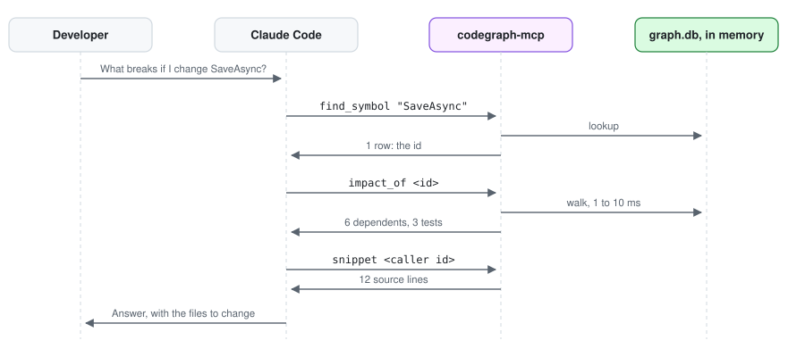
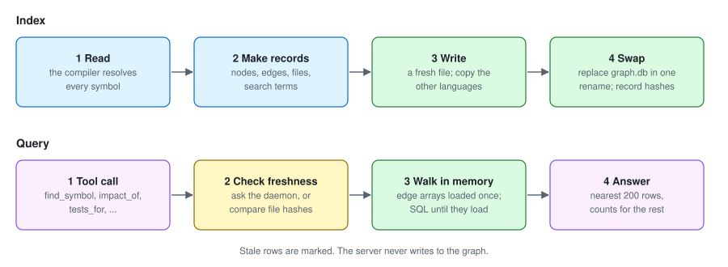

# Measured results

*Author: Alan Seunarayan*

[Home](README.md) · [Installation](installation.md) · [Usage](usage.md) · [Use cases](use-cases.md) · [How it works](how-it-works.md) · [Language versions](language-versions.md) · [Performance](performance.md) · [Architecture](architecture.md) · **Measured results** · [The story](story.md) · [What is missing](roadmap.md) · [Contributing](contributing.md)

---

An AI coding assistant pays for everything it reads. Without a graph, it answers "what breaks if
I change this method?" the way a person would with only a terminal: search for the name, open
the files that match, read them to tell real calls from look-alikes, then repeat for each
caller's callers and look for the tests. Every search result and every file it opens enters the
context window as input tokens, and stays there, taking room from the rest of the session.
Text search makes it worse, because a name matches more than the method: `.Replace(` also
matches every `string.Replace`. And the model can still miss a caller that goes through an
interface, a base class or a property, because nothing in the text says so.

CodeGraph moves that work to index time. The compiler resolves every call, override and test
once, and that costs no tokens. After that, each question is one tool call that returns only the
rows that answer it, with the file and line of each, so the model opens only the code it is
going to change.

Measured on this repository at release 1.1.0's code (`72822e6`, [BENCHMARKS round 12](../BENCHMARKS.md#round-12-the-docs-re-measured)),
for "what breaks if I change `GraphStore.Replace`?":

| How the assistant finds out | What enters its context | Size, at about 4 characters a token |
|---|---|---|
| CodeGraph: `find_symbol`, `impact_of`, `snippet` | The method, its 12 dependents, the 37 tests that guard them, and the method's own source | 21,910 characters, about 5,500 tokens |
| Opening the files the answers name, if the model somehow knew which they were | 15 files | 258,628 characters, about 65,000 tokens |
| Opening every file that matches `.Replace(` | 25 files, and the dependents' own callers are still to find | 491,682 characters, about 123,000 tokens |

So the answers are between a twelfth and a twenty-second of the size of the files that hold the same
facts, and they include the transitive dependents and tests that a text search would still have to chase.
A real session does not read all those files, though. The next section shows what one did.

## In a real session

Claude Code (Opus 5.5, effort high, `claude -p`) got the question "what breaks if I change
`GraphStore.Replace`, and which tests cover it?" twice on 14 November 2026: once with the codegraph server, and
once with no MCP server. The numbers come from the two session logs.

| | With CodeGraph | Without |
|---|---|---|
| Time to answer, wall clock | 42 seconds | 87 seconds |
| Model calls | 4 | 9 |
| Tool calls | 4 codegraph calls, and one tool search | 8 shell commands (`grep`, `sed`, `awk`) |
| Input tokens processed, cache reads included | 180,134 | 459,907 |
| Growth of the context during the session | 18,460 tokens | 21,579 tokens |
| Answer | "37 tests guard it", with each caller by name | "about 40 tests that call it directly" |

The context grew by about the same amount: without the graph, the model searched with `grep` and read
parts of files, not whole files. The difference is in the number of model calls. Each call reads the whole
context again, so nine calls process two and a half times the tokens of four.

Neither count is the whole truth. A run-time check ran each test of release 1.1.0, the code these sessions ran
on, by itself, and recorded every call of `GraphStore.Replace`: 44 of the 300 tests execute it. All 37 that the
graph named are among them. The graph missed 5 tests whose class constructor calls `Replace`, and 2 tests that
run the indexer as a separate process, which no static analysis can follow. CodeGraph now counts what a test
framework runs around each test, such as the class constructor, so on the snapshot the eval below ran on, the
graph names 42 of the 44. Two tests added to `BulkWriteTests` since then also reach `Replace` in the graph; the
run-time check has not been repeated on them.

## Four assistants, with and without

One session each way shows a direction, not a result. So four assistants got the same question three times with
CodeGraph and three times without, on a copy of this repository with all its documentation removed. A run-time
check gives the true answer: 44 tests execute `GraphStore.Replace`. The graph names 42 of them. The other 2 start
the indexer as a separate process. [The method, the answer key and every run](../tools/eval/README.md) are in the
repository.

| Assistant, model | | Gave a total of tests | Time, median (range) | Usage, median (range) |
|---|---|---|---|---|
| Claude Code, Opus 5.5 | with | 3 of 3, each 42 | 37 s (33–37) | 226,000 tokens (172,000–228,000), $0.31 ($0.29–0.43) |
| | without | 0 of 3 | 54 s (53–65) | 380,000 tokens (254,000–420,000), $0.41 ($0.37–0.49) |
| Codex CLI, GPT-6.1 Sol | with | 2 of 3, each 42 | 43 s (41–45) | 228,000 tokens (223,000–272,000) |
| | without | 0 of 3 | 42 s (36–44) | 171,000 tokens (160,000–208,000) |
| Copilot CLI, Claude Sonnet 5.5 | with | 1 of 3, 42 | 20 s (17–21) | 10.4 AI units (8.7–10.5) |
| | without | 0 of 3 | 14 s (14–20) | 6.4 AI units (6.0–8.7) |
| Cursor CLI, Composer 2.5 | with | 1 of 3, 42 | 30 s (17–41) | 167,000 tokens (64,000–337,000) |
| | without | 0 of 3 | 26 s (25–53) | 504,000 tokens (205,000–515,000) |

Tokens are input tokens with cache reads, as each CLI reports them, so compare them within one assistant only.

What the runs show:

- **A test total comes from the graph.** With CodeGraph, 7 of the 12 answers said how many tests exercise the
  method, and each said 42, the graph's count. Without it, no answer gave a test total. The nearest were "about 45
  test call sites", "11 test files" and "about 25 test calls".
- **The callers were found either way.** All 24 answers named both production callers.
- **Naming tests one by one was not better with the graph.** The answers without it often listed more test
  methods by name, because the model read the test files. With it, the answers grouped the tests by class and
  gave the count. One assistant, Cursor, named a few tests that do not run `Replace`, in both conditions.
- **Time and cost depend on the assistant.** Claude Code was faster and cheaper with CodeGraph in each of the three rounds. Codex
  took as long and used more tokens. The Copilot CLI took longer and used more AI units. Cursor's runs varied too
  much to call; in one of its runs with CodeGraph, the 7 calls that take a node id all failed on a wrong argument
  name, which the server now accepts.

These are three runs of one question on one repository. Read them as a direction.

## Four public repositories

On 19 November 2026, Claude Code (Opus 5.5, effort high) got the same kind of question on four public repositories,
three times each way, through [`codegraph-index compare`](usage.md#measure-it-with-and-without): Cobra (Go), HTTPX
(Python), Hono (TypeScript) and Jellyfin (C#). A probe in a copy of each repository recorded which tests execute the
method. [The method, the keys and every session](../tools/eval/README.md#four-public-repositories-19-november-2026)
are in the repository.

| Repository | Wall s, with / without | Model calls | Input tokens | Cost USD | Tests that run it | Graph lists |
|---|---|---|---|---|---|---|
| Cobra | 40.5 / 60.5 | 7 / 9 | 192,608 / 158,018 | 0.3280 / 0.3124 | 208 | 226 |
| HTTPX | 40.4 / 52.3 | 6 / 10 | 175,886 / 156,151 | 0.3372 / 0.2538 | 46 | 225 |
| Hono | 35.0 / 52.4 | 5 / 8 | 218,574 / 130,045 | 0.5592 / 0.2348 | 133 | 124 |
| Jellyfin | 34.6 / 40.1 | 6 / 7 | 218,172 / 155,706 | 0.3852 / 0.2810 | 2 | 17 |

Medians of three sessions; wall time for Cobra and HTTPX was measured while the answer-key test suites ran on the
same machine.

- **Faster on all four, in fewer model calls.** The median session with the graph answered 5.5 to 20.0 seconds
  sooner (Jellyfin 5.5, HTTPX 11.9, Hono 17.4, Cobra 20.0), and the session with the graph was the faster one in 11
  of the 12 rounds. It made fewer model calls in all 12 rounds, and wrote fewer output tokens on all four
  repositories (medians 2,754 to 4,223 with the graph, 3,843 to 5,929 without).
- **A test total in every answer.** Every one of the 12 answers with the graph said how many tests cover the
  method; no answer without it gave a total on Cobra, HTTPX or Hono. On Cobra the graph's list held all 208 tests
  that run the method, and on Jellyfin both. On Jellyfin, all three answers with the graph went a step further and
  said that 2 of the 17 tests it lists run the method, which is what the run-time check found; the answers without
  the graph named the same 2.
- **What the total counts.** The graph's total (from `covered_by`, or from `impact_of` in three answers) is the
  tests that can reach the method through calls, which is not always the tests that execute it. At depth
  10, `covered_by` listed 18 more tests than run the method on Cobra, 15 more on Jellyfin, 179 more on
  HTTPX (225 against 46), and 9 fewer on Hono. So the total is the set of tests to look at, and running them is
  still the way to know which of them execute the code.
- **What it costs.** The server's tool definitions and instructions make each session start 8,681 tokens larger
  (the median first call), and every model call carries them. The context also grew more with the graph: median
  growth 24,054 to 55,311 tokens with it, 13,434 to 24,286 without. So with fewer model calls, the sessions still
  processed more input tokens, and the median cost was higher on all four repositories; the session with the graph
  cost less in 4 of the 12 rounds. On this repository on 14 November, Claude Code was cheaper with the graph in
  each of three rounds. [`codegraph-index compare`](usage.md#measure-it-with-and-without) measures the trade on
  your own code.

Four questions, three sessions each: a direction, not a general result.

## Code mode lite

Each MCP tool answer enters the context of the client in full.
In the lite modes, the client asks the graph through code and prints only the summary
(see [Three ways to ask](architecture.md#three-ways-to-ask)).
The [lite benchmark](../bench/README.md) measured the three modes on 23 November 2026:
Claude Code with `claude-sonnet-5-5`, the Jellyfin graph, 8 tasks, 5 repetitions, 135 runs, none failed.

Median total tokens of a question (min–max), from [the report](../bench/results/20261123-085549/report.md):

| Question | MCP tools (`direct`) | CLI (`lite-cli`) | C# script (`lite`) |
|---|---|---|---|
| Single lookup (2 tasks) | 15,716 (15,213–16,231) | 11,936 (11,865–12,091), −24% | 31,094 (22,895–31,791), +98% |
| Several steps (4 tasks) | 37,677 (18,704–1,662,363) | 23,263 (12,548–40,675), −38% | 35,371 (26,094–310,423), −6% |
| Analytical (2 tasks) | 81,338 (68,951–146,348) | 32,072 (22,314–40,862), −61% | 38,558 (23,796–56,145), −53% |

- The CLI used fewer tokens than the MCP tools for single lookups and analytical questions, and the ranges do not overlap.
- For questions with several steps, the medians fell, but the ranges overlap. Thus no saving is claimed for them.
- The CLI found the correct answer (F1 1.00) in all 40 scored runs.
  On one task (test methods that are the only callers), the MCP tools scored 0 in 3 of 5 runs.
- Limits: one model, one repository, 5 repetitions.
  [The conclusion](../bench/results/20261123-085549/conclusion.md) gives the details.

The MCP tools stay the default: no other client was measured in the lite modes.
To try the CLI, see [Usage](usage.md#the-codegraph-cli).

## Where the savings come from

Small answers and fewer model calls come from a few design choices:

- **Rows, not files.** An answer row is a full name, a file and a line range, and a node id for
  the next call. The model reads source only with `snippet`, for the members it will touch.
- **Bounded answers.** Walks show the nearest 200 rows and a count of the rest at each depth.
  `impact_of` on the most-used member of a 55,000-node graph used to return about 618,000 tokens;
  it now returns about 4,100 ([performance](performance.md#answer-size)).
- **No wasted turns.** The stale warning stops the model from reasoning from an old graph and
  redoing the work. With the live daemon, `check_change` compiles a proposed edit and lists what
  it breaks, so the model doesn't need a build-and-read-the-errors loop to find out.

`usage_stats` reports, for the current session and all time, the size of each tool's answers and of the files
they name. Those are sizes, not a saving; the session pair above is the measured comparison.
`codegraph-index compare "<question>"` makes that comparison on your own repository: separate new Claude Code
sessions with and without the server, alternating which goes first, with every figure read from the session logs
([Measure it with and without](usage.md#measure-it-with-and-without)).

## Keeping the graph current

- **Incremental.** Each file's hash is stored. A re-run re-walks only changed files and their
  dependents (callers, subclasses, referencers, tests), then merges the result into the graph. A
  re-run that finds nothing changed takes 2.6 to 2.9 seconds on this repository (BENCHMARKS rounds 12
  and 13). `--full` rebuilds from scratch.
- **Watch mode.** `codegraph-index <solution> --watch` pays the solution load once and applies
  each save to the compiled solution in memory, so a one-file edit re-indexes in 0.9 to 1.3 seconds on this repository (BENCHMARKS
  round 12; median 1.4 seconds on a busy machine in round 13). The server notices each swap through the file's mtime.
- **Live daemon.** The same watch process answers over a local pipe. `check_change` compiles a
  proposed file in memory and reports what it would break; `rename_preview` runs Roslyn's rename on
  a fork; `diagnostics` reports compiler errors for the working tree. The graph stays the system of
  record for transitive and aggregate questions.
- **Safe while sessions run.** A full rebuild writes a fresh file and swaps it in with one
  rename; the server only ever reads.

## See what it did for you

Every tool call is one JSON line in `.codegraph/telemetry.jsonl`: the tool, the time it took, the size of
the answer, and the size of the files the answer names. The last is a size, not a cost: the session without
the graph above read parts of files, not whole files. `codegraph-index usage` sums the last seven days into one line, the indexer
prints the same line after each run, and the `usage_stats` tool opens with it and then lists every tool.

---

← Previous: [Architecture](architecture.md) · Next: [The story](story.md) →
