# Obsidian

*Author: Alan Seunarayan*

[Home](README.md) · [Installation](installation.md) · [Usage](usage.md) · **Obsidian** · [Use cases](use-cases.md) · [How it works](how-it-works.md) · [Language versions](language-versions.md) · [Performance](performance.md) · [Architecture](architecture.md)

---

## Contents

- [What the plugin does](#what-the-plugin-does)
- [Before you start](#before-you-start)
- [Install the plugin](#install-the-plugin)
- [Browse the code notes](#browse-the-code-notes)
- [Use the live panel](#use-the-live-panel)
  - [A type](#a-type)
  - [A member](#a-member)
- [Find a symbol](#find-a-symbol)
- [Link your notes to the code](#link-your-notes-to-the-code)
- [Read the reports](#read-the-reports)
- [Use the graph view](#use-the-graph-view)
- [Keep the notes current](#keep-the-notes-current)
- [Query the notes with Dataview](#query-the-notes-with-dataview)
- [Settings](#settings)
- [Export without Obsidian](#export-without-obsidian)
- [Troubleshooting](#troubleshooting)
- [Make the screenshots again](#make-the-screenshots-again)

## What the plugin does

The CodeGraph plugin shows the graph of a repository as notes in an Obsidian vault.
Developers, architects, testers and product people can then read the code like their other notes.

The plugin does these tasks:

- It writes one note for each project and each type into the `_code/` folder of the vault.
- It writes the notes again after each re-index.
- It adds a live panel. The panel shows the callers, the impact and the tests of the open note.
- It finds a type or member by name, and it inserts links to code into your own notes.

The plugin is optional.
CodeGraph does not need Obsidian, and Claude Code uses the MCP server without it.
Use the plugin if people want to read the code without an editor or an AI assistant.

The notes and the live panel do not use an AI model.
Thus a person who reads a note or the panel spends no tokens.
For example, a tester can read the tests of a type in its note.
The tester does not have to ask an assistant, which would read the source files.

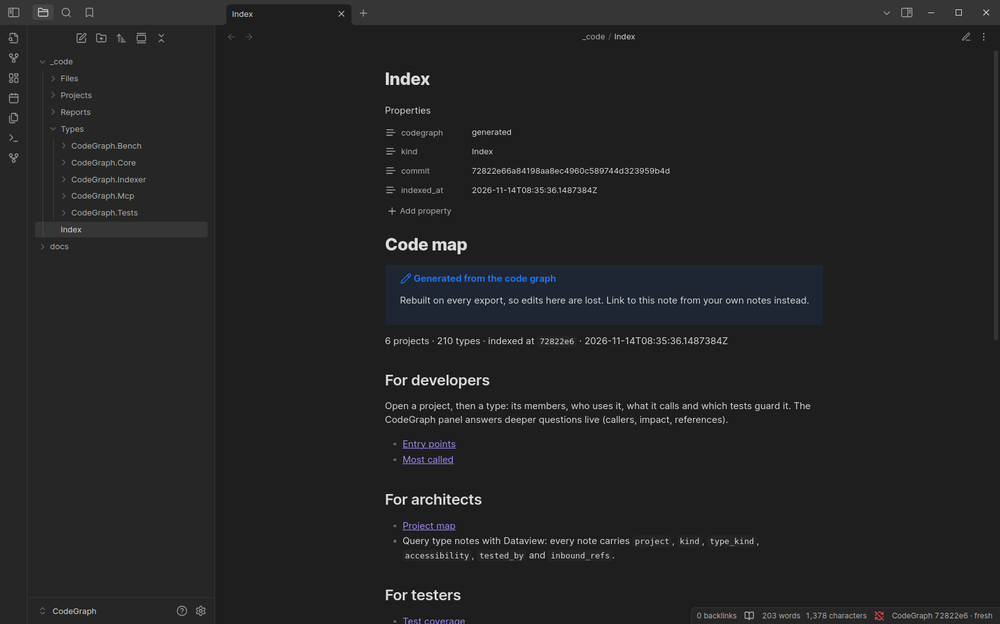

The plugin does not read the code itself.
The indexer writes the notes, and the server answers the live panel:

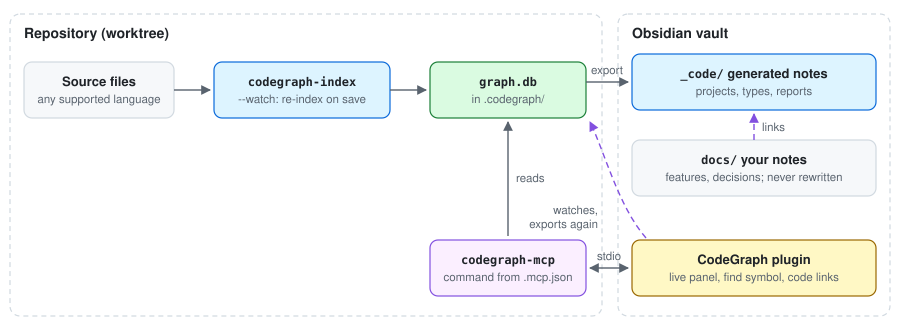

## Before you start

You need these items only for the plugin:

| Item | Version | Necessary for |
|---|---|---|
| Obsidian desktop | 1.5 or later | The plugin. It does not work in Obsidian mobile. |
| CodeGraph | this release | The indexer and the server. See [Installation](installation.md). |
| Node.js | 22.22 or later | Only to install the plugin from a source checkout. |
| A graph | any | `codegraph-index init` in the repository. |

The plugin was tested with Obsidian 1.5.12, 1.8.9 and 1.14.4.

## Install the plugin

NOTE: Use a vault for the code notes only, or a vault that has no `_code/` folder.
The plugin writes into `_code/`.

1. Open Obsidian.
2. Create a vault, for example `~/Notes/MyProject`.
3. Give the vault to the install script.
   It installs the plugin from the release after it installs CodeGraph:

   ```bash
   curl -fsSL https://raw.githubusercontent.com/nerdcules/CodeGraph/main/codegraph/install.sh | bash -s -- ~/src/my-repo --obsidian-vault ~/Notes/MyProject
   ```

   ```powershell
   & ([scriptblock]::Create((irm https://raw.githubusercontent.com/nerdcules/CodeGraph/main/codegraph/install.ps1))) C:\src\my-repo -ObsidianVault C:\Notes\MyProject
   ```

   By hand: download `codegraph-obsidian.zip` from the [latest release](https://github.com/nerdcules/CodeGraph/releases/latest) and unpack it into `<vault>/.obsidian/plugins/codegraph/`.
   From a source checkout: `node obsidian-plugin/install-plugin.mjs ~/Notes/MyProject`.

4. In Obsidian, open **Settings → Community plugins**.
5. If Obsidian shows **Restricted mode**, select **Turn on community plugins**.
6. Turn on **CodeGraph**.
7. Open **Settings → CodeGraph**.
8. Set **Repo folder** to the root of the repository. This is the folder that holds `.codegraph/`.
9. Open the command palette (Ctrl+P, or Cmd+P on macOS).
10. Run **CodeGraph: Rebuild code notes**.
11. Open `_code/Index.md`.
12. Run **CodeGraph: Open live panel**.

NOTE: `codegraph-index init` puts `.codegraph/` at the git root, not in the folder of the solution file.
For a solution in `my-repo/src/App.sln`, the repo folder is `my-repo`.

## Browse the code notes

The export writes these folders:

| Folder | Content |
|---|---|
| `Index.md` | The start page. It has a section for each audience. |
| `Projects/` | One note for each project, with its types and the projects that it uses. |
| `Types/<project>/` | One note for each type. Each member is a heading. |
| `Files/` | Members that are not in a type, for example TypeScript, Python and Go functions. |
| `Reports/` | The project map, test coverage, untested public surface, entry points and the most called members. |

A type note starts with its properties.
Then it gives the members and the types that use it.
It also gives the code that it calls and the tests that call it.
Each name is a link to its note.

## Use the live panel

The live panel shows answers from the graph for the open note.
To open it, run **CodeGraph: Open live panel**.
The panel opens in the right sidebar.
Then it follows each code note that you open.

Each row of an answer has a link to the note of that node.
The button on the right of a row opens the source file at that line in your editor.

### A type

For a type note, the panel has these tabs:

| Tab | Shows |
|---|---|
| References | The code that uses the type. |
| Impact | The code that can break if the type changes. |
| Tests | The tests that reach the type. |
| Members | The members of the type. |

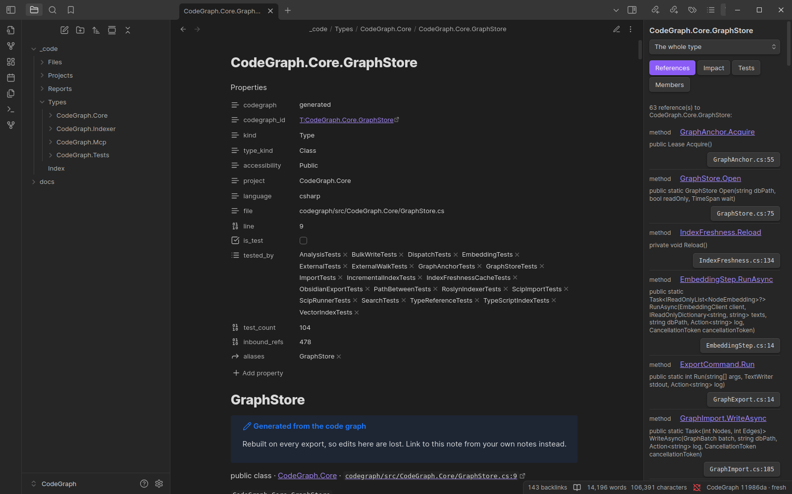

### A member

To see one member, select it in the drop-down list at the top of the panel.
In the editing view, you can also put the cursor below the heading of the member.

For a member, the panel has these tabs:

| Tab | Shows |
|---|---|
| Callers | The methods that call the member. |
| Callees | The methods that the member calls. |
| Impact | The dependents and the tests that guard them. |
| Tests | The tests that reach the member. |

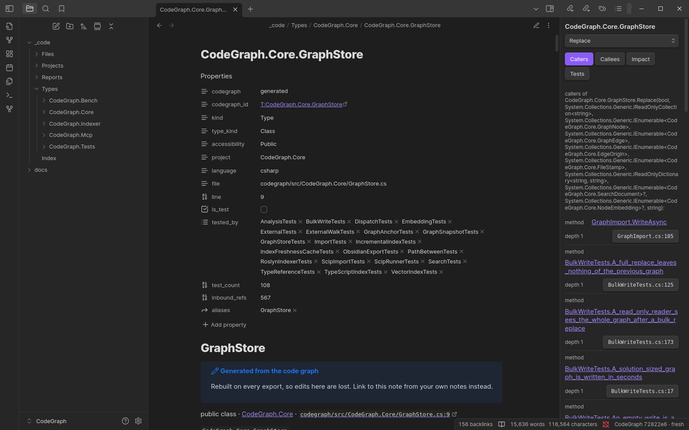

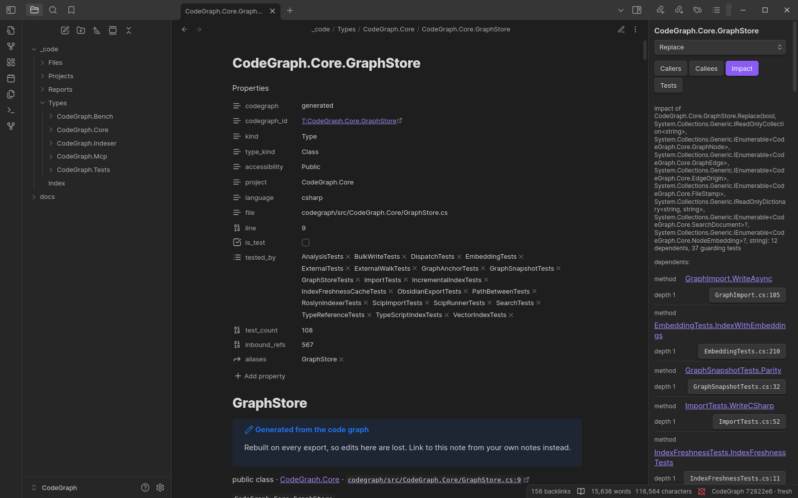

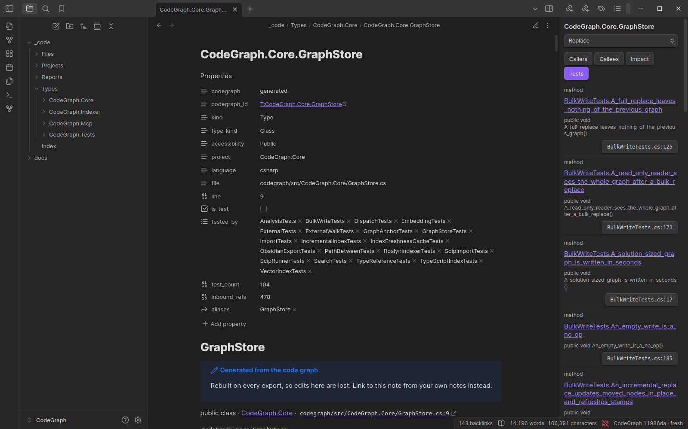

**Call depth** in the settings sets how many steps the Callers and Callees tabs follow.

## Find a symbol

1. Run **CodeGraph: Find symbol**.
2. Type a part of a name.
3. Select a result. Obsidian opens the note of that type or member.

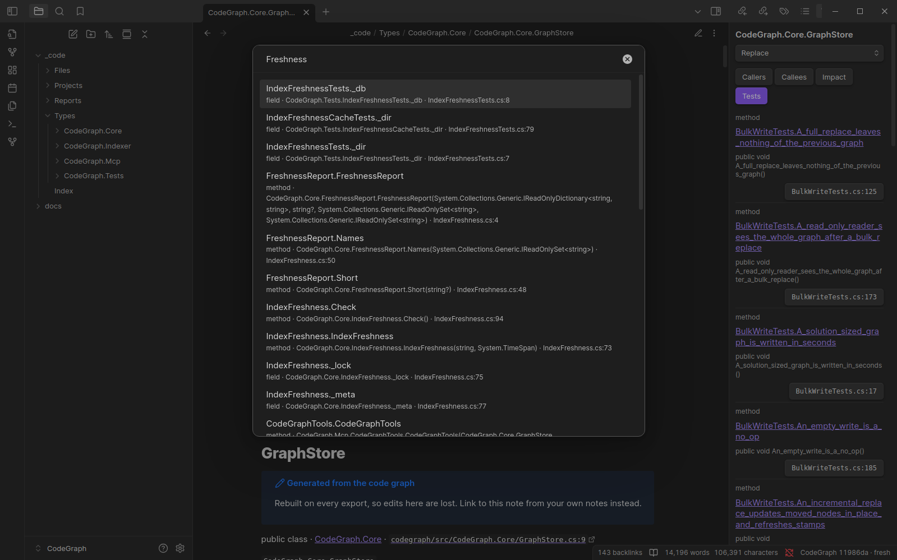

## Link your notes to the code

CAUTION: Do not write your own notes in `_code/`.
The export writes the folder again each time, and it removes your changes.

Keep feature notes, decisions and onboarding pages in a different folder, for example `docs/`.
To link one of them to the code:

1. Open your note and put the cursor where the link must go.
2. Run **CodeGraph: Insert code link**.
3. Type a part of the name and select a result.

The plugin inserts a link such as `[[_code/Types/App/App.Store#Save|Store.Save]]`.
The type note then shows your note in its backlinks.
Your links stay correct after each export.

## Read the reports

The `Reports/` folder has five notes:

| Report | Shows |
|---|---|
| Project map | A Mermaid diagram of the project references. |
| Test coverage | Each type with the tests that call it directly. |
| Untested public surface | Public types and members that no test calls directly. |
| Entry points | The members that the framework or the runtime calls. |
| Most called | The members with the most callers. |

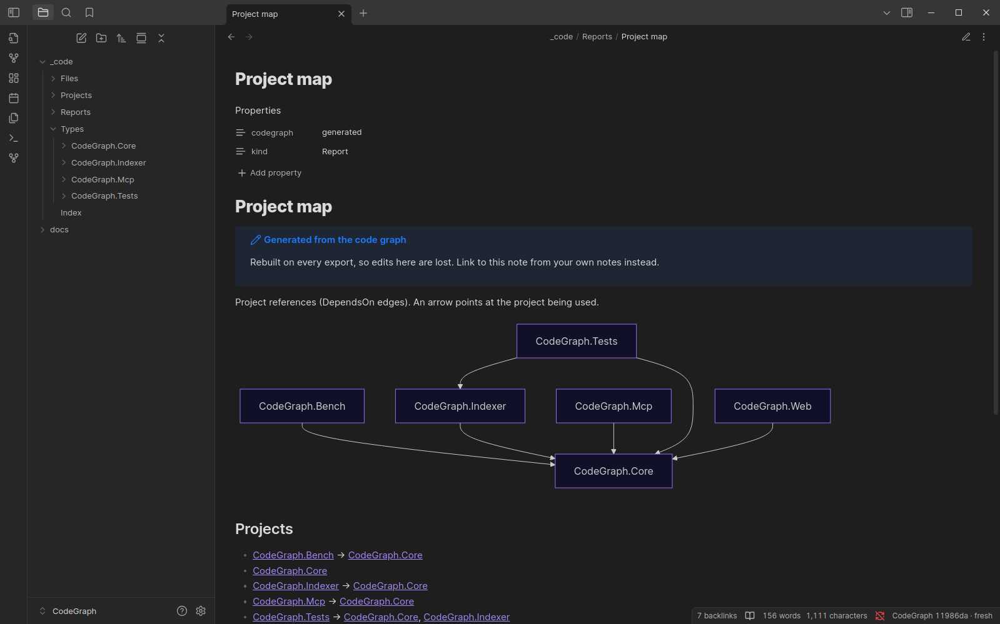

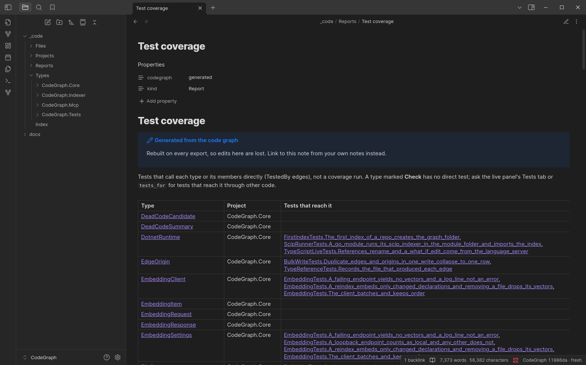

NOTE: Test coverage counts direct calls from tests (`TestedBy` edges).
It is not a coverage run.
For tests that reach a type through other code, use the Tests tab of the live panel.

## Use the graph view

The code notes link to each other, so the Obsidian graph view shows the structure of the code.
Open it with **Open graph view** in the ribbon.

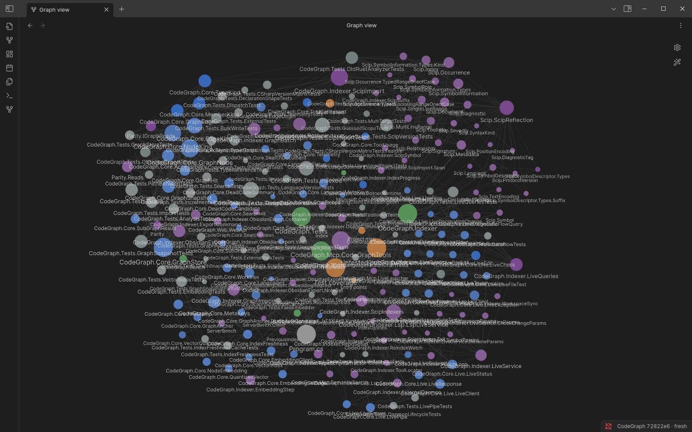

To give each project a colour, open the graph settings and add one group for each project.
Use a query such as `path:_code/Types/CodeGraph.Core`.

## Keep the notes current

The plugin watches `.codegraph/` in the repo folder.
When the graph changes, it writes the notes again after approximately two seconds.
It writes only the notes whose text changed.

To keep the graph current while you edit, run the indexer in watch mode:

```bash
codegraph-index ~/src/my-repo/App.sln --watch
```

To index and export in one step, run **CodeGraph: Re-index repo and rebuild code notes**.

The status bar shows the commit of the graph and its state, for example `CodeGraph 11986da · fresh`.
If a source file is newer than the graph, the panel shows **Index is out of date**.
Select **Re-index** to index the repository again.

## Query the notes with Dataview

Each type note has these properties in its frontmatter:

| Property | Content |
|---|---|
| `codegraph_id` | The id of the node in the graph. |
| `kind`, `type_kind`, `accessibility` | For example `Type`, `Class`, `Public`. |
| `project`, `language` | The project and the language of the type. |
| `file`, `line` | The source location. |
| `is_test`, `tested_by`, `test_count` | The test types that call the type, and their number. |
| `inbound_refs` | The number of members outside the type that use it. |

With the [Dataview](https://github.com/blacksmithgu/obsidian-dataview) plugin, you can query them as a table.
This query lists the most used public types that no test calls directly:

````markdown
```dataview
TABLE project, inbound_refs
FROM "_code/Types"
WHERE kind = "Type" AND accessibility = "Public" AND test_count = 0 AND !is_test
SORT inbound_refs DESC
LIMIT 20
```
````

## Settings

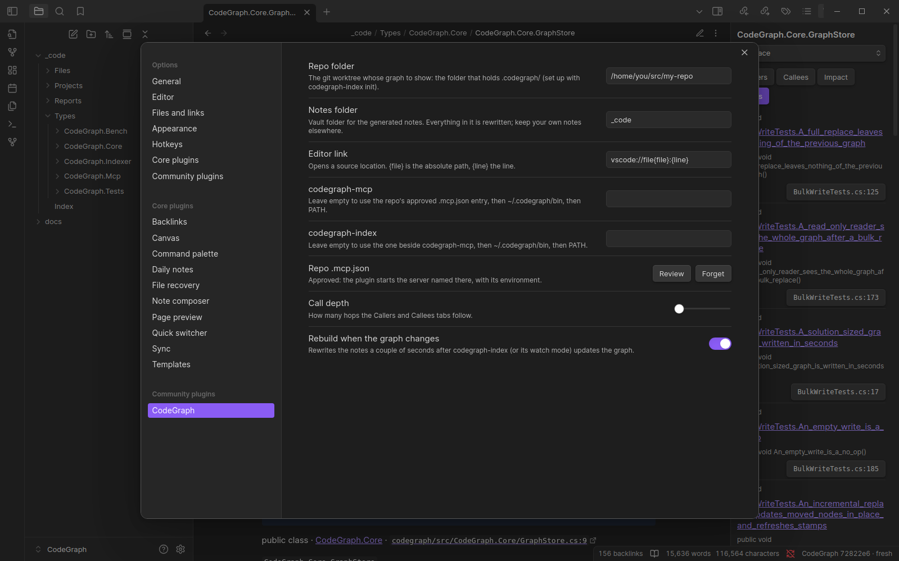

| Setting | Default | Function |
|---|---|---|
| Repo folder | (empty) | The worktree that holds `.codegraph/graph.db`. |
| Notes folder | `_code` | The vault folder for the generated notes. |
| Editor link | `vscode://file{file}:{line}` | The link that opens a source line. `{file}` is the absolute path, `{line}` the line. |
| codegraph-mcp | (empty) | Empty uses the approved `.mcp.json` entry of the repository, then `~/.codegraph/bin`, then PATH. |
| codegraph-index | (empty) | Empty uses the one next to codegraph-mcp, then the install folder, then PATH. |
| Call depth | 1 | The steps that the Callers and Callees tabs follow. |
| Rebuild when the graph changes | on | Export again after each re-index. |
| Repo .mcp.json | (not decided) | Whether the plugin may start the server that the repository's `.mcp.json` names. |

Other editor links: `idea://open?file={file}&line={line}` for JetBrains IDEs, `zed://file{file}:{line}` for Zed.

### The repository's `.mcp.json`

`codegraph-index init` writes the server's command, arguments and environment into the repository's `.mcp.json`.
The file is part of the repository. A clone or a pull can change it, and the plugin runs what it names with your rights.
So the plugin shows you the entry the first time it sees it, and again each time it changes.
It starts that server only after you select **Use it**.
Before that, or after **Ignore it**, it starts the installed `codegraph-mcp` and `codegraph-index` with your own environment.
The decision is kept per repository. **Settings → CodeGraph → Repo .mcp.json** reviews or forgets it.

## Export without Obsidian

The export is a command of the indexer.
It does not need Obsidian, so it can run in CI:

```bash
codegraph-index export obsidian --out ~/Notes/MyProject/_code [--db <graph.db>] [--language csharp] [--link-root _code]
```

`--link-root` is the path of the folder in the vault. Each link uses it.
The default is the name of the folder.

The export obeys these rules:

- It writes only the notes whose text changed.
- It removes only the notes that it wrote before. It lists them in `_code/.codegraph-export.json`.
- It does not touch a file in the folder that has no `codegraph: generated` property.
- It does not write into a folder that has files but no export list.

## Troubleshooting

| Problem | Cause | Action |
|---|---|---|
| The panel says "Set the repo folder in the CodeGraph settings to start." | The repo folder is empty. | Set **Repo folder** in **Settings → CodeGraph**. |
| "CodeGraph could not write the notes" | The repo folder is not the folder that holds `.codegraph/`, or it has no graph. | Set the repo folder to the git root. Run `codegraph-index init` if there is no graph. |
| The panel says "CodeGraph could not answer" and "You must install or update .NET". | The server cannot find the .NET runtime. | Run `codegraph-index init` again. It writes `DOTNET_ROOT` into `.mcp.json`. Approve the entry under **Settings → CodeGraph → Repo .mcp.json**, and the plugin uses it. |
| The panel shows **Index is out of date**. | Source files changed after the last index. | Select **Re-index**, or run the indexer with `--watch`. |
| A new type has no note. | The notes are older than the graph. | Run **CodeGraph: Rebuild code notes**. |
| The plugin is not in the list. | The plugin files are not in `.obsidian/plugins/codegraph/` of this vault. | Run `install-plugin.mjs` with the vault folder again. Then reload Obsidian. |

To see errors, open the developer tools (Ctrl+Shift+I) and select **Console**.

## Make the screenshots again

The screenshots on this page come from real Obsidian, headless in Docker, with the graph of this repository.
To make them again after a change to the plugin or the export:

1. Build the e2e image once. See [tools/obsidian-e2e](../tools/obsidian-e2e/README.md).
2. Install CodeGraph and index this repository with `./install.sh`.
3. Run the screenshot script:

   ```bash
   python3 tools/obsidian-e2e/screenshots.py
   ```

The script writes `docs/images/obsidian-*.png`.

---

← Previous: [Usage](usage.md) · Next: [Use cases](use-cases.md) →
