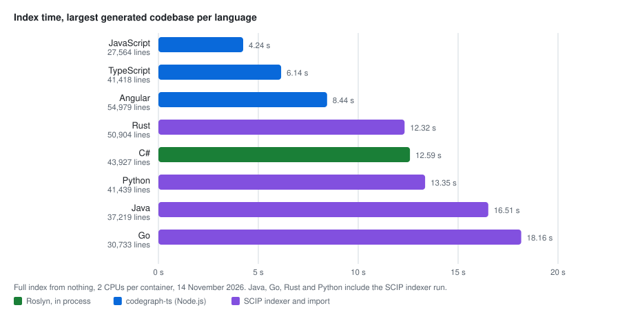
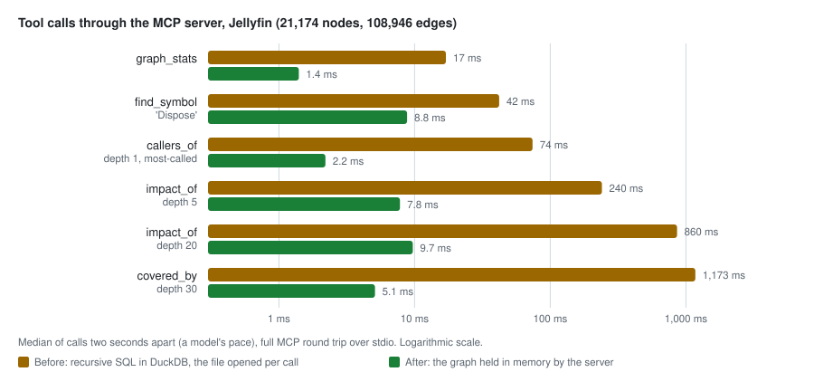
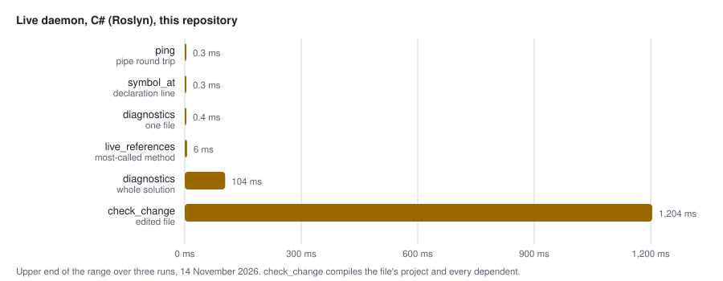

# Performance

*Author: Alan Seunarayan*

[Home](README.md) · [Installation](installation.md) · [Usage](usage.md) · [Use cases](use-cases.md) · [How it works](how-it-works.md) · [Language versions](language-versions.md) · **Performance** · [Architecture](architecture.md) · [Measured results](measured-results.md) · [The story](story.md) · [What is missing](roadmap.md) · [Contributing](contributing.md)

---

## Contents

- [Summary](#summary)
- [Index time](#index-time)
- [Tool calls](#tool-calls)
- [Large graphs](#large-graphs)
- [Answer size](#answer-size)
- [The live daemon](#the-live-daemon)
- [Real repositories](#real-repositories)
- [Disk and memory](#disk-and-memory)
- [How to measure on your machine](#how-to-measure-on-your-machine)

## Summary

- The server keeps the graph in memory. A graph tool call through the server takes 0.3 to 10 ms, also on Jellyfin (21,000 nodes). The first call after start takes 66 to 85 ms, and the live tools take longer (see [The live daemon](#the-live-daemon)).
- A walk on a graph of 181,500 nodes (165,000 methods) takes less than 50 ms.
- In the corpus's large profile, a full index takes 4.2 to 18.2 seconds per language for the larger seed (BENCHMARKS round 12). That seed's line counts were not kept; seed 1's codebases are 27,000 to 55,000 lines.
- For C#, with the live daemon, a save reaches a fresh answer in 0.9 to 1.3 s on this repository. A later run on a busy machine had a median of 1.4 s.
- A walk answer lists the nearest 200 rows (50 for tests) and counts the rest. From a hub on a 55,000-node graph, that is about 3,300 to 4,100 tokens.

All values in this page come from [BENCHMARKS.md](../BENCHMARKS.md) and from the generated corpus.
Your values depend on your machine and your code.

## Index time



These values are for a full index from nothing.
Each run had 2 CPUs in a Docker container.
For Java, Go, Rust and Python, the time includes the run of the SCIP indexer.
For Java, it also includes the Maven build.

| Index | Time |
|---|---|
| This repository, C#, full (3,119 nodes) | 16 s |
| This repository, C#, no change (incremental) | 2.6 s |
| A save of one C# file, with the live daemon | 0.9 to 1.3 s; median 1.4 s in a later run on a busy machine |

These three rows were measured on 14 November 2026, on 8 cores, not in a container.
A save re-walks the file and the files that depend on it: 3 files for a file few others use, 10 for a widely used one.

Most of the C# time is the MSBuild load and the Roslyn compile.
The live daemon loads the solution one time.
Thus a save does not pay for the load again.

## Tool calls



These values are for Jellyfin: 21,174 nodes and 108,946 edges.
Each value is a full MCP round trip, with calls 2 seconds apart, as a model makes them.

| Tool call | Before | Now |
|---|---|---|
| `find_symbol` | 42 ms | 8.8 ms |
| `callers_of`, depth 1 | 74 ms | 2.2 ms |
| `impact_of`, depth 5 | 240 ms | 7.8 ms |
| `impact_of`, depth 20 | 860 ms | 9.7 ms |
| `covered_by`, depth 30 | 1,173 ms | 5.1 ms |

Before, each walk was a recursive SQL query, and each call opened the graph file.
Now the server keeps the graph in memory and follows arrays, as an IDE does.
See [The graph in memory](how-it-works.md#the-graph-in-memory).

On this repository (2,885 nodes then), `impact_of` at depth 20 went from 31 ms to 1.8 ms.
On 14 November 2026, with 3,119 nodes, each graph tool call took 1.2 to 3.5 ms at the same pace.

## Large graphs

These values are for generated call graphs with 12 layers and hub methods.

| Query, 181,500 nodes | SQL | In memory |
|---|---|---|
| `callers_of`, depth 1, hub | 57 ms | 0.32 ms |
| `impact_of`, depth 5 | 378 ms | 40 ms |
| `impact_of`, depth 20, hub | 590 ms | 31 ms |
| `covered_by`, depth 30, hub | 267 ms | 24 ms |
| `coverage_stats` | 172 ms | 1.7 ms |
| `path_between`, depth 10 | 41 ms | 0.05 ms |

A walk from a hub on this graph reaches about 100,000 nodes.
Most of the time in memory is to sort and return these rows.

Before an earlier change, `path_between` took 1,061 ms on a generated graph of 165,000 nodes and 2,368 ms on one of 11,000 nodes.
It is a breadth-first search that visits each node one time.

## Answer size

A large answer uses the context of the client.
Thus the server makes walk answers short.
A walk shows the nearest 200 rows and the count of the other rows at each depth.

| Tool call, 55,000-node graph | Before | Now |
|---|---|---|
| `impact_of`, hub, depth 20 | 2,473,442 characters (about 618,000 tokens) | 16,231 characters (about 4,100 tokens) |
| `callers_of`, hub, depth 5 | 1,379,921 characters (about 345,000 tokens) | 13,151 characters (about 3,300 tokens) |

## The live daemon



These values are for the C# live daemon on this repository (6 projects), measured on 14 November 2026.
The bars show the upper end of the range over three runs. The low end is with Roslyn's caches warm.

| Measurement | Value |
|---|---|
| Rename of `GraphStore.Replace`, which 6 projects compile against, with `check_change` | 0.97 to 1.09 s, with 42 new errors found |
| Save, then a new `find_symbol` answer through the server | 0.9 to 1.3 s; median 1.4 s in a later run on a busy machine |

For TypeScript, on the RealWorld Angular app (47 files), with typescript-language-server, measured on 14 November 2026:

| Measurement | Value |
|---|---|
| `ping` | 0.46 ms |
| `live_references` | 129 to 131 ms |
| `check_change`, an edit that adds an error, in a file with one dependent | 3.5 to 4.8 s |
| `check_change`, a clean edit | 2.5 to 2.8 s |

The language server sends no "done" signal.
Thus `check_change` waits until the edited file and the files that depend on it have reported and gone quiet.
For a file that stays clean, it waits three times the server's measured report latency, because that file may get no report at all.

## Real repositories

| Repository | Language | Size | Full index |
|---|---|---|---|
| This repository | C# | 3,119 nodes | 16 s |
| RealWorld Angular app | Angular | 47 files, 670 nodes | 2.8 s |
| NestJS | TypeScript | 1,180 files, 11,228 nodes | 7.7 s |
| Jellyfin | C# | 1,960 files, 40 projects, 21,174 nodes | 60 s |

These were measured on 14 November 2026: NestJS and RealWorld at their current commits, Jellyfin at 10.11.11.
The C# times are wall clock, with the MSBuild load: this repository from BENCHMARKS round 12 (16.2–16.3 s), Jellyfin from round 13 (59.7–60.1 s), whose wall clock round 12 did not record. The time that the indexer reports is 13.6–14.4 s for this repository (round 12) and 44.9–45.0 s for Jellyfin (round 13).
On NestJS, SQL queries take 2.7 to 174 ms. From memory, they take less than 1.3 ms.
On Jellyfin, SQL queries took up to 1.1 s. From memory, they take less than 2 ms.

## Disk and memory

| Item | Value |
|---|---|
| Graph of this repository | about 23 MB after a full index, stable after more full indexes; 37 to 38 MB under the live daemon after many saves |
| Graph of NestJS | 43 MB, stable after more imports |
| C# live daemon for this repository | about 405 MB |
| Graph in memory in the server, this repository | 2 MB |
| Graph in memory in the server, Jellyfin | 17 MB, loaded in 0.3 s |
| Graph in memory in the server, 181,500 nodes | 78 MB, loaded in 1.1 s |

The server loads the graph in the background.
Until the load is complete, it answers with SQL on the file.

A full index writes a new file and replaces the old one.
Thus the graph does not grow with each full index.
An incremental pass, as the live daemon makes on each save, makes the file larger at first, and then the size levels off.

## How to measure on your machine

1. Build the graph of your solution:

   ```bash
   codegraph-index /path/to/App.slnx
   ```

2. Run the benchmark tool on the graph:

   ```bash
   dotnet run --project tools/CodeGraph.Bench -c Release -- /path/to/.codegraph/graph.db
   ```

3. To also measure the index time, add the solution and the indexer:

   ```bash
   dotnet run --project tools/CodeGraph.Bench -c Release -- /path/to/.codegraph/graph.db \
     --index /path/to/App.slnx --indexer ~/.codegraph/bin/codegraph-index
   ```

4. To measure the live tools, start the live daemon first and add `--live`.
5. To measure tool calls through the server, add `--server` with the path of `codegraph-mcp.dll`.
   Add it more than one time to compare builds.
6. To make sure that the graph in memory gives the same answers as SQL, add `--parity 400`.
7. Compare the values with [BENCHMARKS.md](../BENCHMARKS.md).

To measure all languages, run the generated corpus:

```bash
python3 tools/corpus/run.py --base <local image> --jobs 3 --seeds 1,2
```

The results go to `artifacts/corpus/summary.md`.

---

← Previous: [Language versions](language-versions.md) · Next: [Architecture](architecture.md) →
