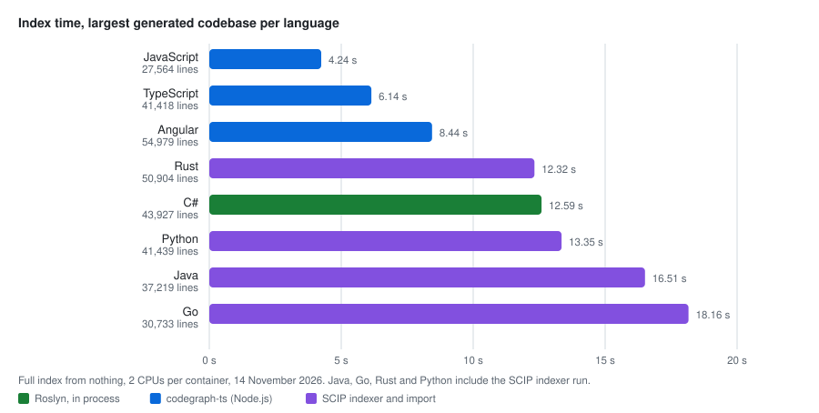
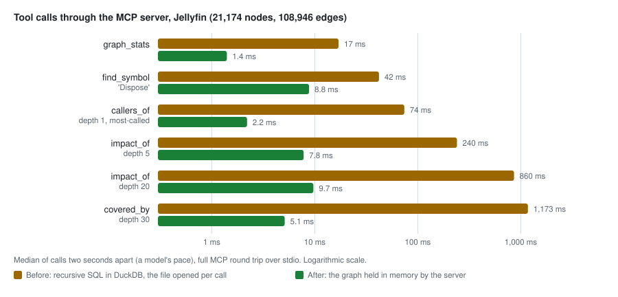
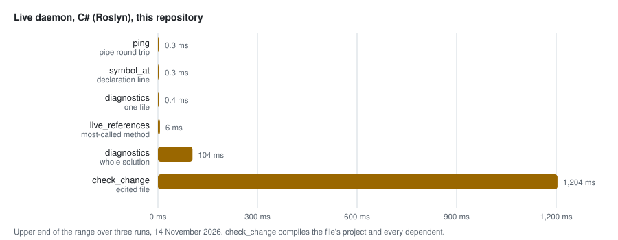

# Performance

*Author: Alan Seunarayan*

[Home](README.md) · [Installation](installation.md) · [Usage](usage.md) · [Use cases](use-cases.md) · [How it works](how-it-works.md) · **Performance** · [Architecture](architecture.md)

---

## Contents

- [Summary](#summary)
- [Index time](#index-time)
- [Tool calls](#tool-calls)
- [Large graphs](#large-graphs)
- [Answer size](#answer-size)
- [The live daemon](#the-live-daemon)
- [Real repositories](#real-repositories)
- [Disk and memory](#disk-and-memory)
- [How to measure on your machine](#how-to-measure-on-your-machine)

## Summary

- A tool call through the server takes 1 to 15 ms on a small graph.
- A walk on a graph of 165,000 nodes takes less than 1 second.
- A full index of 30,000 to 55,000 lines takes 5 to 18 seconds.
- For C#, a save updates the graph in less than one second with the live daemon.
- A walk answer is at most about 4,000 tokens, also on a large graph.

All values in this page come from [BENCHMARKS.md](../BENCHMARKS.md) and from the generated corpus.
Your values depend on your machine and your code.

## Index time



These values are for a full index from nothing.
Each run had 2 CPUs in a Docker container.
For Java, Go, Rust and Python, the time includes the run of the SCIP indexer.
For Java, it also includes the Maven build.

| Index | Time |
|---|---|
| This repository, C#, full | 10.5 s |
| This repository, C#, no change (incremental) | 2.5 s |
| A save of one C# file, with the live daemon | less than 1 s |

Most of the C# time is the MSBuild load and the Roslyn compile.
The live daemon loads the solution one time.
Thus a save does not pay for the load again.

## Tool calls



These values are for the graph of this repository: 1,583 nodes and 8,784 edges.
"Through the server" is a full MCP round trip.
"Store" is the SQL query only.

The server keeps the graph file open.
To open the graph for each call took 11 ms.
With the file open, it takes 0.024 ms.

## Large graphs

These values are for generated call graphs with 12 layers and hub methods.

| Query | 11,000 nodes | 55,000 nodes | 165,000 nodes |
|---|---|---|---|
| `callers_of`, depth 1, hub | 9 ms | 23 ms | 48 ms |
| `impact_of`, depth 5 | 19 ms | 50 ms | 95 ms |
| `impact_of`, depth 20, hub | 70 ms | 242 ms | 662 ms |
| `covered_by`, depth 30, hub | 44 ms | 142 ms | 330 ms |
| `coverage_stats` | 21 ms | 68 ms | 164 ms |
| `path_between`, depth 10 | 38 ms | 105 ms | 60 ms |
| `path_between`, no path | 1.9 ms | 3.9 ms | 4.9 ms |

`path_between` was 1,061 to 2,368 ms before.
It is now a breadth-first search that visits each node one time.

## Answer size

A large answer uses the context of the client.
Thus the server makes walk answers short.
A walk shows the nearest 200 rows and the count of the other rows at each depth.

| Tool call, 55,000-node graph | Before | Now |
|---|---|---|
| `impact_of`, hub, depth 20 | 2,473,442 characters (about 618,000 tokens) | 16,231 characters (about 4,100 tokens) |
| `callers_of`, hub, depth 5 | 1,379,921 characters (about 345,000 tokens) | 13,151 characters (about 3,300 tokens) |

## The live daemon



These values are for the C# live daemon on this repository.
The bars show the upper end of the range over two runs.

| Measurement | Value |
|---|---|
| Rename of a method that 6 projects use, with `check_change` | 1.08 s, with 6 new errors found |
| Save, then a new `find_symbol` answer through the server | 0.64 s |

For TypeScript, with typescript-language-server:

| Measurement | Value |
|---|---|
| `ping` | 0.41 ms |
| `live_references` | 109 ms |
| `check_change`, an edit that adds errors | about 1 s |
| `check_change`, a clean edit | about 2 s |

A clean edit takes longer.
The language server sends no report for a file that stays clean.
Thus `check_change` must wait to be sure.

## Real repositories

| Repository | Language | Size | Full index |
|---|---|---|---|
| This repository | C# | 1,583 nodes | 10.5 s |
| RealWorld Angular app | Angular | 47 files, 670 nodes | 2.7 s |
| NestJS | TypeScript | 1,165 files, 10,754 nodes | 7.0 s |

On NestJS, queries took 11 to 175 ms.
The slowest was `impact_of` at depth 20.

## Disk and memory

| Item | Value |
|---|---|
| Graph of this repository | about 12.5 MB, stable after more rebuilds |
| Graph of NestJS | 43 MB, stable after more imports |
| C# live daemon for this repository | about 220 MB |
| Server process | small; it reads the graph file only |

A full index writes a new file and replaces the old one.
Thus the graph does not grow with each index.

## How to measure on your machine

1. Build the graph of your solution:

   ```bash
   codegraph-index /path/to/App.slnx
   ```

2. Run the benchmark tool on the graph:

   ```bash
   dotnet run --project tools/CodeGraph.Bench -c Release -- /path/to/.codegraph/graph.db
   ```

3. To also measure the index time, add the solution and the indexer:

   ```bash
   dotnet run --project tools/CodeGraph.Bench -c Release -- /path/to/.codegraph/graph.db \
     --index /path/to/App.slnx --indexer ~/.codegraph/bin/codegraph-index
   ```

4. To measure the live tools, start the live daemon first and add `--live`.
5. Compare the values with [BENCHMARKS.md](../BENCHMARKS.md).

To measure all languages, run the generated corpus:

```bash
python3 tools/corpus/run.py --base <local image> --jobs 3 --seeds 1,2
```

The results go to `artifacts/corpus/summary.md`.

---

← Previous: [How it works](how-it-works.md) · Next: [Architecture](architecture.md) →
