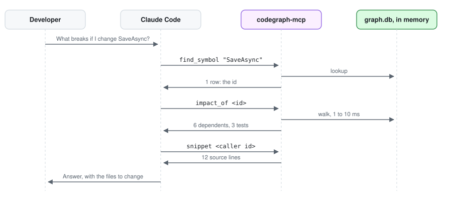

# Usage

*Author: Alan Seunarayan*

[Home](README.md) · [Installation](installation.md) · **Usage** · [Use cases](use-cases.md) · [How it works](how-it-works.md) · [Language versions](language-versions.md) · [Performance](performance.md) · [Architecture](architecture.md) · [Why it saves tokens](why-it-saves-tokens.md) · [The story](story.md) · [What is missing](roadmap.md) · [Contributing](contributing.md)

---

## Contents

- [Build a graph](#build-a-graph)
- [Keep the graph current](#keep-the-graph-current)
  - [Run the indexer again](#run-the-indexer-again)
  - [Use watch mode](#use-watch-mode)
  - [Let the server start the live daemon](#let-the-server-start-the-live-daemon)
  - [Check the graph and stop the daemon](#check-the-graph-and-stop-the-daemon)
  - [Use the VS Code extension](#use-the-vs-code-extension)
- [Ask questions in your assistant](#ask-questions-in-your-assistant)
- [The tools](#the-tools)
- [Read an answer](#read-an-answer)
- [Import and export a graph](#import-and-export-a-graph)
- [See what the graph did for you](#see-what-the-graph-did-for-you)
- [Command reference](#command-reference)
- [Environment variables](#environment-variables)

## Build a graph

Give the indexer a target.
The target tells the indexer which language route to use.

| Target | Language | Route |
|---|---|---|
| `App.sln`, `App.slnx`, `App.csproj` | C# | Roslyn |
| `tsconfig.json`, `angular.json`, `nx.json`, `package.json` | TypeScript, JavaScript, Angular | codegraph-ts |
| `pom.xml`, `build.gradle`, `build.gradle.kts`, `build.sbt` | Java, Kotlin, Scala | scip-java |
| `go.mod`, `go.work` | Go | scip-go |
| `Cargo.toml` | Rust | rust-analyzer |
| `pyproject.toml`, `setup.py`, `setup.cfg` | Python | scip-python |

For TypeScript and the SCIP languages, a folder is also a target: one that holds `angular.json`, `nx.json` or
`tsconfig.json`, or one of the build files above.
For C#, give the `.sln`, `.slnx` or `.csproj` file. `codegraph-index init` also finds it in a folder.

1. Go to the repository.
2. Run the indexer with the target:

   ```bash
   codegraph-index App.slnx
   ```

The indexer writes the graph to `<worktree root>/.codegraph/graph.db`.
Give `--db PATH` to write it to a different path.

The indexer shows its progress on stderr:

```
| loading solution: App.slnx (14s)
/ indexing: [12/33] App.Core: compiling (3s)
\ writing graph: 11095 nodes, 42437 edges (1s)
```

## Keep the graph current

The server compares the graph with the files on disk before each answer.
If a file changed, the answer shows `STALE` on the rows from that file.
Use one of these procedures to keep the graph current.

### Run the indexer again

Run the same command again:

```bash
codegraph-index App.slnx
```

For C#, the second run is incremental.
The indexer reads again only the changed files and the files that use them.
Give `--full` to build the graph again from the start.

> **NOTE:** Give `--full` after a large refactor.
> A new overload can change what an unchanged file calls.

For the other languages, each run indexes the full workspace again.
This took 7.7 to 7.8 seconds for the 1,180 files of NestJS ([BENCHMARKS round 12](../BENCHMARKS.md#round-12-the-docs-re-measured)).

### Use watch mode

Watch mode keeps the indexer in memory.
It indexes each save and answers the live tools.

1. Open a terminal in the repository.
2. Start the indexer with `--watch`:

   ```bash
   codegraph-index App.slnx --watch
   ```

3. Keep the terminal open while you work.
4. Push Ctrl+C to stop it.

For C#, on a solution the size of this repository, a save of one file gives a fresh answer in 0.9 to 1.3 seconds
([BENCHMARKS round 12](../BENCHMARKS.md#round-12-the-docs-re-measured); round 13 measured a median of 1.4 seconds).
A change to a `.csproj`, `.sln`, `.slnx`, `.props` or `.targets` file loads the solution again.

> **NOTE:** In a repository with C# and TypeScript, `--watch` on the solution updates only C#.
> One daemon serves each graph, so a second `--watch` on the front end of the same graph does not start.
> Run `codegraph-index` on the front end again, or use the [VS Code extension](#use-the-vs-code-extension), which
> re-indexes the front end when you save one of its files.

### Let the server start the live daemon

You can let the server start the live daemon.
Do one of these:

- Run `codegraph-index init --live`. This adds `CODEGRAPH_DAEMON=auto` to each client configuration that `init` writes.
- Ask the assistant to call `live_status` with `start=true`.

The live daemon that the server starts stops after 120 minutes with no save and no request.

### Check the graph and stop the daemon

To see how the graph stands, run `status` in the repository:

```bash
codegraph-index status
```

It prints the graph file, when and at which commit it was built, and its size. It says whether the graph matches the
working tree, how many files each language has, whether a daemon serves the graph, and the last week of tool calls.
Add `--json` for the same report as JSON.

To stop the daemon that serves the graph, run `stop`:

```bash
codegraph-index stop
```

It asks the daemon to stop over its pipe and waits until it has gone. A daemon from 1.2.0 or earlier does not know
this request. `stop` says so, names its process id, and leaves it running: stop it with Ctrl+C in its terminal.

### Use the VS Code extension

The [VS Code extension](../vscode-extension/README.md) does all of this from the editor.
It installs CodeGraph, sets a repository up, starts a daemon for each graph, and stops the daemons it started when
the window closes.
It shows each graph's state in the sidebar and the status bar.

## Ask questions in your assistant

Ask your question in normal words.
The assistant selects the tools.
For example:

- "Who calls `SaveAsync`?"
- "What breaks if I change the signature of `PriceCalculator.Total`?"
- "Which tests guard `OrderService.Submit`?"
- "Show me the dead code."

To make the assistant use the graph first, add this line to its instructions file:

```
Use the codegraph tools before you read source files to find callers, tests or impact.
```

| Assistant | Instructions file |
|---|---|
| Claude Code | `CLAUDE.md` |
| GitHub Copilot | `.github/copilot-instructions.md`, or `AGENTS.md` |
| Codex, Cursor, Kilo Code | `AGENTS.md` |
| Gemini CLI | `GEMINI.md` |
| Roo Code | A file in `.roo/rules/`, or `AGENTS.md` |
| Continue | A file in `.continue/rules/` |
| Cline | `.clinerules` |

[PROMPTS.md](../PROMPTS.md) gives more prompts.



A typical turn uses three tools:

1. `find_symbol` finds the node id of the method.
2. `impact_of` finds the dependents and the tests that guard them.
3. `snippet` shows only the lines that the assistant must change.

In [BENCHMARKS round 12](../BENCHMARKS.md#round-12-the-docs-re-measured), the three answers for `GraphStore.Replace` used about 5,500 tokens.
The 15 files that the answers name use about 65,000 tokens.
The 25 files that contain `.Replace(` use about 123,000 tokens.
[Why it saves tokens](why-it-saves-tokens.md) shows a measured example.

## The tools

The server has 35 tools.
All tools only read.
None of them changes your files or the graph.

| Group | Tools |
|---|---|
| Find code | `find_symbol`, `search_code`, `outline`, `members_of`, `snippet`, `neighbors` |
| Calls and impact | `callers_of`, `callees_of`, `impact_of`, `path_between`, `most_called`, `traverse` |
| Types | `references_to`, `implementors_of`, `inheritors_of`, `overrides_of` |
| Tests and coverage | `tests_for`, `covered_by`, `coverage_stats`, `uncovered` |
| Dead code | `dead_code_report`, `explain_reachability`, `list_roots` |
| Projects | `depends_on`, `dependents_of` |
| Live (needs the live daemon) | `live_status`, `symbol_at`, `live_references`, `diagnostics`, `check_change`, `rename_preview`, `data_flow` |
| The server | `graph_stats`, `index_status`, `usage_stats` |

[MCP-SERVER.md](../MCP-SERVER.md#tools) gives the arguments of each tool.

> **NOTE:** `data_flow` works for C# only.
> The other live tools work for all languages that have a language server.

## Read an answer

An answer is compact text.
Each row shows the kind, the name, the file and lines, and the node id:

```
method  App.Core.OrderService.Submit(App.Core.Order)  depth 1  /repo/src/App.Core/OrderService.cs:41-58  [M:App.Core.OrderService.Submit(App.Core.Order)]
```

Give the id in brackets to the next tool.

A walk shows the nearest 200 rows.
After 200 rows, it shows the count at each depth.
`impact_of` shows up to 50 tests.

If a file changed after the last index, the answer starts with a warning.
The rows from changed files show `STALE`.

## Import and export a graph

The indexer can read records from another extractor:

```bash
codegraph-index import records.ndjson
codegraph-index import index.scip
```

An import replaces only the languages in the records.
The other languages in the graph stay.

The indexer can write the graph as records:

```bash
codegraph-index export --language typescript --out graph.ndjson
```

Give `--dead-code` to add the dead-code candidates to the export.
[EXTRACTORS.md](../EXTRACTORS.md#the-record-contract) gives the record format.

## See what the graph did for you

The server writes one line per tool call to `.codegraph/telemetry.jsonl`.
Nothing leaves the machine.
To see the last seven days, run this in the repository:

```bash
codegraph-index usage
```

```
last 7 days: 143 tool calls answered (2 failed); the files they pointed at come to about 1,230,412 tokens, the answers to 48,207, so about 1,182,205 tokens stayed out of the context; most used: find_symbol ×61, impact_of ×24, tests_for ×19
since 2026-10-28: ...

tool          calls  errors   avg ms  result tok  source tok   saved tok
find_symbol      61       2       14        6100      310000      303900
...
```

"Source tok" is the size of the files that the answers pointed at.
That is what the client would have read without the graph.
Give `--days 30` for a longer period.
After a one-shot C# index, the indexer prints the first line with `(codegraph-index usage for details)` at the end.
It does this only when the server has recorded tool calls.
The `usage_stats` tool shows the same figures to the client.
Set `CODEGRAPH_TELEMETRY=off` in `.mcp.json` to keep the calls in memory only.

## Command reference

```
codegraph-index <target> [--db <path>] [--full] [--all-targets] [--watch] [--log <file>] [--idle-exit <minutes>]
codegraph-index init [target | folder] [--client <names>] [--live] [--no-index] [--db <path>]
codegraph-index import <records.ndjson | index.scip | -> [--db <path>]
codegraph-index export [--db <path>] [--language <name>] [--out <file>] [--dead-code]
codegraph-index usage [--db <path>] [--days <n>]
codegraph-index status [--db <path>] [--json]
codegraph-index stop [--db <path>]
codegraph-mcp [<graph.db>] [--root <folder>] [--web <port>]
```

| Option | Function |
|---|---|
| `--db <path>` | Use this graph file. The default is `<worktree root>/.codegraph/graph.db`. |
| `--full` | Build the graph again from the start. |
| `--all-targets` | Compile all target frameworks of a multi-target C# project. The default is the first one. |
| `--watch` | Keep running. Index each save and answer the live tools. |
| `--log <file>` | Write the log to a file, not to stderr. |
| `--idle-exit <minutes>` | With `--watch`, stop after this time with no save and no request. |
| `--client <names>` | With `init`, write the configuration for these assistants. See [Use another assistant](installation.md#use-another-assistant). |
| `--root <folder>` | Find the graph from this folder, not from the working folder of the server. |
| `--web <port>` | Serve the graph viewer on this local port. |
| `--json` | With `status`, print the report as JSON, for tools such as the VS Code extension. |

## Environment variables

| Variable | Function |
|---|---|
| `CODEGRAPH_DB` | The graph file for the server. A path argument has priority. |
| `CODEGRAPH_ROOT` | The folder from which the server finds the graph. `--root` has priority. |
| `CODEGRAPH_DAEMON=auto` | The server starts the live daemon on its first tool call. |
| `CODEGRAPH_INDEXER` | The path of `codegraph-index`, for the server to start the live daemon. Use it when the indexer is not next to the server. |
| `CODEGRAPH_TELEMETRY=off` | The server keeps the tool calls in memory only. It does not write `.codegraph/telemetry.jsonl`. |
| `CODEGRAPH_SNAPSHOT=off` | The server answers with SQL on the graph file, not from its copy in memory. |
| `CODEGRAPH_LSP` | The language server command for the live tools, for example `jdtls -data /tmp/ws`. |
| `CODEGRAPH_TS` | The path of the TypeScript extractor `cli.mjs`. |
| `CODEGRAPH_EMBEDDINGS_URL` | An embeddings endpoint. It adds meaning-based search to `search_code`. |
| `CODEGRAPH_EMBEDDINGS_MODEL` | The embeddings model. The default is `nomic-embed-text`. |
| `CODEGRAPH_EMBEDDINGS_KEY` | A key for the embeddings endpoint, sent as a bearer token. |

---

← Previous: [Installation](installation.md) · Next: [Use cases](use-cases.md) →
