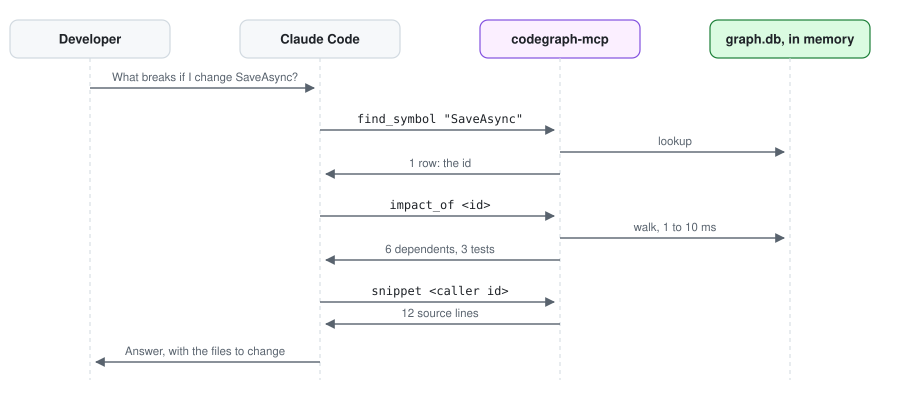

# Usage

*Author: Alan Seunarayan*

[Home](README.md) · [Installation](installation.md) · **Usage** · [Use cases](use-cases.md) · [How it works](how-it-works.md) · [Performance](performance.md) · [Architecture](architecture.md)

---

## Contents

- [Build a graph](#build-a-graph)
- [Keep the graph current](#keep-the-graph-current)
  - [Run the indexer again](#run-the-indexer-again)
  - [Use watch mode](#use-watch-mode)
  - [Let the server start the live daemon](#let-the-server-start-the-live-daemon)
- [Ask questions in Claude Code](#ask-questions-in-claude-code)
- [The tools](#the-tools)
- [Read an answer](#read-an-answer)
- [Import and export a graph](#import-and-export-a-graph)
- [Command reference](#command-reference)
- [Environment variables](#environment-variables)

## Build a graph

Give the indexer a target.
The target tells the indexer which language route to use.

| Target | Language | Route |
|---|---|---|
| `App.sln`, `App.slnx`, `App.csproj` | C# | Roslyn |
| `tsconfig.json`, `angular.json`, `nx.json`, `package.json` | TypeScript, JavaScript, Angular | codegraph-ts |
| `pom.xml`, `build.gradle`, `build.gradle.kts`, `build.sbt` | Java, Kotlin, Scala | scip-java |
| `go.mod`, `go.work` | Go | scip-go |
| `Cargo.toml` | Rust | rust-analyzer |
| `pyproject.toml`, `setup.py`, `setup.cfg` | Python | scip-python |

A folder that holds one of these files is also a target.

1. Go to the repository.
2. Run the indexer with the target:

   ```bash
   codegraph-index App.slnx
   ```

The indexer writes the graph to `<worktree root>/.codegraph/graph.db`.
Give `--db PATH` to write it to a different path.

The indexer shows its progress on stderr:

```
| loading solution: App.slnx (14s)
/ indexing: [12/33] App.Core: compiling (3s)
\ writing graph: 11095 nodes, 42437 edges (1s)
```

## Keep the graph current

The server compares the graph with the files on disk before each answer.
If a file changed, the answer shows `STALE` on the rows from that file.
Use one of these procedures to keep the graph current.

### Run the indexer again

Run the same command again:

```bash
codegraph-index App.slnx
```

For C#, the second run is incremental.
The indexer reads again only the changed files and the files that use them.
Give `--full` to build the graph again from the start.

> **NOTE:** Give `--full` after a large refactor.
> A new overload can change what an unchanged file calls.

For the other languages, each run indexes the full workspace again.
This takes a few seconds for 1,000 files.

### Use watch mode

Watch mode keeps the indexer in memory.
It indexes each save and answers the live tools.

1. Open a terminal in the repository.
2. Start the indexer with `--watch`:

   ```bash
   codegraph-index App.slnx --watch
   ```

3. Keep the terminal open while you work.
4. Push Ctrl+C to stop it.

For C#, a save of one file updates the graph in less than one second.
A change to a `.csproj`, `.sln`, `.props` or `.targets` file loads the solution again.

> **NOTE:** In a repository with C# and TypeScript, `--watch` on the solution updates only C#.
> Start a second `--watch` on the front end, or run `codegraph-index init` again.

### Let the server start the live daemon

You can let the server start the live daemon.
Do one of these:

- Run `codegraph-index init --live`. This adds `CODEGRAPH_DAEMON=auto` to `.mcp.json`.
- Ask Claude Code to call `live_status` with `start=true`.

The live daemon that the server starts stops after 120 minutes with no save and no request.

## Ask questions in Claude Code

Ask your question in normal words.
Claude Code selects the tools.
For example:

- "Who calls `SaveAsync`?"
- "What breaks if I change the signature of `PriceCalculator.Total`?"
- "Which tests guard `OrderService.Submit`?"
- "Show me the dead code in the `Billing` project."

To make Claude Code use the graph first, add this line to `CLAUDE.md`:

```
Use the codegraph tools before you read source files to find callers, tests or impact.
```

[PROMPTS.md](../PROMPTS.md) gives more prompts.



A typical turn uses three tools:

1. `find_symbol` finds the node id of the method.
2. `impact_of` finds the dependents and the tests that guard them.
3. `snippet` shows only the lines that Claude Code must change.

This uses some thousands of tokens.
To read all the files that contain the name uses tens of thousands of tokens.

## The tools

The server has 35 tools.
All tools only read.
None of them changes your files or the graph.

| Group | Tools |
|---|---|
| Find code | `find_symbol`, `search_code`, `outline`, `members_of`, `snippet`, `neighbors` |
| Calls and impact | `callers_of`, `callees_of`, `impact_of`, `path_between`, `most_called`, `traverse` |
| Types | `references_to`, `implementors_of`, `inheritors_of`, `overrides_of` |
| Tests and coverage | `tests_for`, `covered_by`, `coverage_stats`, `uncovered` |
| Dead code | `dead_code_report`, `explain_reachability`, `list_roots` |
| Projects | `depends_on`, `dependents_of` |
| Live (needs the live daemon) | `live_status`, `symbol_at`, `live_references`, `diagnostics`, `check_change`, `rename_preview`, `data_flow` |
| The server | `graph_stats`, `index_status`, `usage_stats` |

[MCP-SERVER.md](../MCP-SERVER.md#tools) gives the arguments of each tool.

> **NOTE:** `data_flow` works for C# only.
> The other live tools work for all languages that have a language server.

## Read an answer

An answer is compact text.
Each row shows the kind, the name, the file and lines, and the node id:

```
method  App.Core.OrderService.Submit  depth 1  src/App.Core/OrderService.cs:41-58  [M:App.Core.OrderService.Submit(App.Core.Order)]
```

Give the id in brackets to the next tool.

A walk shows the nearest 200 rows.
After 200 rows, it shows the count at each depth.
`impact_of` shows up to 50 tests.

If a file changed after the last index, the answer starts with a warning.
The rows from changed files show `STALE`.

## Import and export a graph

The indexer can read records from another extractor:

```bash
codegraph-index import records.ndjson
codegraph-index import index.scip
```

An import replaces only the languages in the records.
The other languages in the graph stay.

The indexer can write the graph as records:

```bash
codegraph-index export --language typescript --out graph.ndjson
```

Give `--dead-code` to add the dead-code candidates to the export.
[EXTRACTORS.md](../EXTRACTORS.md#the-record-contract) gives the record format.

## Command reference

```
codegraph-index <target> [--db <path>] [--full] [--all-targets] [--watch] [--log <file>] [--idle-exit <minutes>]
codegraph-index init [target | folder] [--live] [--no-index] [--db <path>]
codegraph-index import <records.ndjson | index.scip | -> [--db <path>]
codegraph-index export [--db <path>] [--language <name>] [--out <file>] [--dead-code]
codegraph-mcp [<graph.db>] [--web <port>]
```

| Option | Function |
|---|---|
| `--db <path>` | Use this graph file. The default is `<worktree root>/.codegraph/graph.db`. |
| `--full` | Build the graph again from the start. |
| `--all-targets` | Compile all target frameworks of a multi-target C# project. The default is the first one. |
| `--watch` | Keep running. Index each save and answer the live tools. |
| `--log <file>` | Write the log to a file, not to stderr. |
| `--idle-exit <minutes>` | With `--watch`, stop after this time with no save and no request. |
| `--web <port>` | Serve the graph viewer on this local port. |

## Environment variables

| Variable | Function |
|---|---|
| `CODEGRAPH_DB` | The graph file for the server. A path argument has priority. |
| `CODEGRAPH_DAEMON=auto` | The server starts the live daemon on its first tool call. |
| `CODEGRAPH_LSP` | The language server command for the live tools, for example `jdtls -data /tmp/ws`. |
| `CODEGRAPH_TS` | The path of the TypeScript extractor `cli.mjs`. |
| `CODEGRAPH_EMBEDDINGS_URL` | An embeddings endpoint. It adds meaning-based search to `search_code`. |

---

← Previous: [Installation](installation.md) · Next: [Use cases](use-cases.md) →
