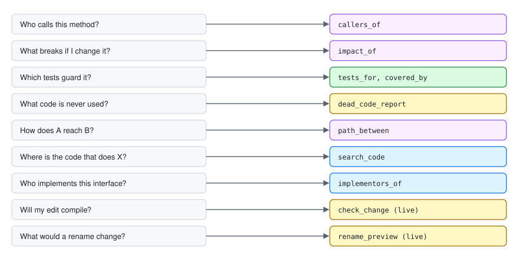
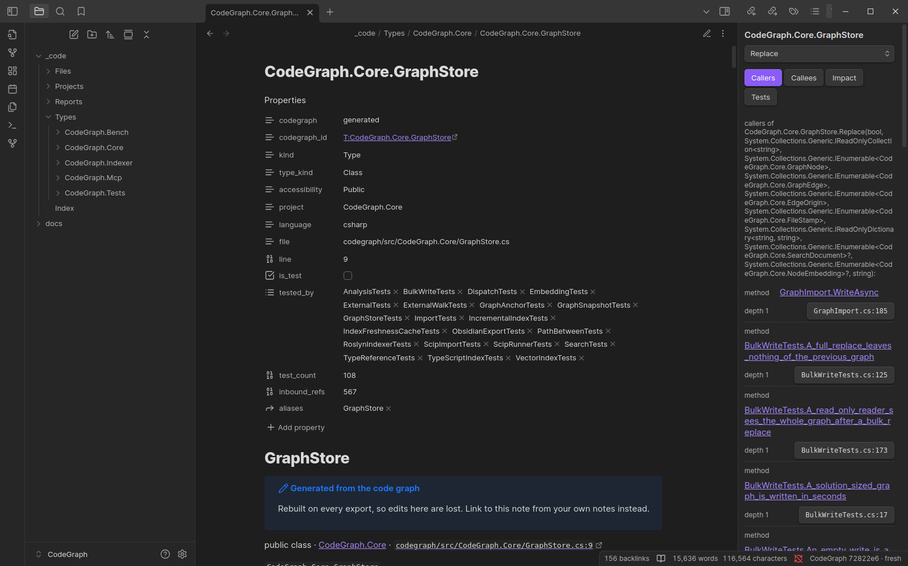

# Use cases

*Author: Alan Seunarayan*

[Home](README.md) · [Installation](installation.md) · [Usage](usage.md) · [Obsidian](obsidian.md) · **Use cases** · [How it works](how-it-works.md) · [Language versions](language-versions.md) · [Performance](performance.md) · [Architecture](architecture.md)

---

## Contents

- [Questions and tools](#questions-and-tools)
- [Before you change shared code](#before-you-change-shared-code)
- [Find the tests for a change](#find-the-tests-for-a-change)
- [Find dead code](#find-dead-code)
- [Learn a codebase that is new to you](#learn-a-codebase-that-is-new-to-you)
- [Share the structure of the code with people who do not code](#share-the-structure-of-the-code-with-people-who-do-not-code)
- [Find code when you do not know its name](#find-code-when-you-do-not-know-its-name)
- [Make sure that an edit compiles before you save it](#make-sure-that-an-edit-compiles-before-you-save-it)
- [Rename a symbol safely](#rename-a-symbol-safely)
- [Find the usage of a framework API](#find-the-usage-of-a-framework-api)
- [Review a pull request](#review-a-pull-request)
- [Work in a repository with more than one language](#work-in-a-repository-with-more-than-one-language)
- [When not to use CodeGraph](#when-not-to-use-codegraph)

## Questions and tools

You do not have to know the tool names.
Ask the question, and the client selects the tool.
This page shows which tool answers each type of question.

## Before you change shared code

**Question:** "What breaks if I change this method?"

1. `find_symbol` finds the method.
2. `impact_of` shows all the code that can break.
3. `snippet` shows each caller that you must change.

`impact_of` follows callers, overrides, implementations and subclasses.
It also follows calls through an interface or a base class.
A text search does not find these calls.
`impact_of` also shows the tests that guard the dependents.

## Find the tests for a change

**Question:** "Which tests must I run after this change?"

| Tool | Answer |
|---|---|
| `tests_for` | The tests that call the member directly. |
| `covered_by` | The tests that reach the member through other calls, with the number of steps. |
| `uncovered` | The production methods that no test reaches. |
| `coverage_stats` | The percentage of production methods that tests reach. |

> **NOTE:** This is static reachability through the call graph.
> It is not line coverage.
> A test that reaches a method does not always test each line of it.

## Find dead code

**Question:** "Which methods does nothing use?"

`dead_code_report` shows the methods that have no callers.
It does not show a method if it overrides or implements a method that has callers.
It also does not show framework entry points, for example `Main`, test methods, Angular lifecycle hooks and Spring handlers.

`explain_reachability` tells you why one method is or is not reachable.

> **CAUTION:** Code that the program calls through reflection or by name in configuration looks unused in the graph.
> Examine each candidate before you remove it.

## Learn a codebase that is new to you

**Question:** "How is this project organized?"

| Tool | Answer |
|---|---|
| `outline` | The files in a project, the types in a file, or the members of a type. |
| `most_called` | The methods with the most callers. These are often the core of the code. |
| `list_roots` | The entry points that a framework calls. |
| `depends_on`, `dependents_of` | The project references. |
| `path_between` | The shortest call chain from one method to another. |

## Share the structure of the code with people who do not code

Architects, testers and product people can read the graph in Obsidian.
They do not need an IDE or an MCP client.

1. Export the graph into a vault. See [Obsidian](obsidian.md).
2. Start from `_code/Index.md`. It has a section for each audience.
3. Use the reports: Project map for architects, Test coverage and Untested public surface for testers.
4. Write feature notes and decisions outside `_code/`, and link them to the code with **Insert code link**.

## Find code when you do not know its name

**Question:** "Where is the code that sends the invoice email?"

`search_code` searches names, signatures, comments, string literals and the identifiers in bodies.
It ranks the results with BM25.
If you set an embeddings endpoint, it also ranks by meaning.
See [Usage](usage.md#environment-variables).

## Make sure that an edit compiles before you save it

**Question:** "If I make this change, what does it break?"

`check_change` needs the live daemon.
The client gives the new text of one or more files.
The live daemon compiles the change in memory with the projects that depend on it.
It shows the new errors and the errors that the change fixes.
It does not write to disk.

`diagnostics` shows the current compiler errors of a file or of the full solution.

## Rename a symbol safely

**Question:** "What does a rename of `Total` to `GrandTotal` change?"

`rename_preview` needs the live daemon.
It shows each line that the rename changes, through interfaces and overrides.
It also shows the compile errors that the rename causes.
It does not write to disk.

## Find the usage of a framework API

**Question:** "Which code deletes files?"

The graph has a node for each framework or package method that your code calls.
Find `File.Delete` with `find_symbol`.
Then use `callers_of`, `impact_of` or `covered_by` on it.

`live_references` also finds property reads on framework types.
The graph does not record these.

## Review a pull request

Use the graph to review a change:

1. List the changed methods from the diff.
2. For each method, ask for `impact_of`.
3. Make sure that the pull request changes or tests each dependent.
4. Ask for `tests_for` to find the tests that the author must run.

## Work in a repository with more than one language

One graph can hold more than one language.
For example, `init` indexes a C# solution and an Angular `ClientApp/` folder into one graph.

Three tools can filter by language: `find_symbol`, `search_code` and `most_called`.
The graph has no edges between languages.
Thus it does not connect an HTTP call in TypeScript to the C# controller that it calls.

## When not to use CodeGraph

- For a small edit in one file that you already know, read the file.
- For text that is not code, for example documentation, use a text search.
- For questions about runtime values, use a debugger. The graph shows structure, not values.

---

← Previous: [Obsidian](obsidian.md) · Next: [How it works](how-it-works.md) →
