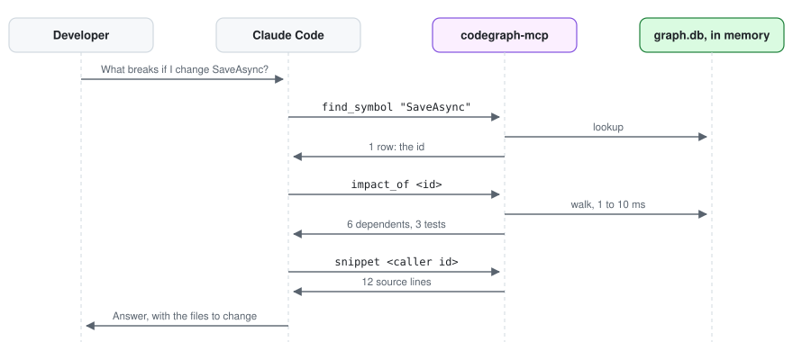
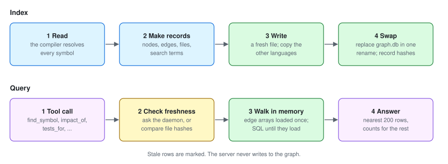

# Why it saves tokens

*Author: Alan Seunarayan*

[Home](README.md) · [Installation](installation.md) · [Usage](usage.md) · [Obsidian](obsidian.md) · [Use cases](use-cases.md) · [How it works](how-it-works.md) · [Language versions](language-versions.md) · [Performance](performance.md) · [Architecture](architecture.md)

---

An AI coding assistant pays for everything it reads. Without a graph, it answers "what breaks if
I change this method?" the way a person would with only a terminal: search for the name, open
the files that match, read them to tell real calls from look-alikes, then repeat for each
caller's callers and look for the tests. Every search result and every file it opens enters the
context window as input tokens, and stays there, taking room from the rest of the session.
Text search makes it worse, because a name matches more than the method: `.Replace(` also
matches every `string.Replace`. And the model can still miss a caller that goes through an
interface, a base class or a property, because nothing in the text says so.

CodeGraph moves that work to index time. The compiler resolves every call, override and test
once, and that costs no tokens. After that, each question is one tool call that returns only the
rows that answer it, with the file and line of each, so the model opens only the code it is
going to change.

Measured on this repository, for "what breaks if I change `GraphStore.Replace`?":

| How the assistant finds out | What enters its context | Size, at about 4 characters a token |
|---|---|---|
| CodeGraph: `find_symbol`, `impact_of`, `snippet` | The method, its 12 dependents, the 37 tests that guard them, and the method's own source | 21,910 characters, about 5,500 tokens |
| Opening the files that answer names, if the model somehow knew which they were | 15 files | 258,628 characters, about 65,000 tokens |
| Opening every file that matches `.Replace(` | 25 files, and the dependents' own callers are still to find | 491,682 characters, about 123,000 tokens |

So the same answer costs between a twelfth and a twenty-second of the tokens, and it includes the
transitive dependents and tests that a text search would still have to chase. The
savings come from a few design choices:

- **Rows, not files.** An answer row is a full name, a file and a line range, and a node id for
  the next call. The model reads source only with `snippet`, for the members it will touch.
- **Bounded answers.** Walks show the nearest 200 rows and a count of the rest at each depth.
  `impact_of` on the most-used member of a 55,000-node graph used to return about 618,000 tokens;
  it now returns about 4,100 ([performance](performance.md#answer-size)).
- **No wasted turns.** The stale warning stops the model from reasoning from an old graph and
  redoing the work. With the live daemon, `check_change` compiles a proposed edit and lists what
  it breaks, so the model doesn't need a build-and-read-the-errors loop to find out.
- **People don't need the assistant at all.** The Obsidian notes and reports below hold the
  same answers, worked out in advance. A tester who reads "which tests reach this type" in a
  note, or a product manager who browses the project map, spends no tokens.

`usage_stats` reports, for the current session and all time, the tokens each tool returned and
an estimate of the source tokens those answers saved the model from reading. Point the assistant
at the tools, not at the Obsidian notes: a tool answer holds only the rows asked for, while a
note holds everything about a type.

## Keeping the graph current

- **Incremental.** Each file's hash is stored. A re-run re-walks only changed files and their
  dependents (callers, subclasses, referencers, tests), then merges the result into the graph in
  about a second. `--full` rebuilds from scratch.
- **Watch mode.** `codegraph-index <solution> --watch` pays the solution load once and applies
  each save to the compiled solution in memory, so a one-file edit re-indexes in about a second
  on this repository. The server notices each swap through the file's mtime.
- **Live daemon.** The same watch process answers over a local pipe. `check_change` compiles a
  proposed file in memory and reports what it would break; `rename_preview` runs Roslyn's rename on
  a fork; `diagnostics` reports compiler errors for the working tree. The graph stays the system of
  record for transitive and aggregate questions, where it is orders of magnitude faster.
- **Safe while sessions run.** A full rebuild writes a fresh file and swaps it in with one
  rename; the server only ever reads.

## See what it did for you

Every tool call is one JSON line in `.codegraph/telemetry.jsonl`: the tool, the time it took, the size of
the answer, and the size of the files the answer pointed at. That last number is what reading those files
instead would have cost. `codegraph-index usage` sums the last seven days into one line, the indexer
prints the same line after each run, and the `usage_stats` tool opens with it and then lists every tool.

---

← Previous: [Home](README.md) · Next: [How it works](how-it-works.md) →
