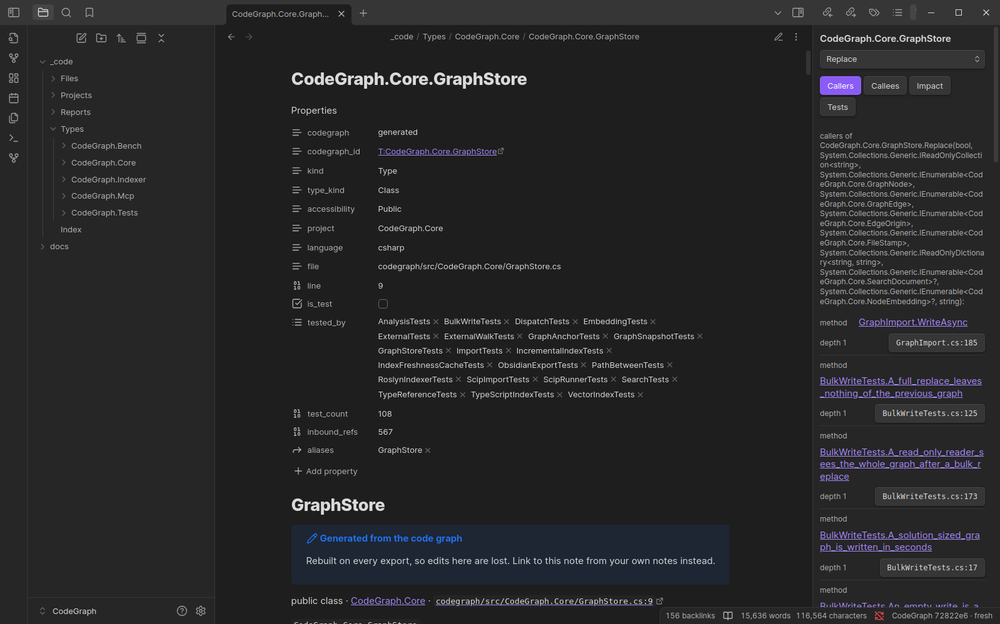

# CodeGraph for Obsidian

This plugin turns a repo's code graph into notes in an Obsidian vault. Developers, architects, testers and product
people can then browse the code the way they browse their other notes, and the plugin adds a panel that answers
live questions about the note you have open.

Desktop only, because it starts `codegraph-index` and `codegraph-mcp`.



The user guide, with a screenshot of each feature, is [docs/obsidian.md](../docs/obsidian.md).

## What it does

- **Writes code notes.** *Rebuild code notes* runs `codegraph-index export obsidian` into the vault's `_code/`
  folder:
  - `Index.md`, the start page, with a section for each audience;
  - `Projects/` with one note per project;
  - `Types/<project>/` with one note per type, members as headings, plus "Used by", "Calls into" and "Tested by";
  - `Files/` for members outside any type (TypeScript, Python, Go);
  - `Reports/`: Project map (Mermaid), Test coverage, Untested public surface, Entry points and Most called.
- **Keeps them fresh.** When the graph changes, for example because `codegraph-index --watch` re-indexed after a
  save, the notes are rewritten about two seconds later. Only notes whose text changed are touched.
  *Re-index repo and rebuild code notes* runs the indexer first.
- **Live panel.** Open a code note and the panel shows its callers, callees, impact and tests. For a type it shows
  references, impact, tests and members. Pick a member from the drop-down, or put the cursor under a member's
  heading. Each row links to its note, and the button on the right opens the source in your editor. When the graph
  is older than the working tree, a banner says so.
- **Find symbol** opens the note for any type or member by name. **Insert code link** puts a link to one into the
  note you are writing, as `[[_code/Types/App/App.Store#Save|Store.Save]]`.

## Generated notes and your notes

Everything in `_code/` is generated. Each note there carries `codegraph: generated` in its frontmatter and is
rewritten on every export. The exporter:

- deletes only notes it wrote before (listed in `_code/.codegraph-export.json`);
- leaves alone any file in the folder without the `codegraph: generated` marker;
- refuses to write into a folder that is not empty and has no export manifest.

Keep feature notes, decisions and onboarding pages outside `_code/`, for example in `docs/`. Link them into the
code with *Insert code link*. Each type's backlinks then list the features and decisions that mention it, and those
links survive every rebuild.

## Setup

1. Set the repo up for CodeGraph once: `codegraph-index init` inside it (see the main README). This writes
   `.mcp.json` with the server's command and environment, which the plugin can reuse once you approve it (below).
2. Install the plugin into a vault:

   ```bash
   node obsidian-plugin/install-plugin.mjs ~/Notes/MyVault        # or: install.sh --obsidian-vault ~/Notes/MyVault (downloads codegraph-obsidian.zip from the release)
   ```

3. In Obsidian, enable **CodeGraph** under Settings → Community plugins.
4. Under its settings, set **Repo folder** to the repo root (the folder holding `.codegraph/`), then run
   **CodeGraph: Rebuild code notes** from the command palette.

## Settings

| Setting | Default | |
| --- | --- | --- |
| Repo folder | (none) | The worktree whose `.codegraph/graph.db` the notes come from |
| Notes folder | `_code` | The vault folder the notes are written to |
| Editor link | `vscode://file{file}:{line}` | Opens a source location. `{file}` is the absolute path with forward slashes, `{line}` the line. For example `idea://open?file={file}&line={line}` or `zed://file{file}:{line}` |
| codegraph-mcp | (empty) | Empty uses the repo's approved `.mcp.json` entry, then `~/.codegraph/bin` (`C:\tools\codegraph` on Windows), then PATH |
| codegraph-index | (empty) | Empty uses the one beside codegraph-mcp, then the install folder, then PATH |
| Call depth | 1 | Hops for the Callers and Callees tabs |
| Rebuild when the graph changes | on | Watches `.codegraph/` and re-exports after a re-index |
| Repo .mcp.json | (not decided) | Whether the plugin may start the server the repo's `.mcp.json` names (see below) |

### The repo's `.mcp.json`

`codegraph-index init` writes the server's command, arguments and environment (`DOTNET_ROOT` for a version-managed
.NET) into the repo's `.mcp.json`, and Claude Code starts the server from there. The file is part of the repo, so a
clone or a pull can change it, and whatever it names runs with your rights. The plugin therefore shows you the
entry the first time it sees it, and again whenever it changes, and starts it only after you choose **Use it**.
Until then, or after **Ignore it**, it starts the installed `codegraph-mcp` and `codegraph-index` with your own
environment, which is what `init` names on most machines anyway. The decision is kept per repo in the plugin's
settings; **Settings → CodeGraph → Repo .mcp.json** reviews or forgets it.

## Dataview

Every type note's frontmatter has these fields:

- `codegraph_id`, `kind`, `type_kind`, `accessibility`, `project`, `language`;
- `file` and `line`;
- `is_test`;
- `tested_by` (test types) and `test_count`;
- `inbound_refs` (members outside the type that use it).

With the [Dataview](https://github.com/blacksmithgu/obsidian-dataview) plugin you can query the code as a table:

````markdown
```dataview
TABLE project, inbound_refs
FROM "_code/Types"
WHERE kind = "Type" AND accessibility = "Public" AND test_count = 0 AND !is_test
SORT inbound_refs DESC
LIMIT 20
```
````

That lists the most-used public types that no test calls directly.

## The exporter on its own

The notes don't need Obsidian to be generated. You can build them in CI and commit them to a docs repo, for
example:

```bash
codegraph-index export obsidian --out ~/Notes/MyVault/_code [--db <graph.db>] [--language csharp] [--link-root _code]
```

`--link-root` is the folder's path inside the vault and is used in every link. It defaults to the folder's name.

## Development

The plugin is plain CommonJS with no dependencies. `lib/` holds the parts that don't use the Obsidian API: the MCP
client, the tool-output parser, links and launch configuration. `src/main.js` is the Obsidian side. Obsidian loads
a single file, so `build.mjs` bundles both into `main.js`, which is checked in.

```bash
node build.mjs     # writes main.js
npm test           # node --test: parser, links, config, MCP client against a fake server, bundle check
```

Edit `src/` and `lib/`, never `main.js`. The tests fail when `main.js` is out of date.

Two more test layers run in Docker:

- **Every corpus language and profile.** [tools/corpus](../tools/corpus/README.md) exports a vault for each one and
  checks its links, coverage and lifecycle. It also drives the real `codegraph-mcp` through this plugin's client.
- **Real Obsidian.** [tools/obsidian-e2e](../tools/obsidian-e2e/README.md) runs the plugin end to end, headless, on
  more than one Obsidian version.
