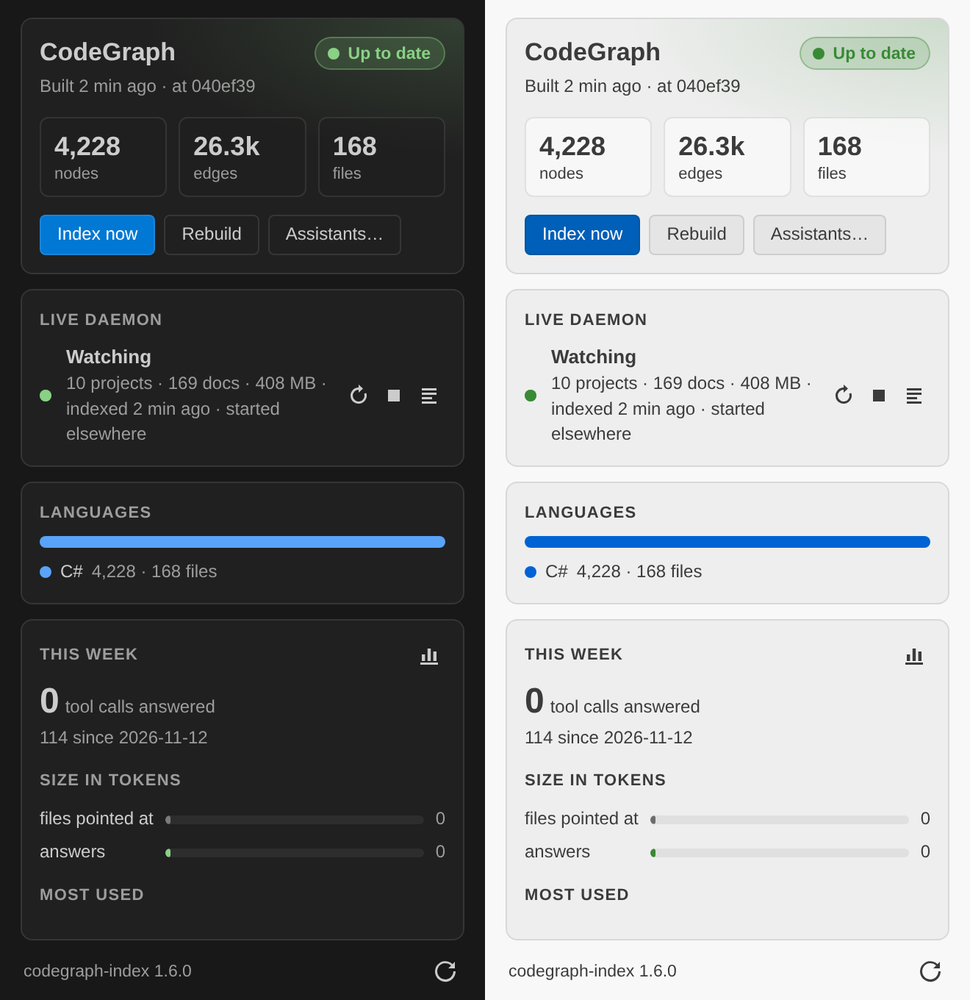

# CodeGraph for VS Code

[CodeGraph](../README.md) · [Docs](../docs/README.md) · [MCP server](../MCP-SERVER.md) · [Extractors](../EXTRACTORS.md) · [Benchmarks](../BENCHMARKS.md) · [Prompts](../PROMPTS.md) · [Changelog](../CHANGELOG.md) · [Claude Code plugin](../plugin/README.md) · **VS Code extension**

CodeGraph gives your AI coding assistant the compiler's answers: who calls this, what breaks if I change it, which
tests guard it. This extension installs CodeGraph, builds each repository's graph, and runs the live daemon that keeps
the graph fresh. It also shows how each graph stands, in a sidebar and in the status bar.



*The Overview of this repository's graph at commit `63f502c`, with its daemon running. It was drawn from the output
of `codegraph-index status --json` by the extension's own page script and stylesheet, in a browser, with the colour
tokens of VS Code's Dark Modern and Light Modern themes.*

## Contents

- [What it does](#what-it-does)
- [Install](#install)
- [First run](#first-run)
- [The views](#the-views)
- [The live daemon](#the-live-daemon)
- [GitHub Copilot and other chat clients](#github-copilot-and-other-chat-clients)
- [Commands](#commands)
- [Settings](#settings)
- [What it sends over the network](#what-it-sends-over-the-network)
- [Tested](#tested)
- [Build it from source](#build-it-from-source)

## What it does

- **Installs and updates CodeGraph.** It downloads the release archive for your machine from GitHub and checks it
  against the release's `SHA256SUMS`. It unpacks it into the folder the installers use. Once a day it checks for a
  newer release.
- **Finds what to index.** It finds the C# solutions, TypeScript and Angular workspaces, Maven and Gradle builds,
  Python projects, Go modules and Rust crates in the workspace. It groups them by the graph they feed: one graph
  for each git worktree.
- **Sets a repository up.** **Set Up Repository** runs `codegraph-index init` with the assistants you pick.
  It writes their MCP configuration and a `.gitignore` entry, then indexes.
- **Runs the live daemon.** One daemon for each graph (`codegraph-index --watch`). It starts and stops the daemon
  and shows its state, memory and last index.
- **Keeps the other targets fresh.** One daemon serves one graph, so in a repository with C# and an Angular front
  end, the daemon watches the solution. A save in the front end re-indexes the front end.
- **Shows each graph's state.** Fresh or stale and why, nodes, edges and files for each language, compile errors,
  and what the graph answered this week.
- **Says what is missing.** A target whose tool is not on `PATH` says which tool, and how to install it: the .NET
  SDK, Node.js, scip-java, scip-python, scip-go or rust-analyzer.

## Install

The extension is not on the Visual Studio Marketplace or Open VSX yet. Releases after 1.2.0 carry it as
`codegraph-vscode.vsix`; 1.2.0 and earlier do not have it:

```bash
curl -fsSLO https://github.com/nerdcules/CodeGraph/releases/latest/download/codegraph-vscode.vsix
code --install-extension codegraph-vscode.vsix
```

Or, in VS Code: **Extensions** › **⋯** › **Install from VSIX…**, and pick the file.

The extension needs VS Code 1.101 or later, and a CodeGraph that has `codegraph-index status`: 1.2.0 and earlier do
not, so the views show an error until you update.

## First run

1. Open a repository. The CodeGraph icon appears in the activity bar.
2. If CodeGraph is not installed, choose **Install CodeGraph**. It installs into `~/.codegraph/bin` on macOS and
   Linux, and `C:\tools\codegraph` on Windows: the same folders `install.sh` and `install.ps1` use. If
   `codegraph-index` is already on `PATH`, the extension uses that one.
3. Choose **Set up repository…** and pick your assistants. Claude Code is selected by default. VS Code's own chat
   gets the server from the extension (see [below](#github-copilot-and-other-chat-clients)).
4. When the index is done, choose **Start Live Daemon**.

## The views

- **Overview** (the top of the CodeGraph sidebar) is a dashboard for one graph at a time. It shows whether the
  graph is up to date, with nodes, edges and files, and when and at which commit it was built. Below that come the
  daemon, the files changed since indexing, the languages with their share of the nodes, and this week's tool calls.
  Its buttons index, rebuild, set up, and start or stop the daemon. With more than one graph in the workspace, tabs
  switch between them.
- **Graphs** is a tree with each graph's daemon, changed files, languages, targets and usage. Hover over an entry
  for the details. The buttons on each row run the same commands as the Overview.
- **The status bar** shows the graph of the file you are editing: a tick when it is up to date, a warning and the
  number of changed files when it is not, and a pulse when its daemon is watching. Click it to open the sidebar.

All three use the colours of your theme, so they work in light, dark and high-contrast themes.

## The live daemon

The extension starts `codegraph-index <target> --watch --idle-exit <minutes>` for each graph that exists when the
workspace opens (`codegraph.daemon.autoStart`). It writes the log to `.codegraph/daemon.log`, the same file the MCP
server's launcher uses.

- A daemon holds the loaded solution in memory. On this repository its working set was 217 MB (16 November 2026). The extension stops the daemons
  it started when the window closes. A daemon stops itself after `codegraph.daemon.idleExitMinutes` (120) with no
  save and no tool call.
- One daemon serves each graph; a second one would fight the first for the graph file and the pipe. If a daemon is
  already running, started from a terminal or by the MCP server, the extension shows it and leaves it running.
- **Stop** asks the daemon to stop over its pipe (`codegraph-index stop`) and waits until it has gone.
- The daemon watches its own target. A save in another target of the same graph, such as the Angular front end
  beside a C# solution, re-indexes that target one and a half seconds after the last save
  (`codegraph.reindexOnSave`). Without a daemon, the daemon's target is not re-indexed on save, because each run
  would load the whole solution again. The graph shows as stale instead, with **Index now**.

## GitHub Copilot and other chat clients

For each graph, the extension offers `codegraph-mcp --root <worktree>` to VS Code's chat as an MCP server called
**CodeGraph**. GitHub Copilot's agent mode can use it without a `.vscode/mcp.json`. If `.vscode/mcp.json` already has
a `codegraph` server, which `codegraph-index init --client vscode` writes, the extension does not offer a second
one. Turn it off with `codegraph.registerMcpServer`.

## Commands

| Command | What it does |
|---|---|
| CodeGraph: Install or Update CodeGraph | Downloads and installs the latest release after checking it against `SHA256SUMS` |
| CodeGraph: Set Up Repository… | `codegraph-index init <target> --client <your picks>` |
| CodeGraph: Index Now | `codegraph-index <target>` for each target of the graph, only the files that changed |
| CodeGraph: Rebuild Graph | The same with `--full` for C# |
| CodeGraph: Start / Stop / Restart Live Daemon | `codegraph-index --watch`, `codegraph-index stop` |
| CodeGraph: Show Daemon Log | Opens `.codegraph/daemon.log` at its end |
| CodeGraph: Show Usage | `codegraph-index usage` for the last 7 and 30 days |
| CodeGraph: Refresh | Searches the workspace again and reads each graph's status |
| CodeGraph: Show Output | Every command the extension ran, with its output |

## Settings

| Setting | Default | Meaning |
|---|---|---|
| `codegraph.installDir` | empty | The folder with `codegraph-index` and `codegraph-mcp`. When it is empty, the extension uses `codegraph-index` on `PATH`, else the installers' folder. |
| `codegraph.daemon.autoStart` | `true` | Start a daemon for each graph that exists when the workspace opens. |
| `codegraph.daemon.idleExitMinutes` | `120` | A daemon the extension starts stops after this long unused. |
| `codegraph.reindexOnSave` | `true` | Re-index the targets no daemon watches when you save one of their files. |
| `codegraph.registerMcpServer` | `true` | Offer `codegraph-mcp` to VS Code's chat clients. |
| `codegraph.checkForUpdates` | `true` | Check GitHub for a newer release once a day. |
| `codegraph.clients` | `["claude"]` | The assistants selected at first in **Set Up Repository**. |

## What it sends over the network

The extension makes these requests and no others:

- the update check: one request a day to `api.github.com/repos/nerdcules/CodeGraph/releases/latest`;
- an install or update: the archive and `SHA256SUMS` from `github.com/nerdcules/CodeGraph/releases`.

The indexer and the MCP server run on your machine, and the graph stays in `.codegraph/`.

## Tested

- **Unit tests** (`npm test`): 9 tests of the parts without VS Code. They cover target discovery, release asset
  names, checksums, version order, status parsing and formatting.
- **Integration test** (`npm run test:integration`): VS Code 1.146.0 starts with the extension on a copy of a small
  C# solution and runs 7 steps against a real `codegraph-index` built from this repository. The extension finds the
  solution, indexes it, sees an edit make the graph stale, starts the daemon and waits for it to index the edit,
  stops it, and rebuilds the graph. CI run 43972862634 (commit `3ae5ace`, 16 November 2026) passed all 9 unit tests
  and all 7 steps on Linux, macOS and Windows.
- **Not tested yet:** the install and update download against a published release (the first release with the
  extension will be the first), and the MCP server offered to Copilot.

## Build it from source

```bash
cd codegraph/vscode-extension
npm ci
npm test                      # compile and run the unit tests
CODEGRAPH_TEST_INSTALL_DIR=../src/CodeGraph.Indexer/bin/Release/net10.0 npm run test:integration
npm run package               # writes ../dist/codegraph-vscode.vsix
```

The integration test downloads VS Code into `.vscode-test/`, or uses the program named by `CODEGRAPH_TEST_VSCODE`.
On Linux without a display, run it under `xvfb-run -a`. Run it from a terminal outside VS Code, or unset
`ELECTRON_RUN_AS_NODE` first.

---

[CodeGraph](../README.md) · [Docs](../docs/README.md) · [MCP server](../MCP-SERVER.md) · [Extractors](../EXTRACTORS.md) · [Benchmarks](../BENCHMARKS.md) · [Prompts](../PROMPTS.md) · [Changelog](../CHANGELOG.md) · [Claude Code plugin](../plugin/README.md) · **VS Code extension**
