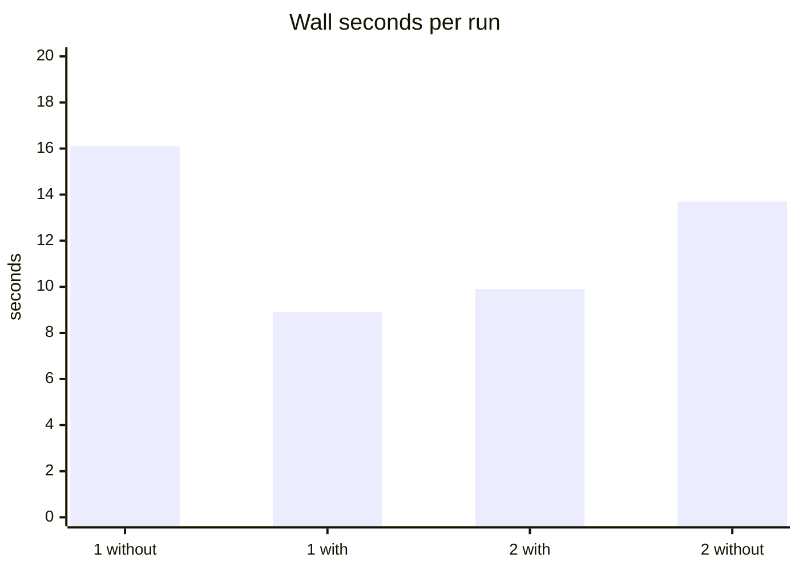
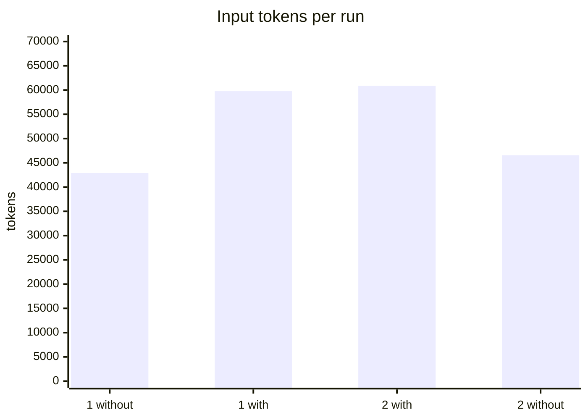
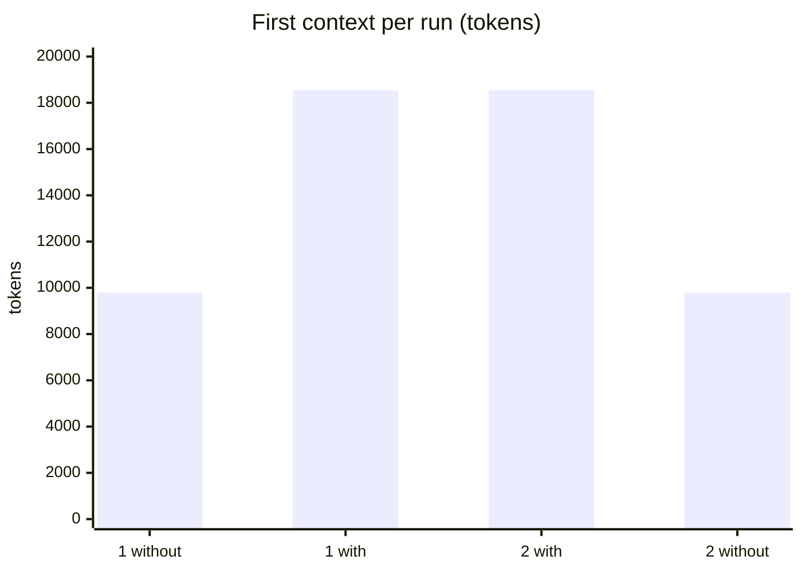
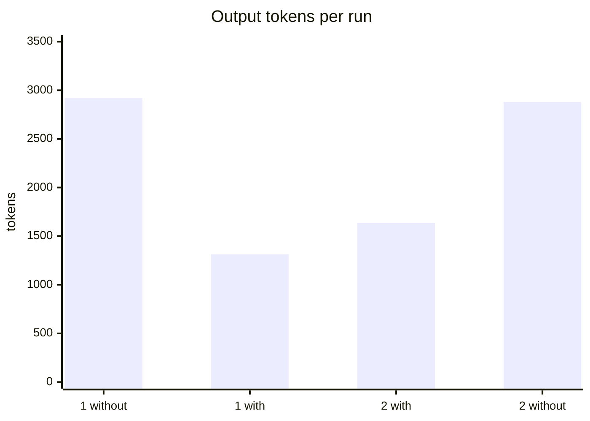
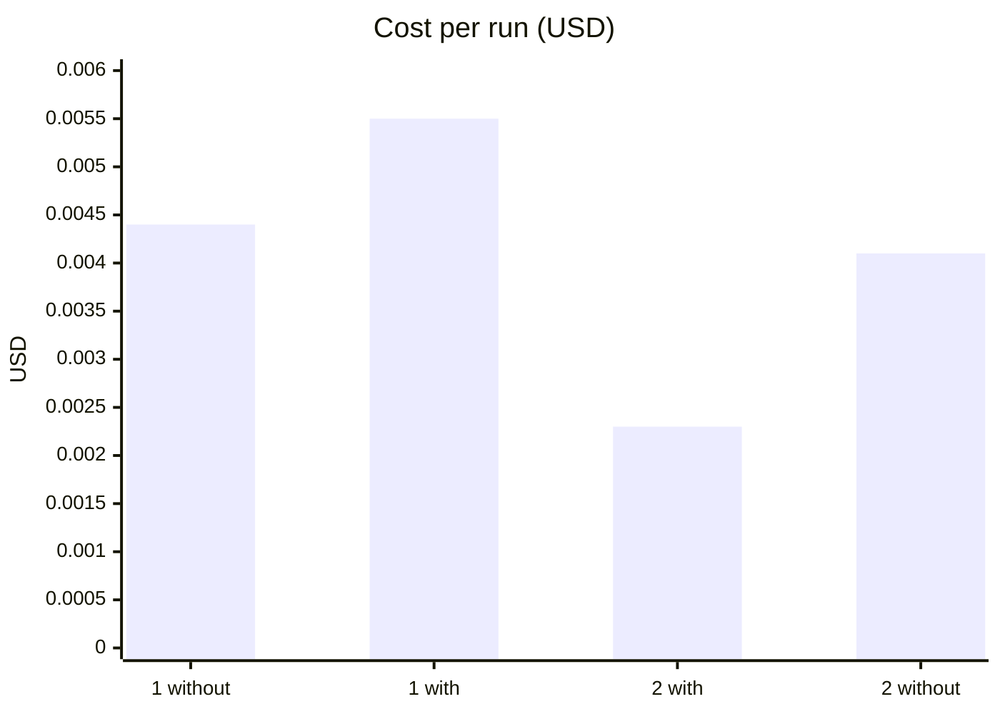

# CodeGraph Windows test 10: `codegraph-index compare` on v1.4.0

Date: 2026-11-19. Release v1.4.0, commit e0077e8. Machine: dell-01-2TB, Windows 11 Pro 10.0.26300 build 26300, x64. PowerShell 7.7.0. Claude Code 2.1.325, found as `C:\Users\seuna\.local\bin\claude.exe`.

All files are in `C:\Users\seuna\AppData\Local\Temp\cg-win10` (`$env:TEMP\cg-win10`). I did not change product code. `install.ps1` ran with `-InstallDir "$T\tools"` and without `-AddToPath`. `C:\tools` did not exist after the run. The user PATH was not measured.

## Summary

| Item | Value |
|---|---|
| Question | Does `codegraph-index compare` (new in 1.4.0) work on Windows? |
| Release | v1.4.0, published 2026-11-19T15:09:44Z, not draft, not prerelease |
| Install | exit 0, 30 s, checksum ok, `codegraph-index.exe --version` prints `1.4.0` |
| Claude Code | 2.1.325, `claude.exe` only (no `claude.cmd`, no `claude.bat` on PATH) |
| Compare command | `compare "What calls UsageSummary.Line, and which tests cover it?" --runs 2 --model haiku --yes` from `$T\repo\codegraph` |
| Compare exit code | 0 |
| Sessions | 4 of 4 counted, all `subtype=success`, `is_error=False` |
| Total wall | 50 s for the whole compare command |
| Run folder | `$T\repo\.codegraph\compare\20261119-160846` |
| Git status after | `?? .mcp.json` only |

## Facts to note

1. **compare works on Windows with `claude.exe`.** All 4 sessions ran, the codegraph server connected in both "with" sessions, and the question arrived intact. The cmd.exe quote problem for `"`, `?` and `&` did not apply, because `claude` resolves to `claude.exe` on this machine, not to `claude.cmd`.
2. **Both "with" sessions connected the server.** The system init line of `1-with.jsonl` and `2-with.jsonl` has `mcp_servers=[codegraph=connected]` and 39 tools. The "without" sessions have no MCP server and 4 tools.
3. **The question arrived intact.** `results.json` has `"prompt": "What calls UsageSummary.Line, and which tests cover it?"`. The first tool result in `1-with.jsonl` is `find_symbol` on `CodeGraph.Core.UsageSummary.Line(string)`. The four answers in `report.md` all open with `UsageSummary.Line`.
4. **`init` wrote to the git root, not to the `codegraph` folder.** `.mcp.json` is at `$T\repo\.mcp.json` and the graph is at `$T\repo\.codegraph\graph.db`. The prompt expected both under `$T\repo\codegraph`. The server command in `.mcp.json` is `C:/Users/seuna/AppData/Local/Temp/cg-win10/tools/codegraph-mcp.exe`, with no args.
5. **The graph was built without `dotnet restore`.** The indexer reported 1,237 compile errors in declarations and this warning for CodeGraph.Core, Indexer, Mcp and Tests: `no obj/project.assets.json, so its NuGet packages were not restored and calls into them are missing from the graph. Run dotnet restore and index again`. The graph still holds 3,126 nodes and 18,553 edges, plus 430 TypeScript nodes, and the compare ran on it as is.
6. **The "with" sessions were faster and used fewer tool calls, with a larger first context.** Medians: wall 9.4 s with against 14.9 s without; first context 18,538 against 9,793; input tokens 60,324 against 44,732. This is 2 runs each way, one prompt, one repository: a direction, not a result.
7. **Line endings.** The four `.jsonl` logs hold LF only (0 bare CR each). `compare-out.txt`, written by `Tee-Object`, is CRLF (45 CR, 45 LF).

## Step 0: release

`gh release view v1.4.0 --repo nerdcules/CodeGraph`:

```
title:	CodeGraph v1.4.0
tag:	v1.4.0
draft:	false
prerelease:	false
immutable:	false
author:	github-actions[bot]
created:	2026-11-19T15:04:11Z
published:	2026-11-19T15:09:44Z
url:	https://github.com/nerdcules/CodeGraph/releases/tag/v1.4.0
asset:	codegraph-linux-arm64.tar.gz
asset:	codegraph-linux-x64.tar.gz
asset:	codegraph-osx-arm64.tar.gz
asset:	codegraph-osx-x64.tar.gz
asset:	codegraph-vscode.vsix
asset:	codegraph-win-arm64.zip
asset:	codegraph-win-x64.zip
asset:	SHA256SUMS
```

## Step 1: clone and install

`git clone --branch v1.4.0 --depth 1`: exit 0. `rev-parse --short HEAD` = `e0077e8`, `describe --tags` = `v1.4.0`.

`install.ps1 -Version v1.4.0 -InstallDir "$T\tools" -Repo "$T\repo\codegraph" -Client claude -NoVSCode -Yes`: exit 0, 30 s. Output in `$T\install-out.txt`. The index part:

```
==> Downloading codegraph-win-x64.zip (v1.4.0)
  checksum ok

==> Installing to C:\Users\seuna\AppData\Local\Temp\cg-win10\tools
  codegraph 1.4.0

==> Checking the executables start
  ok: codegraph 1.4.0

==> Setting up C:\Users\seuna\AppData\Local\Temp\cg-win10\repo\codegraph
codegraph init: C:\Users\seuna\AppData\Local\Temp\cg-win10\repo\codegraph\CodeGraph.slnx
  .mcp.json      created with the codegraph server for Claude Code, Copilot CLI (C:\Users\seuna\AppData\Local\Temp\cg-win10\repo\.mcp.json)
  .gitignore     already ignores .codegraph/
  other clients  add --client copilot, cursor, gemini, codex, roo, kilo or continue (or all)
[1/6] project: CodeGraph.Core
⚠ CodeGraph.Core: 19 compile error(s) and no obj/project.assets.json, so its NuGet packages were not restored and calls into them are missing from the graph. Run dotnet restore and index again
[2/6] project: CodeGraph.Indexer
⚠ CodeGraph.Indexer: 163 compile error(s) and no obj/project.assets.json, so its NuGet packages were not restored and calls into them are missing from the graph. Run dotnet restore and index again
[3/6] project: CodeGraph.Mcp
⚠ CodeGraph.Mcp: 76 compile error(s) and no obj/project.assets.json, so its NuGet packages were not restored and calls into them are missing from the graph. Run dotnet restore and index again
[4/6] project: CodeGraph.Web
[5/6] project: CodeGraph.Tests
⚠ CodeGraph.Tests: 979 compile error(s) and no obj/project.assets.json, so its NuGet packages were not restored and calls into them are missing from the graph. Run dotnet restore and index again
[6/6] project: CodeGraph.Bench
compiler: Roslyn 5.9.0 (up to C# 14); projects use C# 14; 1237 compile error(s) in declarations, first: GraphAnchor.cs(1): CS0246 The type or namespace name 'DuckDB' could not be found (are you missing a using directive or an assembly reference?)
indexed 3126 nodes, 18553 edges (full) in 11.1s → C:\Users\seuna\AppData\Local\Temp\cg-win10\repo\.codegraph\graph.db
typescript workspace: C:\Users\seuna\AppData\Local\Temp\cg-win10\repo\codegraph\vscode-extension\tsconfig.json
codegraph-ts: vscode-extension: 18 file(s) from tsconfig.json
codegraph-ts: compiler: typescript 6.0.3, @angular/compiler 22.2.6; targets ES2022; 0 syntax error(s)
codegraph-ts: note: tsconfig: Cannot find type definition file for 'node'.   The file is in the program because:     Entry point of type library 'node' specified in compilerOptions
codegraph-ts: note: tsconfig: Cannot find type definition file for 'vscode'.   The file is in the program because:     Entry point of type library 'vscode' specified in compilerOptions
codegraph-ts: 18 file(s), 430 nodes, 1306 edges, 2465 records in 0.8s
kept 3126 node(s) of other languages from the previous graph
indexed 430 typescript nodes, 1306 edges from 19 files in 2.8s → C:\Users\seuna\AppData\Local\Temp\cg-win10\repo\.codegraph\graph.db
```

Records:

| Check | Result |
|---|---|
| `& "$T\tools\codegraph-index.exe" --version` | `1.4.0`, exit 0 |
| `$T\repo\codegraph\.mcp.json` | does not exist |
| `$T\repo\.mcp.json` | exists; `mcpServers.codegraph.command` = `C:/Users/seuna/AppData/Local/Temp/cg-win10/tools/codegraph-mcp.exe`, no args |
| `$T\repo\codegraph\.codegraph` | does not exist |
| `$T\repo\.codegraph` | exists; `graph.db` 29,110,272 bytes, `graph.db.lock` 0 bytes |

`$T\repo\.mcp.json` in full:

```
{
  "mcpServers": {
    "codegraph": {
      "command": "C:/Users/seuna/AppData/Local/Temp/cg-win10/tools/codegraph-mcp.exe"
    }
  }
}
```

## Step 2: claude

`Get-Command claude -All | Format-List Source`:

```
Source : C:\Users\seuna\.local\bin\claude.exe
```

`claude --version`: `2.1.325 (Claude Code)`. `Get-Command claude.cmd` and `Get-Command claude.bat`: not found.

## Step 3: compare

From `$T\repo\codegraph`:

```
& "$T\tools\codegraph-index.exe" compare "What calls UsageSummary.Line, and which tests cover it?" --runs 2 --model haiku --yes 2>&1 | Tee-Object "$T\compare-out.txt"
```

Exit 0. Console output in `$T\compare-out.txt`, in full apart from the report it repeats:

```
compare runs 4 Claude Code sessions (2 with the codegraph server, 2 without), one after another.
Each is a new `claude -p` session with no saved session, so no run sees another's context.
They use your Claude account's usage. The sessions get read-only tools: none can edit a file.
round 1 without: 16.1 s, 3 model calls, 42,898 input tokens
round 1 with: 8.9 s, 3 model calls, 59,762 input tokens
round 2 with: 9.9 s, 3 model calls, 60,886 input tokens
round 2 without: 13.7 s, 3 model calls, 46,567 input tokens
...
Logs: C:\Users\seuna\AppData\Local\Temp\cg-win10\repo\.codegraph\compare\20261119-160846
exit 0
total wall: 50 s
```

Round 1 ran without the server first, round 2 with it first, as expected. No run line carries a "not counted" reason.

## Step 4: results

Per run, from `report.md` (every figure from the session's own log except wall time, which compare measured):

| run | condition | wall s | model calls | input tokens | cache reads | output tokens | cost USD | first context | last context | growth | codegraph calls | other tool calls | denied | counted |
|---|---|---|---|---|---|---|---|---|---|---|---|---|---|---|
| 1 | without | 16.1 | 3 | 42,898 | 29,672 | 2,919 | 0.0044 | 9,793 | 17,923 | 8,130 | 0 | 5 | 0 | yes |
| 1 | with | 8.9 | 3 | 59,762 | 37,317 | 1,313 | 0.0055 | 18,538 | 22,441 | 3,903 | 4 | 0 | 0 | yes |
| 2 | with | 9.9 | 3 | 60,886 | 56,415 | 1,638 | 0.0023 | 18,538 | 23,003 | 4,465 | 5 | 0 | 0 | yes |
| 2 | without | 13.7 | 3 | 46,567 | 34,762 | 2,879 | 0.0041 | 9,793 | 21,592 | 11,799 | 0 | 8 | 0 | yes |

Medians of the counted runs (with: 2, without: 2):

| | with | without |
|---|---|---|
| wall s | 9.4 | 14.9 |
| model calls | 3 | 3 |
| input tokens | 60,324 | 44,732 |
| cache reads | 46,866 | 32,217 |
| output tokens | 1,476 | 2,899 |
| cost USD | 0.0039 | 0.0043 |
| first context | 18,538 | 9,793 |
| last context | 22,722 | 19,758 |
| context growth | 4,184 | 9,964 |
| tool calls | 4 | 6 |

Server connection, from the `system`/`init` line of each log:

| Log | model | mcp_servers | tools |
|---|---|---|---|
| `1-with.jsonl` | claude-haiku-5-5 | codegraph=connected | 39 |
| `1-without.jsonl` | claude-haiku-5-5 | (none) | 4 |
| `2-with.jsonl` | claude-haiku-5-5 | codegraph=connected | 39 |
| `2-without.jsonl` | claude-haiku-5-5 | (none) | 4 |

The `result` line of each log: all four `subtype=success`, `is_error=False`. `duration_ms`: 6,320 (1-with), 14,242 (1-without), 7,676 (2-with), 12,498 (2-without). Each log also holds one `rate_limit_event` with `status: allowed`, five-hour utilization 0.26.

Files in `$T\repo\.codegraph\compare\20261119-160846`:

| File | Bytes |
|---|---|
| `1-with.err` | 0 |
| `1-with.jsonl` | 47,993 |
| `1-without.err` | 0 |
| `1-without.jsonl` | 59,960 |
| `2-with.err` | 0 |
| `2-with.jsonl` | 55,362 |
| `2-without.err` | 0 |
| `2-without.jsonl` | 77,361 |
| `report.md` | 9,701 |
| `results.json` | 17,193 |

`git -C "$T\repo" status --porcelain`:

```
?? .mcp.json
```

Opening of the "Round 1, with" answer in `report.md`:

```
### Round 1, with

Tools: mcp__codegraph__find_symbol ×1, mcp__codegraph__callers_of ×1, mcp__codegraph__tests_for ×1, mcp__codegraph__covered_by ×1

`UsageSummary.Line(string)` has six direct callers. Two tests call it directly, and twelve tests reach it through the call graph.

**Direct callers** (`src/CodeGraph.Core/Telemetry.cs:274`):
- `StatusCommand.Usage` (`src/CodeGraph.Indexer/StatusCommand.cs:141`)
- `UsageCommand.AfterIndexLine` (`src/CodeGraph.Indexer/UsageCommand.cs:59`)
- `UsageCommand.Run` (`src/CodeGraph.Indexer/UsageCommand.cs:12`)
- `CodeGraphTools.UsageStats` (`src/CodeGraph.Mcp/CodeGraphTools.cs:359`)
- `UsageSummaryTests.Says_so_when_there_were_no_calls` (test)
- `UsageSummaryTests.Sums_the_calls_in_the_period_only` (test)
```

Opening of the "Round 1, without" answer:

```
### Round 1, without

Tools: Grep ×3, Read ×2

`UsageSummary.Line` (`codegraph/src/CodeGraph.Core/Telemetry.cs:274`) has four production callers, all in the indexer and MCP server. Two unit tests call it directly, and one status test covers it indirectly.
```

The two "with" answers name the same 4 production callers, 2 direct tests and 12 tests by static reach. The two "without" answers name the same 4 production callers (5 call sites) and 2 direct tests, plus one indirect `StatusCommandTests.cs:93` check. The answers are not scored here.

## Charts

The same per-run figures as bars, in run order. GitHub renders these Mermaid blocks.











## Files

| File | Content |
|---|---|
| `$T\install-out.txt` | install.ps1 output and exit code |
| `$T\compare-out.txt` | compare console output, exit code and total wall |
| `$T\repo\.codegraph\compare\20261119-160846\` | `report.md`, `results.json`, four `.jsonl` logs, four empty `.err` files |
